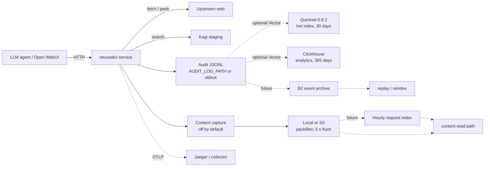

# neuradex documentation

This directory is the design, operations, and reference documentation for the audit,
analytics, and content work in neuradex. It is separate from the generated API reference at
`/docs`, which is rendered from the OpenAPI document.

The service is an internal Kagi staging service that handles real data. Every design here
assumes **named access**: there are no anonymous audit or content readers.

## Status

The audit event and content planes are wired into the HTTP service. Audit events are emitted as
JSONL to `AUDIT_LOG_PATH` (or stdout); content is off by default and can be stored in a local
directory or an S3-compatible bucket (MinIO locally, B2 when configured). The service does
**not** write to Quickwit, ClickHouse, or an event archive itself: the local compose stack
provides those and an optional Vector bridge. The local compose stack *is* runnable. Where a document describes an endpoint, setting,
or table that does not exist yet, the document says so explicitly.

| Area | Status | Source of truth |
| --- | --- | --- |
| HTTP API (`/v1/fetch`, `/v1/peek`, `/v1/search`, `/v1/openwebui_search`, `/healthz`) | implemented | `crates/neuradex` |
| Local observability stack (Quickwit, MinIO, ClickHouse, Jaeger, optional Vector) | implemented by this PR | `compose.yaml`, `hack/` |
| Audit event schema and header policy | implemented and wired into the service | [RFD 0001](rfd/0001-audit-event-model.md), [RFD 0005](rfd/0005-header-policy.md) |
| Content-addressed packfiles | implemented; `CONTENT_STORE` defaults to `off` | [RFD 0002](rfd/0002-content-addressed-storage.md), [reference/packfile-format.md](reference/packfile-format.md) |
| Hashing rules (BLAKE3 / SHA-256 / XXH3) | implemented in the audit/packfile crates | [RFD 0003](rfd/0003-hashing.md) |
| Quickwit + ClickHouse + B2 storage topology | specified | [RFD 0004](rfd/0004-storage-and-analytics.md) |
| Capacity, cost, and 365-day retention | under discussion | [RFD 0008](rfd/0008-capacity-cost-and-retention.md) |
| Named access and read audit | specified | [RFD 0009](rfd/0009-access-and-read-audit.md) |

## Start here

| If you need to… | Read |
| --- | --- |
| Understand the whole system in ten minutes | [architecture/overview.md](architecture/overview.md) |
| Follow one request from socket to object storage | [architecture/request-lifecycle.md](architecture/request-lifecycle.md) |
| Know every audit field and its type | [reference/event-fields.md](reference/event-fields.md) |
| Understand the packfile bytes | [reference/packfile-format.md](reference/packfile-format.md) |
| Run the stack locally | [development/local-development.md](development/local-development.md) |
| Debug missing or corrupt data | [operations/runbook.md](operations/runbook.md) |
| Know what to monitor | [operations/observability.md](operations/observability.md) |
| Make or review a design decision | [rfd/README.md](rfd/README.md), [rfd/TEMPLATE.md](rfd/TEMPLATE.md) |
| Look up a term | [glossary.md](glossary.md) |

## The design in one page



The non-negotiable invariants:

1. **The request path is never blocked by audit or content storage.** If a sink is down, the
   response still returns; the event records the degradation instead of lying.
2. **Content identity is BLAKE3-256.** SHA-256 is the independent audit hash. XXH3-64 is a
   checksum of a compressed frame, never a content identity.
3. **No per-request object (target design).** Bodies are packed into immutable packfiles with a
   footer index; the hourly request index and event archive are future work. The current service
   writes packs to the configured local/S3 store and flushes every 5 seconds.
4. **Frames are self-describing; the footer is a rebuildable index.** The request index
   accelerates lookup; a lost footer can be rebuilt from frame headers, but a lost pack cannot
   be rebuilt from an index.
5. **Audit metadata survives content loss.** Content is best-effort and explicitly marked when
   missing; the event is the durable record.
6. **Hot search is short, cold truth is long.** Quickwit holds 30 days for search; ClickHouse
   holds 365 days for aggregates; B2 holds the source records and content for 365 days.
7. **Named access only.** Every event and body read is authenticated, authorized, and itself
   audited.

## Local stack at a glance

```sh
docker compose up -d
docker compose ps
# Quickwit UI:    http://127.0.0.1:7280
# MinIO console:  http://127.0.0.1:9001  (neuradex / neuradex-local-secret)
# ClickHouse:     http://127.0.0.1:8123  (database neuradex)
# Jaeger UI:      http://127.0.0.1:16686
```

Then run the service on the host with an OTLP endpoint:

```sh
mkdir -p .local/neuradex
export KAGI_SESSION_TOKEN=staging-token
export AUDIT_LOG_PATH=.local/neuradex/events.jsonl
export CONTENT_STORE=local
export CONTENT_LOCAL_PATH=.local/neuradex/content
export OTEL_EXPORTER_OTLP_ENDPOINT=http://127.0.0.1:4318
export LOG_FORMAT=json
cargo run
```

Content is off by default; set `CONTENT_STORE` to `local` or `s3` to enable it. Without
`AUDIT_LOG_PATH` (or with `-`), audit events go to stdout.

The optional Vector profile tails `.local/neuradex/events.jsonl` into Quickwit and ClickHouse:

```sh
mkdir -p .local/neuradex
docker compose --profile ingest up -d vector
```

The full sequence, including real service-generated events, is in
[development/local-development.md](development/local-development.md).

## Documentation map

### RFDs

RFDs replace ADRs. They record options, benefits, drawbacks, and a determination, following the
spirit of Oxide RFD 1 and RFD 5. See [rfd/README.md](rfd/README.md) for the process.

| RFD | Title | State |
| --- | --- | --- |
| [0001](rfd/0001-audit-event-model.md) | Audit event model | published |
| [0002](rfd/0002-content-addressed-storage.md) | Content-addressed storage | published |
| [0003](rfd/0003-hashing.md) | Hashing | published |
| [0004](rfd/0004-storage-and-analytics.md) | Storage and analytics | published |
| [0005](rfd/0005-header-policy.md) | Header policy | published |
| [0006](rfd/0006-crate-boundaries.md) | Crate boundaries | published |
| [0007](rfd/0007-local-testing-stack.md) | Local testing stack | published |
| [0008](rfd/0008-capacity-cost-and-retention.md) | Capacity, cost, and retention | discussion |
| [0009](rfd/0009-access-and-read-audit.md) | Access and read audit | published |

### Architecture

- [overview.md](architecture/overview.md) — context, components, and data planes.
- [request-lifecycle.md](architecture/request-lifecycle.md) — fetch, peek, search, error, and
  cancel sequences.
- [event-model.md](architecture/event-model.md) — event types, field groups, and schema
  evolution.
- [content-plane.md](architecture/content-plane.md) — capture, pack, upload, read, and delete.
- [storage-topology.md](architecture/storage-topology.md) — buckets, prefixes, stores, and
  failure domains.
- [access-security.md](architecture/access-security.md) — principals, trust boundaries,
  encryption, and read audit.
- [failure-model.md](architecture/failure-model.md) — failure modes, impact, and degradation.

### Development

- [local-development.md](development/local-development.md) — compose stack and a working
  end-to-end loop.
- [testing.md](development/testing.md) — test matrix and fixtures.
- [style.md](development/style.md) — modern module layout (`foo.rs` + `foo/bar.rs`), naming,
  paths, and visibility.
- [ci.md](development/ci.md) — pipeline, gates, and what a docs/compose PR runs.

### Operations

- [runbook.md](operations/runbook.md) — decision tree and procedures.
- [observability.md](operations/observability.md) — signals, SLOs, and alerts.
- [capacity-and-cost.md](operations/capacity-and-cost.md) — measured and modelled cost.

### Reference

- [configuration.md](reference/configuration.md) — environment variables and config files.
- [event-fields.md](reference/event-fields.md) — the complete event schema.
- [packfile-format.md](reference/packfile-format.md) — byte-level pack format.
- [clickhouse-schema.md](reference/clickhouse-schema.md) — DDL, views, and queries.
- [quickwit-index.md](reference/quickwit-index.md) — index mapping, ingestion, and search.
- [compose-services.md](reference/compose-services.md) — services, ports, volumes, and
  credentials.

## Conventions

- Times are UTC, RFC 3339 with millisecond precision.
- Sizes are binary (KiB, MiB, GiB, TiB) unless a cloud bill is being compared; B2 bills in
  decimal TB, so cost docs note the difference.
- `request_id`, `pack_id`, and hashes are opaque strings to consumers; do not parse them.
- Examples use `example.com`, `neuradex`, and `neuradex-local-secret`. None are production
  credentials.
- "Planned" means the design is agreed but the code is not in this branch. "Scaffolded" means
  the crate exists with a doc comment and manifest only.

## Keeping docs accurate

An implementation PR that changes one of the following must update the linked document in the
same PR:

| Change | Update |
| --- | --- |
| An event field, enum, or default | [reference/event-fields.md](reference/event-fields.md), [RFD 0001](rfd/0001-audit-event-model.md) |
| A packfile byte, flag, or format rule | [reference/packfile-format.md](reference/packfile-format.md), [RFD 0002](rfd/0002-content-addressed-storage.md) |
| A hash algorithm or what is hashed | [RFD 0003](rfd/0003-hashing.md) |
| A compose service, image, port, or volume | [reference/compose-services.md](reference/compose-services.md), `compose.yaml` |
| A ClickHouse column, view, or TTL | [reference/clickhouse-schema.md](reference/clickhouse-schema.md), `hack/clickhouse/init.sql` |
| A Quickwit field, mapping, or retention | [reference/quickwit-index.md](reference/quickwit-index.md), `hack/quickwit/neuradex-events.yaml` |
| A configuration variable | [reference/configuration.md](reference/configuration.md) |
| A module layout or file name | [development/style.md](development/style.md) |
| A failure mode or recovery step | [architecture/failure-model.md](architecture/failure-model.md), [operations/runbook.md](operations/runbook.md) |
