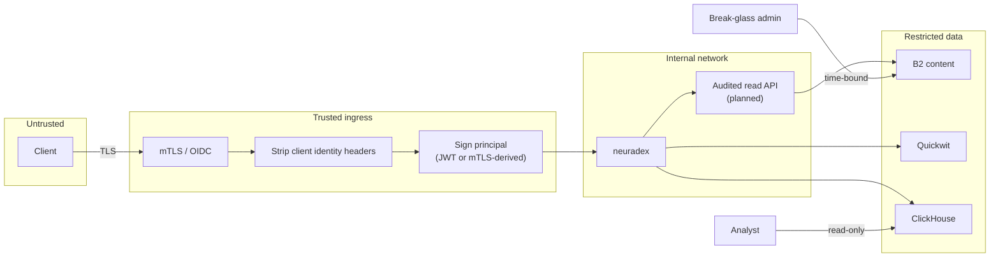

# Access and security

**Status:** access is specified; the current service has no application-level auth. The local
compose stack is unauthenticated and localhost-only. Do not put real data in it.

## Trust boundaries

The trust boundary is the ingress. Everything before it is untrusted; everything after it is
authenticated but still subject to authorization. The service never accepts an identity header
that a client can set.

## Principals and roles

| Principal | Role | Can | Cannot |
| --- | --- | --- | --- |
| Service writer | `service` | Fetch/peek/search; write events/content | Read audit/content |
| Incident responder | `audit.reader` | Search/read event metadata, exports | Read bodies |
| Senior responder | `content.reader` | Read event metadata and bodies | Query ClickHouse directly |
| Analyst | `analyst` | Aggregate queries, dashboards | Read bodies or raw query text |
| Operator | `admin` | Break-glass, retention, config | Routine content reads |

The full matrix is in [RFD 0009](../rfd/0009-access-and-read-audit.md#roles). A principal can
hold multiple roles; the read audit records the role used.

## Authentication flow

1. Client connects to the ingress over TLS with mTLS (service) or OIDC (human).
2. Ingress validates the credential and obtains `sub`, `roles`, `iss`, `aud`, `exp`.
3. Ingress removes any client-supplied `Authorization`, `X-Forwarded-User`,
   `X-Auth-Request-User`, and `X-Forwarded-Email`.
4. Ingress adds a signed principal (short-lived JWT or a mTLS-derived header with a signature).
5. neuradex verifies the signature, issuer, audience, and expiry. It rejects unsigned or expired
   principals with the JSON error envelope.
6. neuradex records `auth_subject`, `auth_method`, `user_id`. It never records the token.

A failed authentication is audited with `outcome=client_error`, `error_type=unauthorized`,
`auth_method=none`, and no principal. It does not reveal whether the target exists.

## Authorization

- Route-level: `/v1/fetch|peek|search|openwebui_search` requires `service` or an authenticated
  API client. Audit routes require their specific roles.
- Object-level: a content read requires `content.reader` and a reason; an event read requires
  `audit.reader`. There is no per-event ACL; a role grants the class of data.
- Store-level: B2 writer/reader/admin keys; ClickHouse read-only user; Quickwit internal only.
- Defense in depth: even if the app check is bypassed, the store credentials do not grant more
  than the role needs.

## Read audit

Every read of events or content produces an `audit.read` or `content.read` event:

| Field | Example |
| --- | --- |
| `read_action` | `get_content` |
| `read_target` | `req_019a7f3c...` or `pack_019a...` |
| `read_reason` | `INC-1234` (required for content/exports) |
| `read_bytes` | 5123 |
| `auth_subject` | `user:alice@example.com` |
| `outcome` | `success` |

Read audit events are stored in the same archive/Quickwit/ClickHouse pipeline today. They are
immutable from the application's perspective; only B2 lifecycle deletes them. A separate
immutable store is a future hardening step. See
[RFD 0009](../rfd/0009-access-and-read-audit.md#read-audit-event).

## Break-glass

- Ticket + second approver + time-bound credential (≤ 4 hours) + security notification.
- Minimum role; link the ticket in `read_reason`.
- Review the read audit within one business day.
- A recurring break-glass pattern means a role or dashboard is missing; fix the cause.

## Encryption

| Path | Mechanism |
| --- | --- |
| Client → ingress | TLS 1.2+; mTLS for services |
| Ingress → service | TLS or trusted internal network; signed principal |
| Service → B2 | TLS; B2 SSE at rest |
| Service → Quickwit/ClickHouse | TLS in production; localhost only locally |
| Service → Jaeger/collector | TLS in production; plaintext localhost locally |
| Backups | B2 lifecycle/versioning (open question) |

Customer-managed keys (SSE-C) are an open question. If required, the key lives in the secret
manager, not in the image or the repository.

## Data classification and handling

| Data | Handling |
| --- | --- |
| Page bodies | Restricted; access via audited read API; never paste into tickets |
| Event metadata | Internal/restricted; URLs sanitized; headers redacted/HMACed |
| Query text | Restricted; off by default; aggregate with `query_hash` |
| Header HMACs | Restricted; key separate from storage credentials |
| Aggregates | Internal; no raw URLs/query text |
| Traces | Internal; may contain sanitized URLs; local Jaeger is ephemeral |

## Retention and deletion

- Content, events, request index, and archive: 365 days.
- Quickwit: 30 days.
- ClickHouse: 365 days.
- No per-request deletion. Packs are immutable. A legal deletion request requires a pack
  rewrite, which is not supported initially. Escalate rather than improvising.
- Lifecycle deletion is irreversible and restricted to break-glass admins.

## Local-development caveats

- No auth, no TLS, root MinIO credentials, no ClickHouse password policy.
- Ports bind to `127.0.0.1`; do not change to `0.0.0.0` on a shared host.
- Use synthetic data. `.local/` is gitignored because it can contain real metadata.
- The local stack is not a production parity environment for security.

## Security checklist for a change

- [ ] Does the change add a field that can contain a secret, PII, or internal topology?
- [ ] Is the field on an allow-list, redacted, or HMACed?
- [ ] Does the change add a read path? If so, is it authenticated, authorized, and read-audited?
- [ ] Does the change add a store credential? Is it scoped and rotatable?
- [ ] Does the change alter retention or lifecycle? Is it reviewed by security/budget owner?
- [ ] Does the change log a URL, header, token, or body? If so, remove it.
- [ ] Does the change touch the ingress identity contract? Test spoofed headers.
