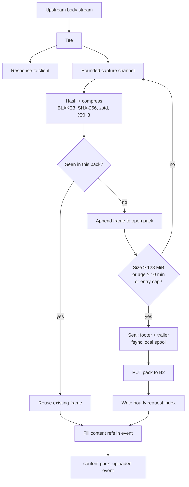
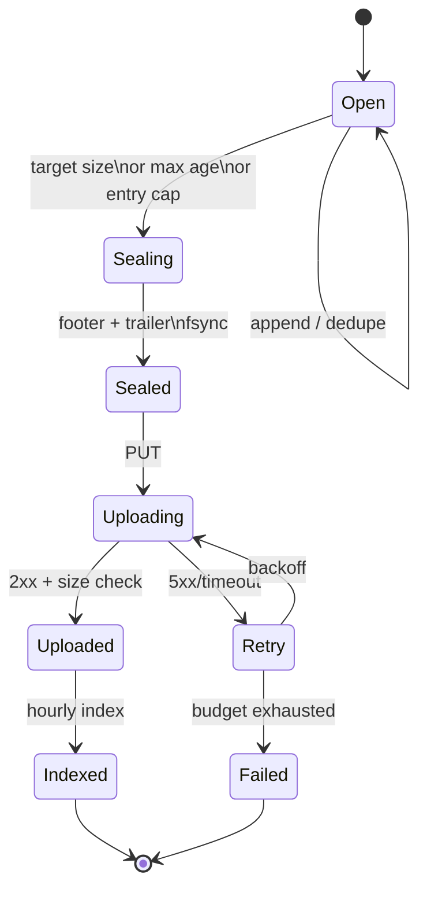
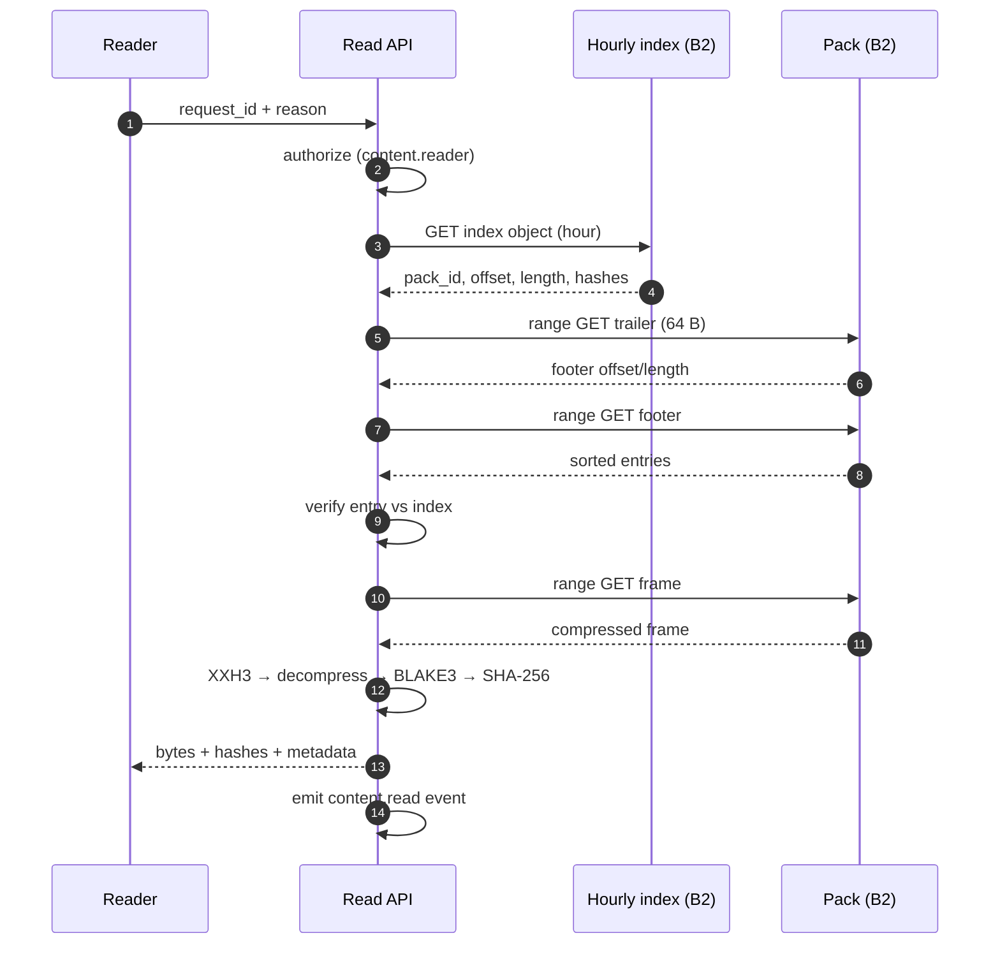

# Content plane

**Status:** target design. `crates/neuradex-content` and `crates/neuradex-packfile` are
scaffolded; the capture, pack, upload, and read paths are not wired into the service.

## What is captured

| Endpoint | Captured bytes | Cap | Content kind |
| --- | --- | --- | --- |
| `/v1/fetch` | Decompressed response body | 25 MiB | `fetch_body` |
| `/v1/peek` | Decompressed head bytes actually read | 2 MiB | `peek_head` |
| `/v1/search` | none | — | — |
| `/v1/openwebui_search` | none | — | — |

The cap applies to the canonical bytes that are hashed. If the cap is hit, the captured prefix
is stored with `content_truncated=true`; the hash identifies the prefix, not the full upstream
body.

## Write path

### Stages

| Stage | Input | Output | Failure behaviour |
| --- | --- | --- | --- |
| Tee | streamed chunks | channel messages | If the channel is full, drop capture and mark the event |
| Canonicalize | decompressed bytes | contiguous buffer/file | If the body is interrupted, mark `client_disconnect` |
| Hash | canonical bytes | BLAKE3, SHA-256 | Internal error; mark capture failure |
| Compress | canonical bytes | zstd frame (or raw if smaller) | Fall back to raw codec |
| Frame | header + payload | frame record | Local spool error; mark failure |
| Dedupe | BLAKE3 | existing frame or append | In-memory map; no cross-pack lookup |
| Seal | frames + index | footer + trailer | Do not upload an incomplete pack |
| Upload | sealed pack | B2 object | Retry with backoff; mark after budget |
| Index | request IDs + refs | hourly object | Orphan pack; reconciliation |
| Event | refs | `content.pack_uploaded` | Event spool; retry |

### Spool and backpressure

The capture path is bounded at every stage:

- The stream tee writes to a bounded `tokio::sync::mpsc` channel. If it is full, the tee drops
  the frame and records `content_capture_error=spool_full`. It never awaits the content path
  while the client is waiting for bytes.
- The pack builder writes to a local spool file, not a 128 MiB in-memory buffer. The spool is
  on a dedicated volume with a capacity alarm.
- The uploader has a bounded retry queue. A slow B2 increases spool depth; it does not increase
  response latency.
- The event path has higher priority than the content path. Content is shed first.

### Dedupe

Within one open pack, the builder maps BLAKE3 → frame. A duplicate body reuses the frame and
does not consume pack space. Across packs, duplicates are stored again. The request index points
each request at the frame that was actually used; if two requests dedupe to one frame, both
index records point to the same offset. A global index is a future optimization, not a
correctness requirement.

### Large bodies

The large-body threshold is 30 MiB. A body at or above it is intended to be stored as a
standalone CAS object (`cas/v1/blake3/<prefix>/<hash>`) instead of a frame. Because the fetch
cap is 25 MiB and the peek cap is 2 MiB, no body can reach the threshold today. The event fields
and object prefix exist so a future cap increase does not require a schema change.

### Pack lifecycle

A pack is never visible to readers before its index is written. An uploaded pack without an index
is an orphan; it is safe but unreachable until reconciliation.

## Read path

Read rules:

- Authorize before reading bytes; record the reason for content reads.
- Range GET the trailer/footer, not the whole pack. Cache footers by pack ID.
- The footer is authoritative. If it disagrees with the request index, fail verification and
  record `content.read` with `failed`.
- Verify XXH3 before decompression, then BLAKE3 and SHA-256 after decompression. Never return
  unverified bytes.
- A missing pack is `410 Gone` (expired) or `404` (never indexed), not an empty body.
- Emit a `content.read` event with `read_bytes`, `read_action`, target, reason, and outcome.

## Retention and deletion

- Packs, indexes, archives, and CAS objects have a 365-day B2 lifecycle rule.
- Quickwit has 30 days; ClickHouse has 365 days. Content is independent of both.
- There is no per-request deletion. Deleting one request means rewriting its pack, which changes
  the pack ID and every referencing event. This is not supported initially; a legal deletion
  request is an open question in RFD 0009.
- A pack expires as a unit. A request whose pack is gone cannot be read, even if its event is
  still in ClickHouse. The event says where the frame was; the reader returns "expired".

## Failure and degradation

| Failure | Client impact | Content impact | Event marker |
| --- | --- | --- | --- |
| Capture channel full | none | body not stored | `spool_full` |
| Spool disk full | none | body not stored | `spool_full` |
| Client disconnect | connection closed | partial not stored | `client_disconnect` |
| Upstream error | error response | no body | `upstream_error` |
| Pack upload fails | none | body not durable | `pack_upload_failed` |
| Index write fails | none | pack orphaned | `index_write_failed` |
| Hash mismatch on read | 502 | bytes withheld | `content.read` failed |
| B2 unavailable | none for writes (spool), read 5xx | delayed writes | `pack_upload_failed` after budget |
| Lifecycle early delete | read 410 | data gone | no event; lifecycle audit |

## Capacity notes

At 4 MiB average and 100k fetches/hour, a pack fills in ~1.2 seconds, so the 10-minute max age
is a low-traffic guard, not the normal trigger. The uploader must sustain ~111 MiB/s and ~0.87
PUTs/s. See [RFD 0008](../rfd/0008-capacity-cost-and-retention.md) for the full model and the
measurement gate.

## Configuration

Planned content settings (names are indicative; see
[reference/configuration.md](../reference/configuration.md#planned-audit-and-content-settings)):

| Setting | Default | Meaning |
| --- | --- | --- |
| `NEURADEX_CONTENT_BUCKET` | `neuradex-content` | B2 bucket |
| `NEURADEX_CONTENT_PACK_TARGET_BYTES` | `134217728` | 128 MiB encoded target |
| `NEURADEX_CONTENT_PACK_MAX_AGE_SECS` | `600` | 10 minutes |
| `NEURADEX_CONTENT_SPOOL_DIR` | `.local/neuradex/spool` | Local spool |
| `NEURADEX_CONTENT_MAX_BODY_BYTES` | `26214400` | 25 MiB capture cap |
| `NEURADEX_CONTENT_LARGE_BODY_BYTES` | `31457280` | 30 MiB threshold |

These are not implemented yet. The compose stack only provides the stores.
