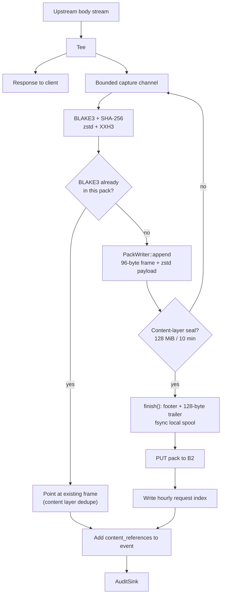
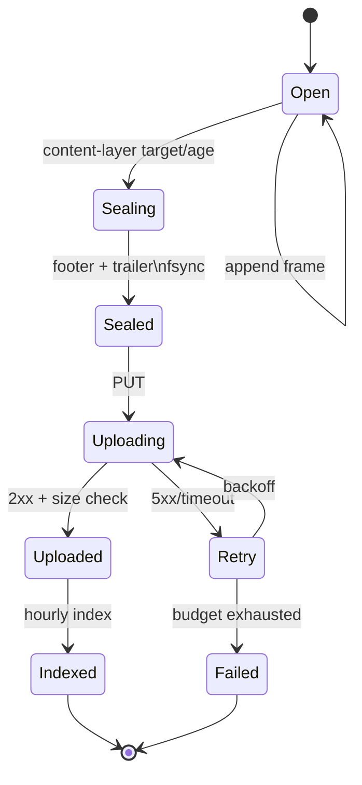

# Content plane

**Status:** `neuradex-packfile` is implemented (PR #68); `neuradex-content` is scaffolded. The
capture, pack orchestration, upload, and read paths are not wired into the service.

## What is captured

| Endpoint | Captured bytes | Cap | Storage kind |
| --- | --- | --- | --- |
| `/v1/fetch` | Decompressed response body | 25 MiB | `pack` (or `object` for a future large body) |
| `/v1/peek` | Decompressed head bytes actually read | 2 MiB | `pack` |
| `/v1/search` | none | — | — |
| `/v1/openwebui_search` | none | — | — |

The cap applies to the canonical bytes that are hashed. If the cap is hit, the captured prefix
is stored; `operation.truncated` is true and the reference's hashes identify the prefix, not the
full upstream body.

## Write path



### Stages

| Stage | Input | Output | Failure behaviour |
| --- | --- | --- | --- |
| Tee | streamed chunks | channel messages | If full, drop capture; no content reference |
| Canonicalize | decompressed bytes | contiguous buffer/file | If interrupted, no reference (`client_disconnect` is future) |
| Hash | canonical bytes | BLAKE3-256, SHA-256 | Internal error; no reference |
| Compress | canonical bytes | zstd frame | Writer fails; no reference |
| Frame | header + payload | 96-byte header + zstd | Local spool error; no reference |
| Dedupe | BLAKE3 | existing frame or append | The writer rejects duplicates; the content layer must check first |
| Seal | frames + footer | footer + 128-byte trailer | Do not upload an incomplete pack |
| Upload | sealed pack | B2 object | Retry with backoff; mark failure |
| Index | request IDs + frame offsets | hourly object | Orphan pack; reconciliation |
| Event | content reference | `content_references` array | Event spool; retry |

### Spool and backpressure

- The stream tee writes to a bounded `tokio::sync::mpsc` channel. If it is full, the tee drops
  the capture. It never awaits the content path while the client is waiting for bytes.
- The pack builder writes to a local spool file, not a 128 MiB in-memory buffer. The spool has a
  capacity alarm.
- The uploader has a bounded retry queue. A slow B2 increases spool depth; it does not increase
  response latency.
- The event path has higher priority than the content path. Content is shed first.

### Dedupe

`PackWriter::append` computes BLAKE3 and rejects a duplicate hash in the same pack with
`PackError::DuplicateHash`. The content layer keeps an in-memory `BLAKE3 → frame` map and points
a second request at the existing frame, or routes the duplicate to a new pack. There is no
global content index; the same page fetched tomorrow is stored again.

### Large bodies

The large-body threshold is 30 MiB. A body at or above it is intended to be stored as a
standalone object (`storage: "object"` in `ContentReference`) instead of a frame. Because the
fetch cap is 25 MiB and the peek cap is 2 MiB, no body can reach the threshold today. The
`ContentStorage::Object` variant exists so a future cap increase does not require a schema change.

### Pack lifecycle



The format has no pack header and does not enforce the 128 MiB/10-minute policy; that policy is
in the content layer. A pack is never visible to readers before its index is written. An uploaded
pack without an index is an orphan; it is safe but unreachable until reconciliation.

## Read path

```mermaid
sequenceDiagram
    autonumber
    participant R as Reader
    participant API as Read API (future)
    participant IDX as Hourly request index (B2)
    participant P as Pack (B2)
    R->>API: request_id + reason
    API->>API: authorize (content.reader)
    API->>IDX: GET index object (hour)
    IDX-->>API: pack key, frame_offset, frame_length, hashes
    API->>P: GET pack (or range GET in a future adapter)
    P-->>API: pack bytes
    API->>API: PackReader::new validates trailer/footer/pack hashes
    API->>API: lookup BLAKE3 → footer entry
    API->>API: frame(): header vs entry; decode(): XXH3/zstd/BLAKE3/SHA-256
    API-->>R: bytes + hashes + metadata
    API->>API: audit.read/content.read event (future)
```

Read rules:

- Authorize before reading bytes; record the reason for content reads (future read-audit schema).
- The current `PackReader` takes a complete pack byte slice. The format is range-friendly, but a
  range-GET reader is future work.
- Frames are self-describing. The footer is a rebuildable index; if it disagrees with a frame
  header, verify the frame and rebuild the footer.
- Verify XXH3 before decompression, then BLAKE3 and SHA-256 after decompression. Never return
  unverified bytes.
- A missing pack is `410 Gone` (expired) or `404` (never indexed), not an empty body.
- The read audit event is future work; the current `AuditEvent` has no `read_action` fields.

## Retention and deletion

- Packs, indexes, archives, and large objects have a 365-day B2 lifecycle rule.
- Quickwit has 30 days; ClickHouse has 365 days. Content is independent of both.
- There is no per-request deletion. Deleting one request means rewriting its pack, which changes
  the pack and every referencing event. This is not supported initially.
- A pack expires as a unit. A request whose pack is gone cannot be read, even if its event is
  still in ClickHouse. The event's `content_references[].key` still exists; the reader returns
  "expired".

## Failure and degradation

| Failure | Client impact | Content impact | Event impact |
| --- | --- | --- | --- |
| Capture channel full | none | body not stored | no `content_references`; capture status is future |
| Spool disk full | none | body not stored | same |
| Client disconnect | connection closed | partial not stored | no reference; `outcome=aborted` |
| Upstream error | error response | no body | no reference |
| Pack upload fails | none | body not durable | no durable reference; reconcile |
| Index write fails | none | pack orphaned | reference cannot be resolved |
| Hash mismatch on read | 502 | bytes withheld | future `content.read` failure |
| B2 unavailable | none for writes (spool), read 5xx | delayed writes | events still emitted |
| Lifecycle early delete | read 410 | data gone | reference remains; lifecycle audit |

The current schema has no `content_captured`/`content_capture_error` field. The content layer
must either add a capture-status field or emit a separate event; that is an open question in
RFDs 0001/0004.

## Capacity notes

At 4 MiB average and 100k fetches/hour, a 128 MiB pack fills in ~1.2 seconds, so the 10-minute
max age is a low-traffic guard. The uploader must sustain ~111 MiB/s and ~0.87 PUTs/s. See
[RFD 0008](../rfd/0008-capacity-cost-and-retention.md).

## Configuration

Planned content settings (names are indicative; see
[reference/configuration.md](../reference/configuration.md#planned-audit-and-content-settings)):

| Setting | Default | Meaning |
| --- | --- | --- |
| `NEURADEX_CONTENT_BUCKET` | `neuradex-content` | B2 bucket |
| `NEURADEX_CONTENT_PACK_TARGET_BYTES` | `134217728` | 128 MiB encoded target |
| `NEURADEX_CONTENT_PACK_MAX_AGE_SECS` | `600` | 10 minutes |
| `NEURADEX_CONTENT_SPOOL_DIR` | `.local/neuradex/spool` | Local spool |
| `NEURADEX_CONTENT_MAX_BODY_BYTES` | `26214400` | 25 MiB capture cap |
| `NEURADEX_CONTENT_LARGE_BODY_BYTES` | `31457280` | 30 MiB standalone object threshold |

These are not implemented yet. The compose stack only provides the stores.
