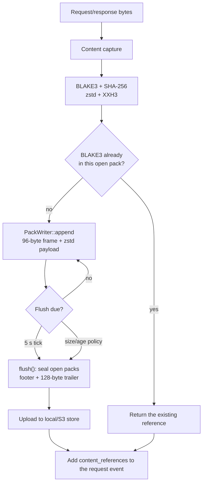

# Content plane

**Status:** implemented. The service wires the content pipeline when `CONTENT_STORE` is `local`
or `s3`; it is **off by default**. Audit events are written as JSONL by the service; Quickwit,
ClickHouse, and the hourly event archive are not wired by the service (the local stack supports
a separate Vector/replay path).

## What is captured

| Endpoint | Captured bytes | Stored as |
| --- | --- | --- |
| `/v1/fetch` | The returned response body | `fetch-response` pack frame |
| `/v1/peek` | The head bytes actually read | `peek-response` pack frame |
| `/v1/search` | The request JSON and the response JSON | `search-request` + `search-response` frames |
| `/v1/openwebui_search` | The request JSON and the response JSON | `openwebui-search-request` + `openwebui-search-response` frames |

`CONTENT_MAX_BODY_BYTES` (default 25 MiB) caps each captured body. An oversized body is rejected
by the content writer; the HTTP request still succeeds and the failure is logged. The audit
middleware also uses the same value as its request-body capture limit; JSON request bodies are
capped at 1 MiB by the extractor.

## Write path



### Stages

| Stage | Input | Output | Failure behaviour |
| --- | --- | --- | --- |
| Capture | request/response bytes | body bytes | Body over the limit is rejected; no reference |
| Hash | body | BLAKE3-256, SHA-256 | Content error; no reference |
| Compress | body | zstd frame | Content error; no reference |
| Pack | header + payload | 96-byte frame + zstd | Local temp-file error; no reference |
| Dedupe | BLAKE3 | existing reference or append | Content writer returns the existing frame for a duplicate in the same open pack |
| Flush | open packs/objects | uploaded pack/object | Failure is logged; the request is unaffected; sealed items stay queued for retry |
| Event | content reference | `content_references` | Audit sink failure is logged; the request is unaffected |

### Pack grouping and keys

The service groups bodies by operation. A pack key is fixed when the pack opens:

```text
packs/{operation}/{yyyy-mm-ddTHH}/{pid}-{sequence}.pack
```

A body at or above the fixed 30 MiB large-body threshold is written as a standalone object:

```text
objects/{blake3}
```

The pack target is measured in appended **plaintext** bytes. The pack writer's target is
`CONTENT_PACK_TARGET_BYTES` (default 128 MiB); the age policy is
`CONTENT_MAX_PACK_AGE_SECS` (default 600 s).

### Flush interval

While serving, `http::serve` starts a background flush task every **5 seconds**. Each flush
seals every open pack and uploads sealed packs/objects. On shutdown, the task is stopped and one
final best-effort flush runs.

Because the periodic flush seals open packs, in normal service operation packs close at the
5-second tick, not at the 10-minute policy age. The 10-minute value is a backstop checked during
`ContentWriter::append` if no flush has run. At the modelled 4 MiB average and 100k fetches/hour,
the 128 MiB target is still reached before the 5-second tick, so size drives pack closure.

## Dedupe

`ContentWriter` keeps a per-open-pack `BLAKE3 → StoredContent` map. A duplicate body in the same
pack returns the existing reference (including the first body's content type). There is no
global dedupe across packs; the same page fetched tomorrow is stored again. A body is durable
only after a successful flush.

## Large bodies

The large-body threshold is fixed at 30 MiB in `neuradex-content`; there is no environment
variable for it. A body at or above the threshold is queued as `objects/{blake3}`. Because the
default capture cap is 25 MiB, this path is not reached with default settings.

## Read path

The content crate provides `read_content` and `read_pack_content` with range requests: trailer,
footer, then the frame header/payload. The service does **not** expose a public content-read API
yet; an audited read API is future work. A pack reference in an audit event is the pack key plus
the BLAKE3 hash; the frame is found by binary-searching the pack footer for that hash.

Read rules:

- Verify the trailer/footer checksum and pack hashes before trusting offsets.
- Verify the frame XXH3 before decompression, then BLAKE3 and SHA-256 of the plaintext.
- Never return unverified bytes.
- A missing pack is an expired/deleted condition, not an empty body.

## Retention and deletion

`CONTENT_RETENTION_DAYS` (default 365) is stored in the content policy and logged at startup, but
the service does not delete objects or configure a bucket lifecycle. Retention enforcement is an
external B2/S3 lifecycle concern. There is no per-request deletion; packs are immutable.

## Failure and degradation

| Failure | Client impact | Content impact |
| --- | --- | --- |
| Content disabled (`CONTENT_STORE=off`) | none | no content references |
| Body over `CONTENT_MAX_BODY_BYTES` | none | reference omitted; warning logged |
| Local store path cannot be created/opened | startup fails | no service |
| S3 client settings invalid | startup fails | no service |
| Upload fails | none | sealed items stay queued; warning logged; retry on next flush |
| Periodic flush fails | none | same; final shutdown flush retries |
| Duplicate body in one pack | none | existing reference reused |
| Hash mismatch on read | read fails | bytes withheld |

## Configuration

Exact names and defaults are documented in
[reference/configuration.md](../reference/configuration.md#content). The content-related
variables are:

| Variable | Default | Meaning |
| --- | --- | --- |
| `CONTENT_STORE` | `off` | `off`, `local`, or `s3` |
| `CONTENT_LOCAL_PATH` | — | Local root; required for `local` |
| `CONTENT_S3_ENDPOINT` / `CONTENT_S3_REGION` / `CONTENT_S3_BUCKET` | — | Required for `s3` |
| `CONTENT_S3_PREFIX` | unset | Optional key prefix |
| `CONTENT_S3_ACCESS_KEY_ID` / `CONTENT_S3_SECRET_ACCESS_KEY` | — | Required for `s3` |
| `CONTENT_S3_FORCE_PATH_STYLE` | `true` | Path-style addressing |
| `CONTENT_PACK_TARGET_BYTES` | `134217728` | Target plaintext bytes per pack |
| `CONTENT_MAX_PACK_AGE_SECS` | `600` | Max open-pack age policy |
| `CONTENT_MAX_BODY_BYTES` | `26214400` | Max captured body bytes |
| `CONTENT_RETENTION_DAYS` | `365` | Retention policy value (not enforced by the service) |
| `CONTENT_COMPRESSION_LEVEL` | `3` | zstd level |

The numeric settings are validated even when `CONTENT_STORE=off`; an invalid value fails
startup. A change requires a restart.
