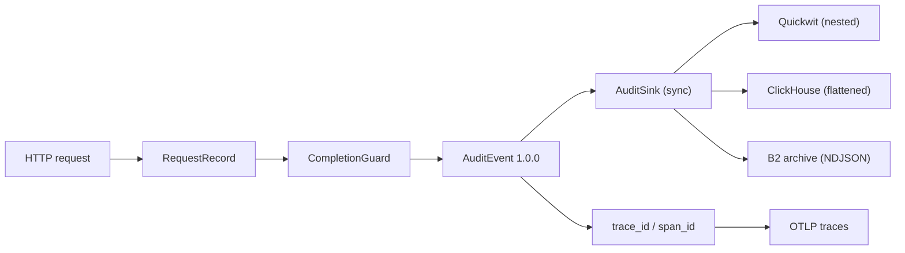
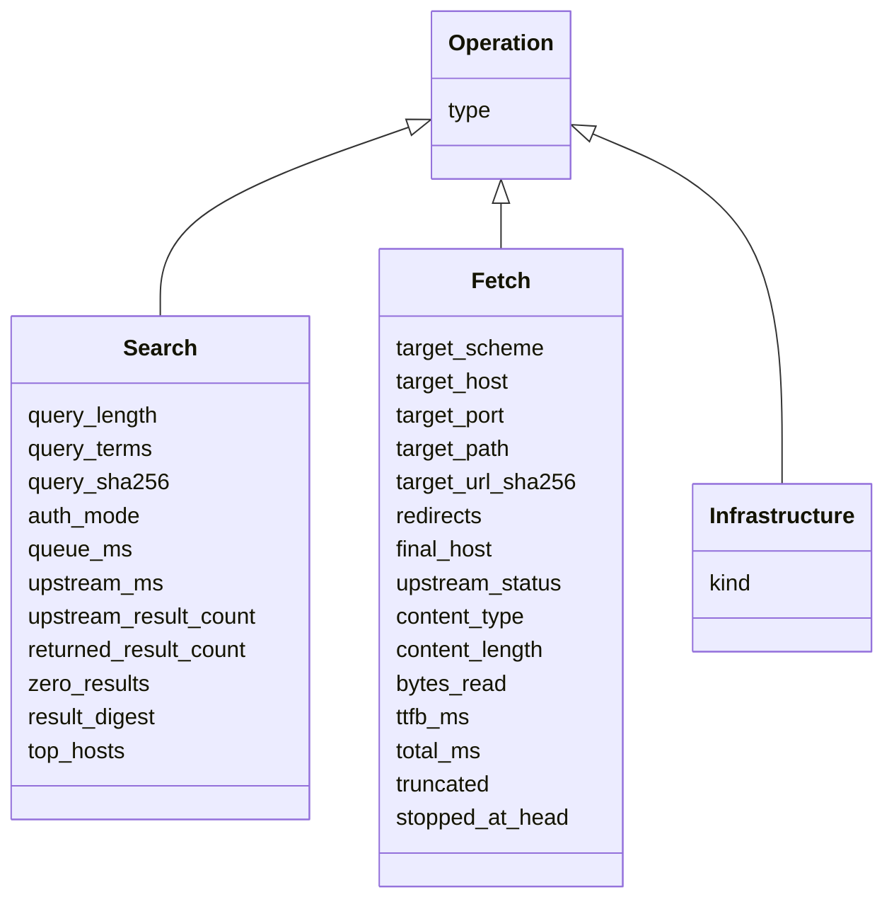
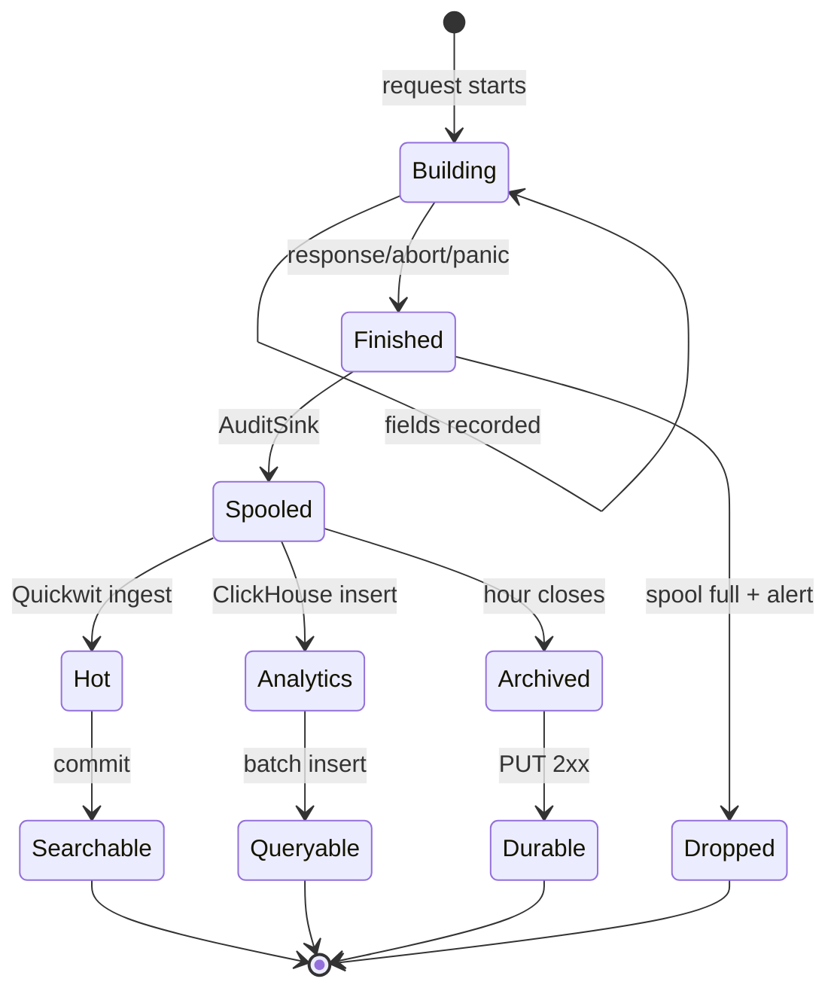

# Event model

**Status:** the `neuradex-audit` crate implements the event schema; the service does not emit
events yet. Read-audit and auth-subject fields are future work (RFD 0009).

## One event, one request

Every inbound request produces exactly one `AuditEvent`, emitted by a completion guard. The
event is nested: `service`, `http`, `operation`, `content_references`, and the header captures
are objects/arrays, not a flat row. The event is serialized once and fanned out to Quickwit
(nested mapping), ClickHouse (flat projection), and the B2 archive (original JSON).



## Envelope

| Field | Type | Notes |
| --- | --- | --- |
| `event` | string | Always `neuradex.request` |
| `schema_version` | string | `1.0.0` |
| `event_id` | string | `evt-…`, unique per event |
| `timestamp` | RFC 3339 UTC | Event creation time |
| `observed_at` | RFC 3339 UTC | Optional; upstream observation time |
| `service` | object | `{name, version, environment?}` |
| `trace_id` / `span_id` | string | Optional; present when traced |
| `request_id` | string | `req-…`, shared by one request's events |
| `http` | object | Method, optional route, path, optional status, optional body sizes, duration |
| `outcome` | enum | `success`, `client_error`, `server_error`, `aborted`, `panic` |
| `error_type` | string | Optional low-cardinality failure class |
| `operation` | object | Tagged union; `type` selects fields |
| `content_references` | array | Optional stored-content references |
| `request_headers` / `response_headers` | object | Optional `HeaderCapture` |

Optional fields are omitted, not null. Consumers must treat missing fields as absent.

## Operation union



`search` and `openwebui_search` share `Search`; `fetch` and `peek` share `Fetch`. The audit crate
never stores query text: only `query_sha256`, length, and term count. It never stores the full
target URL: only scheme/host/port/path plus `target_url_sha256`.

## Content references

```json
{
  "storage": "pack",
  "key": "packs/v1/date=2026-11-10/hour=12/pack-019a.nrp",
  "blake3": "<64 hex>",
  "sha256": "<64 hex>",
  "size": 5123,
  "content_type": "text/html"
}
```

`storage` is `pack` or `object`. The event has no frame offset/length; the hourly request index
maps `request_id` to the frame. Absence of `content_references` means no captured content, not
an empty body (an empty body can be a reference of size 0).

## Header captures

`request_headers`/`response_headers` are `HeaderCapture` objects:

```json
{
  "headers": [
    {
      "name": "content-type",
      "action": "allow",
      "redacted": false,
      "value_bytes": 24,
      "values": [
        {"value": "text/html; charset=utf-8", "encoding": "utf8", "length": 24, "truncated": false}
      ],
      "omitted_values": 0
    }
  ],
  "omitted_headers": 0,
  "redacted_values": 0,
  "truncated_values": 0
}
```

Unknown headers are redacted (name and byte length kept); credentials are redacted; IP/user/chat
identifiers are HMAC-SHA256 hashed when keyed; `location`/`referer` lose query/fragment. See
[RFD 0005](../rfd/0005-header-policy.md).

## Event lifecycle



Quickwit visibility depends on the 10-second commit; ClickHouse on the insert batch; the archive
on the hour close + grace. These are independent timelines; `timestamp` does not imply ordering
across sinks.

## Deduplication

- `event_id` is unique per event. A retry keeps the same ID.
- Duplicate rows in Quickwit/ClickHouse are tolerated. Use `uniqExact(event_id)` when exact
  counts matter.
- `request_id` appears in multiple events (request + content/pack events), so it is not a unique
  event key.
- The archive may contain a duplicate if a writer retries an hour with a new object key; readers
  dedupe by `event_id`.

## Schema evolution

| Change | Allowed within 1.0.x? | Required action |
| --- | --- | --- |
| Add an optional field | yes | Add to event, reference page, Quickwit mapping if searchable, ClickHouse column if queried |
| Add an enum value | yes | Add to reference page and validation |
| Rename a field | no | New field + dual-write + `schema_version` bump |
| Change a type | no | New field + `schema_version` bump |
| Change an outcome/operation meaning | no | New `schema_version` and migration note |
| Remove a field | no | Dual-read for one retention window + bump |

Quickwit uses `mode: lenient`, so an unmapped field is ignored rather than rejecting the event.
ClickHouse tolerates missing keys via column defaults; unknown keys are dropped by Vector's
`skip_unknown_fields`. Add the column before enabling the field.

## Sink mappings

| Event part | Quickwit | ClickHouse |
| --- | --- | --- |
| `service`, `http`, `operation` | nested `object` fields | `service_*`, `http_*`, `operation_type` + union columns |
| `content_references` | `json`, stored; wrapped as `{"items":[…]}` | `String` JSON array + derived `content_*` scalars |
| `request_headers`/`response_headers` | `json`, stored | `String` JSON objects |
| Scalars (`event`, `outcome`, …) | typed fields | typed columns |

Quickwit's `json` field is object-only, hence the `{"items":[…]}` wrapper for arrays. The archive
and ClickHouse keep the original array shape.

## Event size

| Part | Typical | Cap |
| --- | --- | --- |
| Envelope + correlation | ~300 B | — |
| Service + HTTP + operation | ~500 B | — |
| Content references | ~200 B each | — |
| Headers | ~1 KiB | 8 KiB per side (512 B/value, 64 headers) |
| Total | ~1.5–2 KiB | ~16 KiB headline worst case |

The header capture is bounded; an event cannot grow without limit through headers. Bodies are
never embedded.

## Example

```json
{
  "event": "neuradex.request",
  "schema_version": "1.0.0",
  "event_id": "evt-1",
  "timestamp": "2026-11-10T12:34:56.789Z",
  "service": {"name": "neuradex", "version": "0.1.0"},
  "trace_id": "4bf92f3577b34da6a3ce929d0e0e4736",
  "span_id": "00f067aa0ba902b7",
  "request_id": "req-1",
  "http": {
    "method": "GET",
    "route": "/v1/fetch",
    "path": "/v1/fetch",
    "status": 200,
    "duration_ms": 120
  },
  "outcome": "success",
  "operation": {
    "type": "fetch",
    "target_scheme": "https",
    "target_host": "example.com",
    "target_path": "/a/path",
    "target_url_sha256": "7d5e1f180f774d3f6d57faa2ae34610fdbfb752d0c0e48d840e3f2d633a27f78",
    "redirects": 0,
    "final_host": "example.com",
    "upstream_status": 200,
    "content_type": "text/html",
    "content_length": 5123,
    "bytes_read": 5123,
    "ttfb_ms": 87,
    "total_ms": 120,
    "truncated": false,
    "stopped_at_head": false
  },
  "content_references": [
    {
      "storage": "pack",
      "key": "packs/v1/date=2026-11-10/hour=12/pack-019a.nrp",
      "blake3": "9f2c000000000000000000000000000000000000000000000000000000000000",
      "sha256": "3a7d000000000000000000000000000000000000000000000000000000000000",
      "size": 5123,
      "content_type": "text/html"
    }
  ]
}
```

## Invariants

1. `event` is `neuradex.request`; the operation type is `operation.type`, not `event`.
2. `schema_version` is a string (`1.0.0`).
3. `event_id` is unique; `request_id` is stable for one request.
4. `timestamp` is RFC 3339 UTC; `http.duration_ms` is non-negative.
5. `operation` is optional; when present, `operation.type` is one of the five values.
6. No query text, full target URL, body, or result snippet appears.
7. Header captures are bounded and redacted/HMACed per policy.
8. `content_references` is an array; absence means no captured content.

## Future fields

`auth_subject`, `auth_method`, `user_id`, `read_action`, `read_target`, `read_reason`,
`read_bytes`, `content_captured`, and `content_capture_error` are not in 1.0.0. Do not index or
store them until the audit crate emits them. See RFD 0009 for the proposed read-audit shape.
