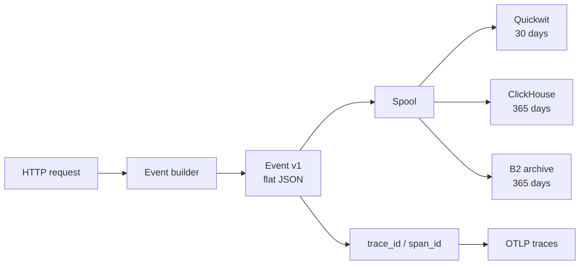
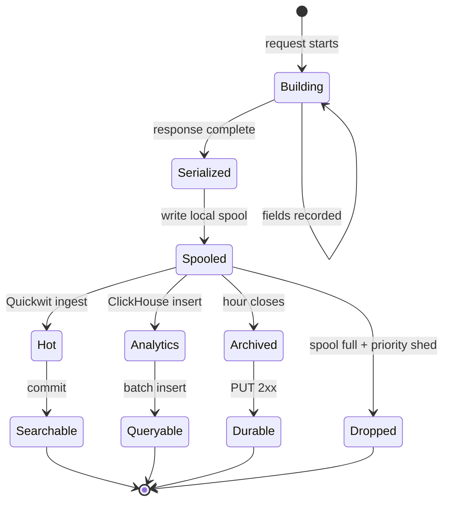

# Event model

**Status:** target design. The schema is specified in
[reference/event-fields.md](../reference/event-fields.md); the Rust types are not implemented
beyond the crate scaffold.

## One event, one request

Every inbound request produces exactly one *request event*, except `/healthz`. Operational
actions (pack upload, content read, audit read) produce their own events. An event is a flat
JSON object; headers are JSON objects, and content is referenced by hashes and frame locations,
never embedded.



## Event types

| Type | Trigger | HTTP status | Typical `outcome` |
| --- | --- | --- | --- |
| `fetch` | `/v1/fetch` completes or fails | final status | success, client_error, upstream_error, timeout, canceled |
| `peek` | `/v1/peek` completes or fails | final status | same |
| `search` | `/v1/search` completes or fails | final status | success, client_error, upstream_error, timeout |
| `openwebui_search` | `/v1/openwebui_search` completes or fails | final status | same |
| `audit.read` | A principal reads events/exports | 0 | success, client_error, failed |
| `content.read` | A principal reads a content frame | 0 | success, failed |
| `content.pack_sealed` | Pack footer/trailer written | 0 | success |
| `content.pack_uploaded` | Pack PUT confirmed | 0 | success |
| `content.pack_failed` | Upload/verification failed | 0 | failed |
| `content.read` (verify) | Frame hash verification | 0 | success, failed |

The request events are the only ones that carry `duration_ms` and the full target fields.
Operational events use the same envelope so a single index/table can hold them.

## Field groups

| Group | Fields | Sensitivity | Notes |
| --- | --- | --- | --- |
| Envelope | `schema_version`, `event`, `event_id`, `timestamp` | public to readers | `event_id` unique |
| Correlation | `request_id`, `trace_id`, `span_id` | internal | `request_id` primary key for lookup |
| Request | `route`, `method`, `status`, `duration_ms`, `outcome`, `error_type`, `service_version` | internal | `error_type` low-cardinality |
| Principal | `auth_subject`, `auth_method`, `user_id` | restricted | Signed by ingress |
| Search | `query_text`, `query_hash`, `result_count` | `query_text` restricted | Hash always present |
| Target | `target_url`, `upstream_host`, `redirects_followed` | restricted | URL sanitized |
| Content | `content_*` | restricted (ref only) | See content plane |
| Headers | `request_headers`, `response_headers`, `*_truncated` | restricted | Redaction/HMAC per RFD 0005 |
| Read | `read_action`, `read_target`, `read_reason`, `read_bytes` | restricted | Only for reads |

The full type table is [reference/event-fields.md](../reference/event-fields.md). The same field
names are used in Quickwit and ClickHouse; do not rename per sink.

## Event lifecycle



A request event is not visible in Quickwit until the indexer commits (`commit_timeout_secs: 10`
in the local index). ClickHouse visibility depends on the insert batch. The archive is written
after the hour closes plus a grace window. These are independent timelines; the event's
`timestamp` does not imply ordering across sinks.

## Deduplication

- `event_id` is unique per event. A retry of the same event keeps the same `event_id`.
- A duplicate row in Quickwit/ClickHouse is tolerated. Queries that require exact counts should
  use `uniqExact(event_id)` or group by `event_id` before aggregating.
- The event archive may contain a duplicate if a writer retries an hour with a new object key.
  Readers should dedupe by `event_id` when replaying.
- `request_id` is unique per request but can appear in multiple events (`fetch`,
  `content.pack_uploaded`, `audit.read`). Do not use it as the sole unique key for event rows.

## Schema evolution

| Change | Allowed within v1? | Required action |
| --- | --- | --- |
| Add an optional field | yes | Add to event struct, reference page, Quickwit mapping if searchable, ClickHouse column if queried |
| Add an enum value | yes | Add to reference page and validation; storage accepts it |
| Rename a field | no | New field + dual-write + deprecation; bump `schema_version` |
| Change a type | no | New field; bump `schema_version` |
| Change `outcome` meaning | no | New `schema_version` and a migration note |
| Remove a field | no | Dual-read for one retention window; bump `schema_version` |

Quickwit uses `mode: lenient`, so an unmapped field is ignored rather than rejecting the
document. That prevents a deploy from breaking ingestion, but it also means a new field is not
searchable until the mapping is updated and the index is recreated/reindexed.

ClickHouse tolerates missing JSON keys (column defaults) and unknown keys only when the ingester
skips them. Add the column before enabling the field; otherwise Vector's `skip_unknown_fields`
will drop it silently.

## Sink mappings

| Event part | Quickwit | ClickHouse |
| --- | --- | --- |
| Scalars | typed field, `fast` for low-cardinality | typed column |
| `request_headers`/`response_headers` | `json`, `indexed:false`, `stored:true` | `String` containing JSON |
| Content refs | scalar fields | scalar columns |
| Read audit | scalar fields | scalar columns |
| Archive | n/a | n/a |

Quickwit is for text search and recent inspection; it stores the source document so the full
event is returned. ClickHouse is for aggregates and typed filters; it does not store bodies or
result text. B2 archive stores the original NDJSON for replay.

## Event size

| Part | Typical | Cap |
| --- | --- | --- |
| Envelope + correlation | ~300 B | — |
| Principal + target | ~300 B | — |
| Content refs | ~300 B | — |
| Headers | ~1 KiB | 32 KiB per direction |
| Total | ~1.5–2 KiB | 64 KiB |

The 64 KiB cap is enforced before serialization. If it is exceeded, response headers are dropped
first, then request headers; the event still records the request. A 64 KiB event is a bug or an
attack, not a normal page.

## Worked example

A successful fetch:

```json
{
  "schema_version": 1,
  "event": "fetch",
  "event_id": "019a7f3c-6a2e-7c31-9b5a-2f4c1d0e8a11",
  "timestamp": "2026-11-10T12:34:56.789Z",
  "request_id": "019a7f3c-6a2e-7c31-9b5a-2f4c1d0e8a10",
  "trace_id": "4bf92f3577b34da6a3ce929d0e0e4736",
  "span_id": "00f067aa0ba902b7",
  "route": "/v1/fetch",
  "method": "GET",
  "status": 200,
  "duration_ms": 120,
  "outcome": "success",
  "error_type": "",
  "service_version": "0.1.0",
  "auth_subject": "user:alice@example.com",
  "auth_method": "mtls",
  "user_id": "alice",
  "query_text": "",
  "query_hash": "",
  "result_count": 0,
  "target_url": "https://example.com/",
  "upstream_host": "example.com",
  "redirects_followed": 0,
  "content_captured": true,
  "content_kind": "fetch_body",
  "content_hash_blake3": "<64 hex>",
  "content_hash_sha256": "<64 hex>",
  "content_bytes": 5123,
  "content_type": "text/html",
  "content_truncated": false,
  "content_pack_id": "<uuid>",
  "content_frame_offset": 4096,
  "content_frame_length": 1234,
  "content_capture_error": "",
  "request_headers": {"accept": ["*/*"], "user-agent": ["neuradex/0.1"]},
  "response_headers": {"content-type": ["text/html; charset=utf-8"]},
  "request_headers_truncated": false,
  "response_headers_truncated": false,
  "read_action": "",
  "read_target": "",
  "read_reason": "",
  "read_bytes": 0
}
```

A failed fetch:

```json
{
  "schema_version": 1,
  "event": "fetch",
  "event_id": "019a7f3c-...",
  "timestamp": "2026-11-10T12:35:01.000Z",
  "request_id": "019a7f3c-...",
  "route": "/v1/fetch",
  "method": "GET",
  "status": 502,
  "duration_ms": 30000,
  "outcome": "upstream_error",
  "error_type": "upstream_timeout",
  "target_url": "https://slow.example.com/",
  "upstream_host": "slow.example.com",
  "content_captured": false,
  "content_capture_error": "upstream_error",
  "request_headers": {},
  "response_headers": {}
}
```

The failed event has no pack refs. That is not data loss; it is the correct record that there
was no body to capture.

## Invariants

1. `event_id` is unique; `request_id` is stable for one request.
2. `timestamp` is completion time UTC; `duration_ms` is monotonic and non-negative.
3. `status` is the final client status; 0 for non-HTTP events.
4. `outcome` and `error_type` are low-cardinality and never contain free text.
5. `content_captured=false` always has a non-empty `content_capture_error` (except for events
   that never capture content, where `content_captured=false` is expected and
   `content_capture_error` may be empty).
6. `content_hash_blake3` is lowercase hex, 64 chars, when captured.
7. Headers are JSON objects in the event; ClickHouse stores them as JSON-encoded strings.
8. Bodies, result snippets, tokens, and cookies never appear.
