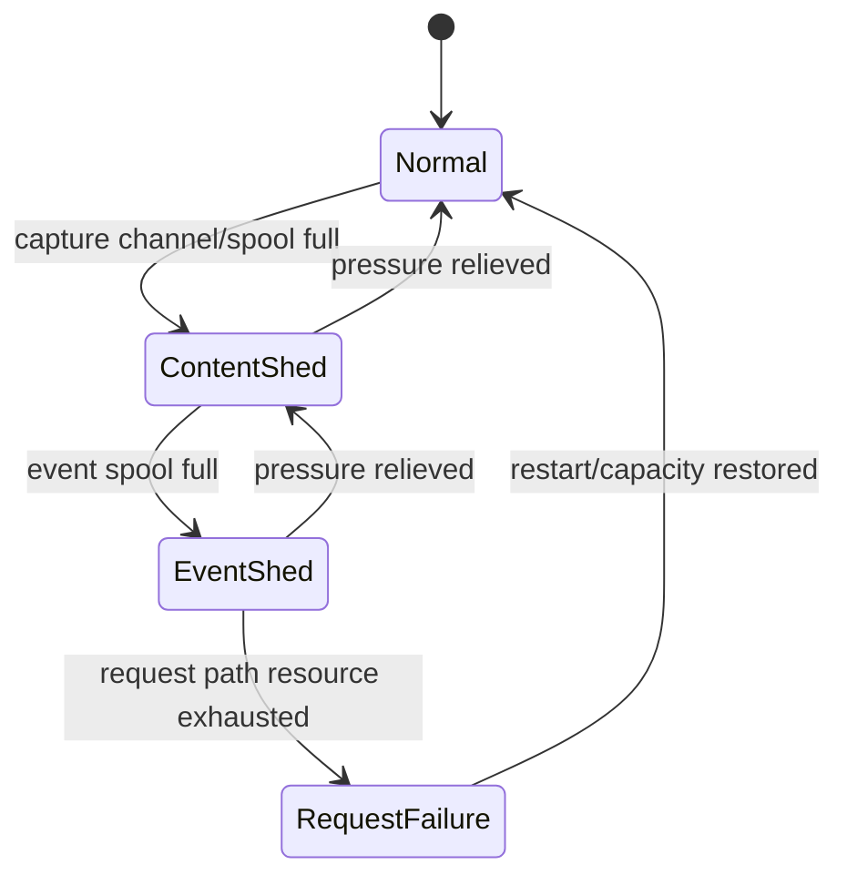

# Failure model

**Status:** target design. The service is implemented; the audit/content failure handling is
specified and must be implemented with the pipeline.

## Principles

1. **The response wins.** A sink failure never turns a successful fetch into a 5xx.
2. **Events outrank content.** If resources are scarce, shed content and mark it; keep the event.
3. **Fail visibly.** A missing body is marked with `content_capture_error`, not silently omitted.
4. **Derived stores are disposable.** Quickwit and ClickHouse can be rebuilt from B2.
5. **B2 loss is data loss.** Treat it as an incident, not a cache miss.
6. **At-least-once.** Duplicates are acceptable; silent loss is not.

## Failure matrix

| # | Failure | Detection | Client impact | Audit/content impact | Mitigation | Data loss? |
| --- | --- | --- | --- | --- | --- | --- |
| F1 | B2 PUT 5xx/timeout | Upload error rate | none (async) | pack delayed; spool grows | retry/backoff; alert; capacity | no, if spool survives |
| F2 | B2 unavailable > spool | Spool depth/lag | none | content shed; events maybe shed | shed content first; page | content only |
| F3 | B2 read 5xx | Read API error rate | 5xx on read | investigation blocked | retry; status page | no |
| F4 | Pack upload succeeds, index write fails | Reconciliation mismatch | none | orphan pack; request unresolvable | rebuild index from archive/footers | no (recoverable) |
| F5 | Pack corrupt on read | XXH3/BLAKE3 mismatch | 502 | bytes withheld | re-read; check another copy; incident | possible for that frame |
| F6 | Pack expired early (lifecycle bug) | 410 spike; lifecycle audit | 410 | content gone | restore lifecycle; restore from backup if any | yes |
| F7 | Quickwit down | Ingest errors; search 5xx | none for API; search UI down | hot events delayed | spool; replay | no |
| F8 | Quickwit index deleted/corrupt | Search fails; index list empty | hot search down | hot copy lost | recreate + replay from B2 | no |
| F9 | ClickHouse down | Insert errors; query 5xx | none | analytics delayed | spool; replay | no |
| F10 | ClickHouse disk full | Insert errors; disk metric | none | analytics stops | TTL/drop partitions; expand | no (if archive) |
| F11 | ClickHouse schema drift | Insert errors `unknown field` | none | rows dropped | add column; migrate; replay | maybe (rows) |
| F12 | Event spool full | Spool depth 100%; drop counter | none | events dropped | page; expand; shed content | yes, events |
| F13 | Content spool full | Drop counter | none | content dropped | page; expand; mark | content only |
| F14 | Service crash mid-request | Restart; client error | request fails | event may be missing; content may be partial | idempotent retry; partial packs discarded | possibly one request |
| F15 | Client disconnect | Canceled metric | connection closed | partial content not canonical | mark `client_disconnect` | no |
| F16 | Upstream DNS/TLS/timeout | `error_type` spike | 502/504 | event records failure | retry? no automatic; investigate | no |
| F17 | Kagi session exhaustion | Queue/latency; 429/5xx | slow/5xx search | event records failure | session pool; backoff | no |
| F18 | OTLP collector down | Export errors in logs | none | traces lost/sampled | buffer; disable export | traces only |
| F19 | Clock skew | Pack age/hour mismatch | none | wrong hour prefix; still unique key | NTP; alert | no |
| F20 | Event archive missed hour | Hourly completeness check | none | cold archive gap | replay from spool/Quickwit? | maybe |
| F21 | Duplicate events | Duplicate rate metric | none | counts inflated | dedupe by `event_id` | no |
| F22 | Hash mismatch on write | Write verification failure | none | frame rejected | bug/corruption; page | content only |
| F23 | Local disk full (spool) | Disk metric | none | content/events shed | free space; expand | yes if spool not flushed |
| F24 | Vector down (local) | `docker compose ps` | none | local ingest stops | restart; source replays | no (spool persists) |
| F25 | MinIO down (local) | Healthcheck | local content fails | local only | restart | local only |

## Degradation ladder

- **Normal:** all sinks healthy; content captured; events delivered.
- **ContentShed:** events still delivered; content dropped and marked. The API is unaffected.
- **EventShed:** events are dropped only after a high-severity alert; this is an audit incident.
- **RequestFailure:** the service cannot serve; this is a user-visible outage, not a sink issue.

The ladder is deliberate: content is the first thing to lose, events are the last. Never invert
it by blocking the response on content.

## RPO / RTO

| Data | RPO | RTO | Notes |
| --- | --- | --- | --- |
| Events (hot) | ≤ 5 min spool | ≤ 30 min | Quickwit replay from archive |
| Events (cold) | ≤ 1 hour + grace | ≤ 4 hours | Hourly archive object |
| Content | ≤ last uploaded pack | ≤ 1 hour | Spool retry; last pack may be lost |
| ClickHouse | ≤ batch interval | ≤ 4 hours | Replay from archive |
| Traces | sampling window | n/a | Not a source of truth |

These are targets, not guarantees. Measure them in staging.

## What is never acceptable

- Returning a 5xx because Quickwit, ClickHouse, or B2 is down.
- Returning bytes that fail hash verification.
- Writing an event without `event_id`/`request_id` correlation.
- Storing a header value that the policy says to redact.
- Deleting a pack or index outside the documented retention path.
- Dropping an event without a high-severity alert and a counter.
- Trusting a client-supplied identity header.

## Detection and alerting

| Signal | Threshold | Severity | Runbook |
| --- | --- | --- | --- |
| Event ingest lag | > 5 min p95 for 10 min | page | [Event lag](../operations/runbook.md#events-are-missing-or-late) |
| Event spool depth | > 80% for 5 min | page | [Spool full](../operations/runbook.md#spool-is-full) |
| Content spool depth | > 80% for 5 min | ticket | [Content missing](../operations/runbook.md#content-is-missing) |
| Pack upload failure rate | > 1% for 15 min | ticket/page | [Upload failures](../operations/runbook.md#pack-upload-failures) |
| Hash mismatch rate | > 0.01% for 15 min | page | [Hash mismatch](../operations/runbook.md#hash-mismatch) |
| Archive missing for closed hour | > 15 min after close | page | [Archive gap](../operations/runbook.md#archive-gap) |
| ClickHouse insert failures | > 0 for 5 min | ticket | [Analytics down](../operations/runbook.md#clickhouse-is-down) |
| Quickwit search errors | > 1% for 5 min | ticket | [Hot search down](../operations/runbook.md#quickwit-is-down) |
| Request index missing | > 1 per hour | page | [Index gap](../operations/runbook.md#request-index-gap) |
| Read audit failure | any | page | [Read audit](../operations/runbook.md#access-and-read-audit) |

## Failure testing

Before production, test:

- Stop B2 (block egress) for 15 minutes: responses stay 200; events spool; content sheds and is
  marked; recovery drains the spool.
- Stop Quickwit: events spool; search UI fails; restart; replay/commit catches up.
- Stop ClickHouse: inserts fail; events still archive; restart; replay.
- Fill the content spool: content sheds; events continue.
- Fill the event spool: events drop after alert; API still serves (the last resort).
- Corrupt a frame byte: read returns 502; `content.read` failure event; no bad bytes.
- Kill the pack builder mid-pack: partial pack is not uploaded; restart discards it.
- Clock skew ±5 minutes: keys remain unique; pack age may seal early/late; no data loss.
- Spoof `X-Forwarded-User`: ingress strips it; service does not trust it.

## Open questions

| Question | Why it is open | Trigger / owner |
| --- | --- | --- |
| Does an event wait for content refs or emit pending? | Affects completeness vs latency | Decide with the pipeline implementation |
| What is the exact event-shed policy? | Priority by event type/principal? | Operations review |
| Do we need a second B2 region? | Durability vs cost | Security/budget review |
| How do we restore a pack from B2 versioning? | Versioning is not enabled yet | Add with B2 configuration |
| What is the production trace sampling rate? | Not defined | Observability review |
