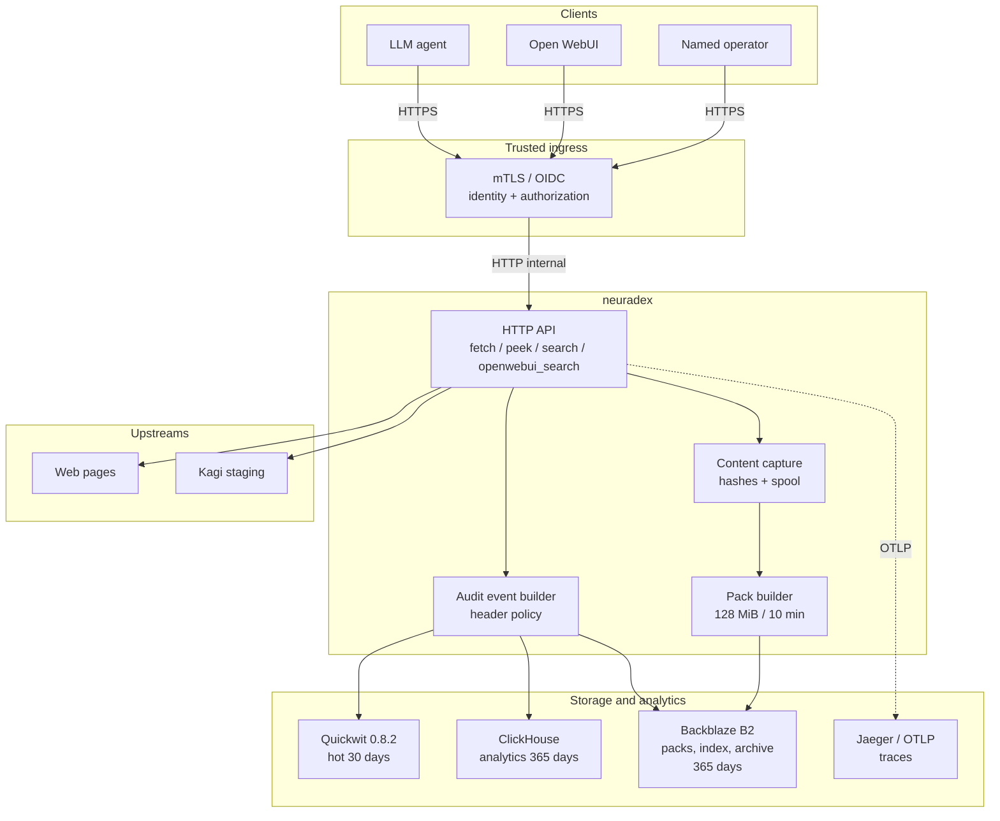
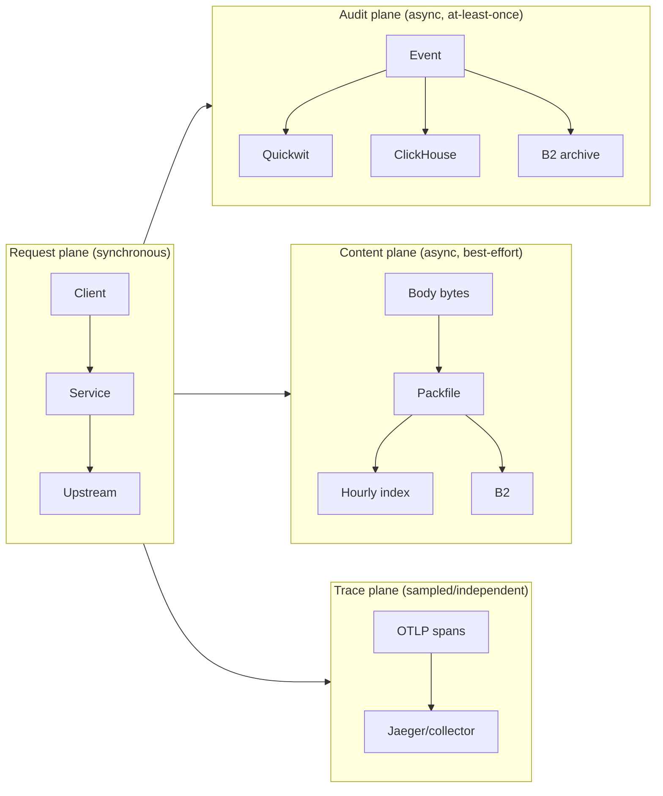

# Architecture overview

**Status:** target design. The HTTP service and `neuradex-audit` are implemented; the packfile
format is implemented (PR #68); the content orchestration and service wiring are pending. See [docs/README.md](../README.md#status).

## System context

The service is the only component that talks to Kagi and the only component that writes content.
The stores are derived views except B2, which is the source of truth.

## Components

| Component | Responsibility | Failure impact | Source |
| --- | --- | --- | --- |
| `neuradex` HTTP API | Request parsing, validation, upstream calls, response | User-visible | `crates/neuradex` |
| Audit event builder | Build one nested `AuditEvent` per request; redact headers; assign IDs | Audit completeness | `crates/neuradex-audit` |
| Content capture | Tee decompressed bytes; hash; spool; mark truncation | Content completeness | `crates/neuradex-content` |
| Pack builder | Seal 128 MiB/10 min packs; 96-byte frame headers, footer, 128-byte trailer; upload | Content availability | `crates/neuradex-content` + `crates/neuradex-packfile` |
| Request index writer | Hourly `request_id → frame` object | Content lookup | `crates/neuradex-content` |
| Event archive writer | Hourly NDJSON.zst object | Cold audit truth | `crates/neuradex-content` |
| Quickwit | Full-text search over the last 30 days | Hot search unavailable | Quickwit 0.8.2 |
| ClickHouse | Typed analytics and daily aggregates over 365 days | Dashboards/analytics unavailable | ClickHouse 25.8 |
| B2 | Durable packs, indexes, archives | Content/source-of-truth loss | Backblaze B2 |
| Jaeger | Local OTLP traces | Trace visibility only | Jaeger 2.22.0 |
| Vector (optional local) | Tail spool; fan out to Quickwit/ClickHouse | Local ingest demo only | Vector 0.49 |

## Data planes

Rules that follow from the split:

- The request plane never waits for audit/content/trace export.
- The audit plane has higher priority than the content plane. If resources are scarce, shed
  content first and mark the event.
- The trace plane is independent: a trace may be sampled out or the collector may be down, but
  the audit event always has `trace_id`/`span_id` because the service creates spans locally.
- A derived store (Quickwit, ClickHouse) can be rebuilt from B2; B2 cannot be rebuilt from them.

## Deployment shapes

| Shape | Service | Quickwit | ClickHouse | B2 | Jaeger | Purpose |
| --- | --- | --- | --- | --- | --- | --- |
| Local | `cargo run` on host | compose | compose | MinIO | compose | Development |
| Staging | container/Helm | single node or managed | single node | real B2 bucket | OTLP collector | Internal real data |
| Production | Helm, HPA | HA (TBD) | cluster (TBD) | real B2 bucket | TBD | Not in this PR |

Local differences that must not leak into production assumptions:

- MinIO instead of B2, no TLS, root credentials.
- Quickwit file metastore instead of S3/Postgres.
- ClickHouse single node, no replication.
- Jaeger in-memory.
- No auth on the local stack.

## Core invariants

1. **Response first.** Audit and content failures never turn a successful fetch into a 5xx.
2. **Event is the durable record.** Content may be missing; the event says why.
3. **BLAKE3 is identity.** SHA-256 is audit. XXH3 is a frame checksum only.
4. **Packs are immutable.** No per-request objects, no per-request manifests, no in-place edits.
5. **Frames are self-describing; the footer is a rebuildable index.** The hourly index accelerates lookup; it does not replace the pack.
6. **Hot is short, cold is long.** Quickwit 30 days, ClickHouse/B2 365 days.
7. **Named access only.** Reads are authenticated, authorized, and audited.
8. **At-least-once, not exactly-once.** Duplicates are tolerated; silent loss is not.

## Where to go next

| Question | Document |
| --- | --- |
| What happens during one fetch? | [request-lifecycle.md](request-lifecycle.md) |
| What exactly is in an event? | [event-model.md](event-model.md), [event-fields.md](../reference/event-fields.md) |
| How is content packed and read? | [content-plane.md](content-plane.md) |
| Which store holds what? | [storage-topology.md](storage-topology.md) |
| Who can read it? | [access-security.md](access-security.md) |
| What breaks and how? | [failure-model.md](failure-model.md) |
