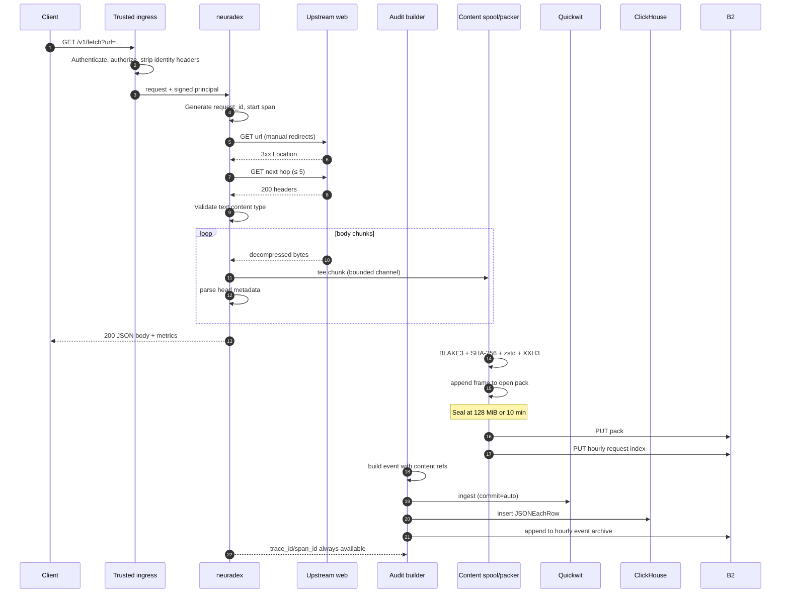
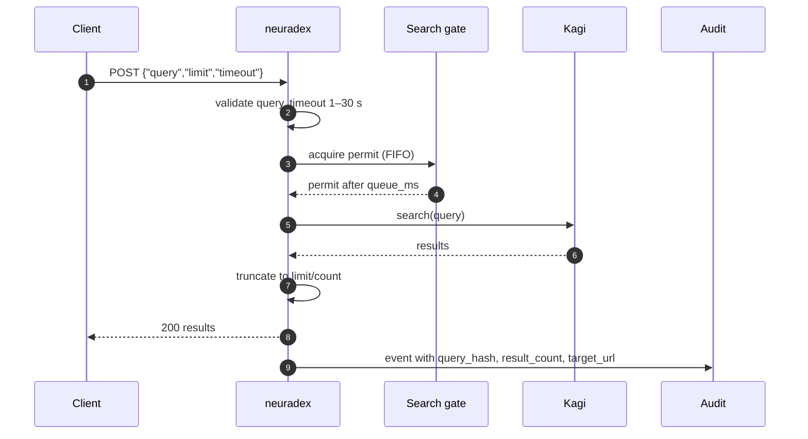

# Request lifecycle

**Status:** the HTTP behaviour is implemented; the audit and content steps are the target design
and are not wired yet. The order is fixed so the implementation has one path to follow.

## Fetch (`GET /v1/fetch`)

### Ordered steps

| # | Step | Blocking? | On failure |
| --- | --- | --- | --- |
| 1 | Authenticate at ingress | yes | 401/403 JSON error; audit the rejection |
| 2 | Validate `url`, `redirects`, `include` | yes, before I/O | 400 `invalid_param`; audit |
| 3 | Generate `request_id` and start the server span | no | Internal error; 500 |
| 4 | Fetch upstream, following redirects manually | yes | 502 `upstream`; audit with final/failed URL |
| 5 | Validate text content type | yes | 415/400; audit |
| 6 | Stream body; tee to content spool; parse head | yes for stream, no for spool | If spool is full, drop content and continue |
| 7 | Serialize response | yes | 500 internal; audit with `error_type=serialization_failed` |
| 8 | Return response to client | — | Client may disconnect; mark `canceled` |
| 9 | Finish hashing/compression; append frame | no | Mark event `content_capture_error` |
| 10 | Seal/upload pack; write hourly index | no | Retry; then mark events |
| 11 | Emit event to Quickwit/ClickHouse/archive | no | Spool; alert on lag/depth |

Steps 1–8 are the only ones on the critical path. Step 6's tee must not apply backpressure to
the upstream read if the content spool is full; the capture path drops and marks instead.

### Response is sent before content is indexed

The response body and metrics are complete before the pack is sealed. This is deliberate: a
128 MiB pack may take seconds to fill and upload, and the client should not wait. The event's
content refs are filled when the pack is indexed. If the event is emitted before the refs are
known, it carries `content_captured=true`, `content_pack_id=""`, and a `content_pending` marker;
a later `content.pack_uploaded` event supplies the refs keyed by `request_id`.

> Open question: whether to buffer the request event until the refs are known, or emit early
> with a pending state. RFD 0004 records the trade-off. Either way, a reader must handle a
> pending ref.

## Peek (`GET /v1/peek`)

Peek differences:

- The reader is aborted as soon as the head ends. Dropping the receiver does not interrupt a
  reader parked in `bytes_stream().next()`, so the service explicitly aborts it.
- `HEAD_MAX_BYTES` is 2 MiB. The parser may stop earlier, so the captured head is usually much
  smaller than 2 MiB.
- `include=headers` is not supported by peek; the event still records response headers per the
  header policy.
- The response body is metadata only; content capture covers the head bytes, not a full body.

## Search (`POST /v1/search` and `/v1/openwebui_search`)

- Search is queued: at most `KAGI_MAX_SESSIONS` run at once (default 2, max 64). The queue wait
  is reported in `metrics.queue_ms`.
- `timeout` covers queue wait, session wait, and the search itself. Without it, the request waits
  until the client disconnects.
- Open WebUI search has no timeout field and returns a bare array; its event is
  `openwebui_search`.
- `query_text` is optional and restricted. `query_hash` is always computed. `target_url` is the
  first result URL, sanitized; the full result list is not stored.
- Search does not capture content bytes.

## Error and fallback paths

| Path | Status | Event? | Content? | Notes |
| --- | --- | --- | --- | --- |
| Invalid query/body | 400 `invalid_param` | yes | no | Extractor or handler validation |
| Missing JSON content type | 415 `unsupported_media_type` | yes | no | `ApiJson` rejection |
| Unknown route | 404 `not_found` | yes | no | Router fallback; `http.route` stays empty |
| Wrong method | 405 `method_not_allowed` | yes | no | Router fallback |
| Upstream DNS/TLS/connect | 502 `upstream` | yes | no | `error_type` low-cardinality |
| Upstream timeout | 502/504 | yes | no | `outcome=upstream_error`/`timeout` |
| Binary content type | 400/415 | yes | no | Fetch rejects binary |
| Response serialization | 500 `internal` | yes | maybe | Details only in logs |
| Health probe | 204 | **no** | no | Excluded on purpose |
| Client disconnect | — | yes | no partial canonical body | `outcome=canceled` |

All error bodies use `{"error": {"type", "message"}}`. 5xx messages are generic; the source
chain is logged, never rendered. The audit event records `error_type`, not the message.

## Cancellation and partial content

- If the client disconnects while the body is streaming, the service stops reading. The bytes
  already captured are not stored as a canonical frame, because they are a prefix that does not
  correspond to a complete upstream response. The event records `content_captured=false`,
  `content_capture_error=client_disconnect`.
- If the body reaches `FETCH_MAX_BYTES` (25 MiB), the captured prefix *is* canonical content:
  `content_truncated=true`, and the hash identifies the prefix. The event records
  `content_bytes` of the prefix, not the announced `content_length`.
- If the content spool is full, the body is still returned to the client; the event records
  `content_capture_error=spool_full`.
- A pack upload failure after retries marks every event referencing that pack with
  `content_capture_error=pack_upload_failed`. The events themselves are not lost.

## Timing fields

| Field | Start | End | Used for |
| --- | --- | --- | --- |
| `duration_ms` | request received | response serialized | SLOs, route latency |
| `metrics.ttfb_ms` | request received | final response headers | Upstream latency |
| `metrics.total_ms` | request received | body read complete | Fetch latency |
| `metrics.queue_ms` | search enqueued | permit acquired | Kagi contention |
| `audit lag` | event created | event searchable | Pipeline health |
| `archive lag` | hour closed | archive object exists | Cold durability |

`timestamp` is the event emission time (completion), not the request start. Reconstruct the
start as `timestamp - duration_ms`.

## Why the order matters

If content capture ran before the response body was sent, a slow B2 upload could add latency to
every fetch. If the event were emitted before the response was serialized, it could not record
the final status. If the pack were uploaded before it was sealed, a reader could see an
incomplete footer. The order above keeps the client path fast and the durable record
self-consistent.
