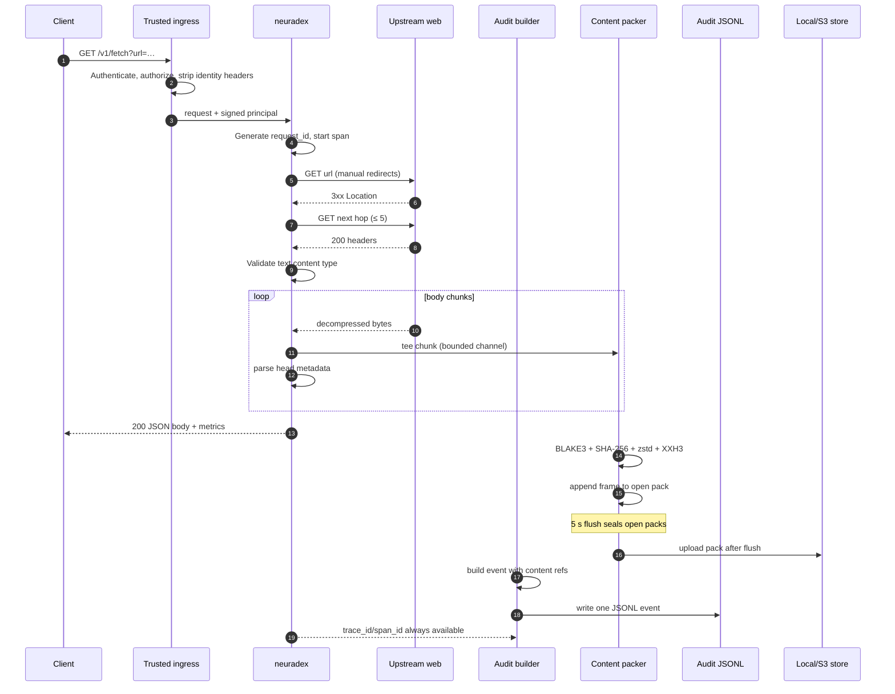
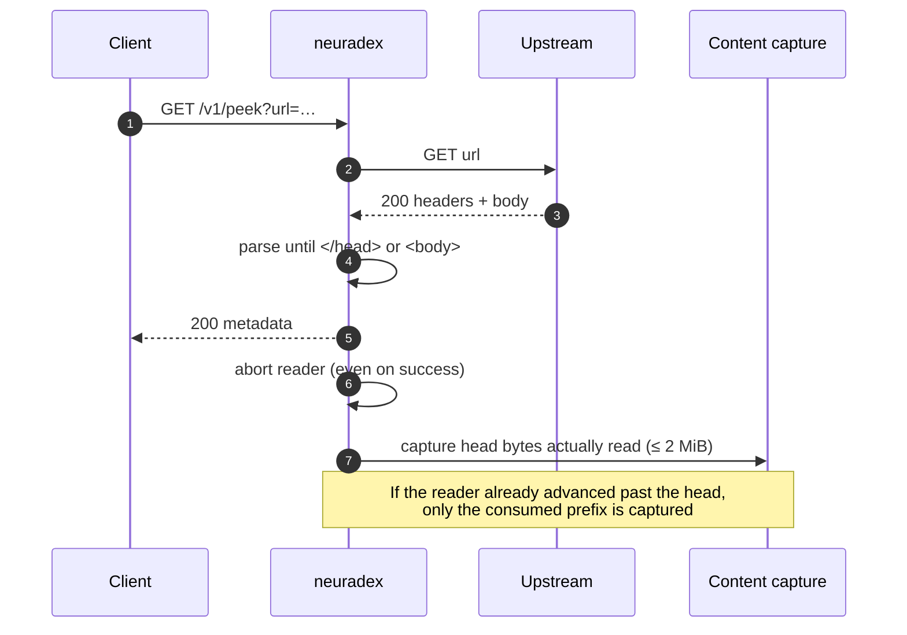
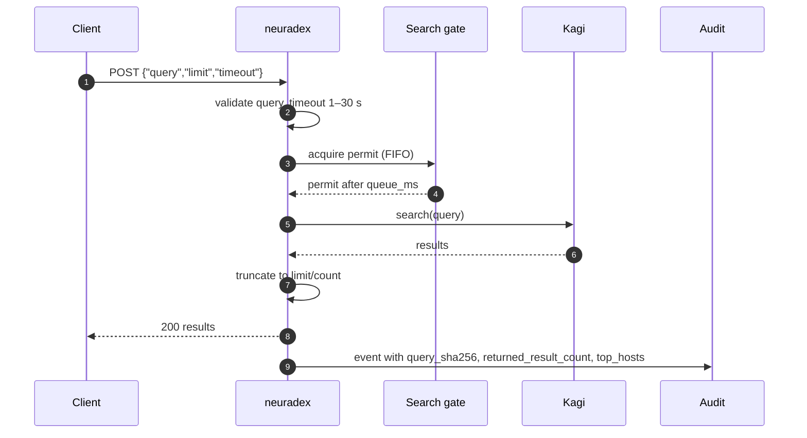

# Request lifecycle

**Status:** implemented. Audit events are emitted as JSONL (`AUDIT_LOG_PATH` or stdout). Content
is off by default; when `CONTENT_STORE` is `local` or `s3`, bodies are packed and flushed every
5 seconds. Quickwit/ClickHouse are optional local views fed by Vector, not service sinks.

## Fetch (`GET /v1/fetch`)

### Ordered steps

| # | Step | Blocking? | On failure |
| --- | --- | --- | --- |
| 1 | Authenticate at ingress | yes | 401/403 JSON error; audit the rejection |
| 2 | Validate `url`, `redirects`, `include` | yes, before I/O | 400 `invalid_param`; audit |
| 3 | Generate `request_id` and start the server span | no | Internal error; 500 |
| 4 | Fetch upstream, following redirects manually | yes | 502 `upstream`; audit with final/failed URL |
| 5 | Validate text content type | yes | 415/400; audit |
| 6 | Stream body; tee to content capture; parse head | yes for stream | If capture fails/over limit, continue without content |
| 7 | Serialize response | yes | 500 internal; audit with `error_type=serialization_failed` |
| 8 | Return response to client | — | Client may disconnect; mark `outcome=aborted` |
| 9 | Finish hashing/compression; append frame | no | Omit the content reference; capture failure is future schema work |
| 10 | Flush every 5 s: seal/upload open packs | no | Log; sealed items stay queued for retry |
| 11 | Emit event to JSONL (file/stdout) | yes | Log `audit_sink`; response still returns |

Steps 1–8 are the only ones on the client path. Content capture is best-effort; a content
failure is logged and does not fail the request. Audit emission is synchronous but separate from
the HTTP response status.

### Response is sent before content is durable

The response body and metrics are complete before the 5-second content flush seals and uploads
the pack. The audit event carries the pack key and BLAKE3 hash returned by `append`; the bytes
are durable only after a successful flush. If the flush fails, the reference points at content
that is not yet in the store; the content writer keeps sealed items queued for the next flush and
logs the failure. There is no `content_pending` field in `AuditEvent` 1.0.0.

## Peek (`GET /v1/peek`)

Peek differences:

- The reader is aborted as soon as the head ends. Dropping the receiver does not interrupt a
  reader parked in `bytes_stream().next()`, so the service explicitly aborts it.
- `HEAD_MAX_BYTES` is 2 MiB. The parser may stop earlier, so the captured head is usually much
  smaller than 2 MiB.
- `include=headers` is not supported by peek; the event still records response headers per the
  header policy.
- The response body is metadata only; content capture covers the head bytes, not a full body.

## Search (`POST /v1/search` and `/v1/openwebui_search`)

- Search is queued: at most `KAGI_MAX_SESSIONS` run at once (default 2, max 64). The queue wait
  is reported in `operation.queue_ms`.
- `timeout` covers queue wait, session wait, and the search itself. Without it, the request waits
  until the client disconnects.
- Open WebUI search has no timeout field and returns a bare array; its event has
  `operation.type = "openwebui_search"`.
- The query text is never stored. `operation.query_sha256` is always computed, with
  `query_length` and `query_terms`.
- `operation.returned_result_count`, `upstream_result_count`, `zero_results`, `result_digest`, and
  `top_hosts` describe the result set without storing full URLs.
- When content storage is enabled, search captures the request JSON (`search-request`) and the
  response JSON (`search-response`) as content references. With content off, there is no
  `content_references` array.

## Error and fallback paths

| Path | Status | Event? | Content? | Notes |
| --- | --- | --- | --- | --- |
| Invalid query/body | 400 `invalid_param` | yes | no | Extractor or handler validation |
| Missing JSON content type | 415 `unsupported_media_type` | yes | no | `ApiJson` rejection |
| Unknown route | 404 `not_found` | yes | no | Router fallback; `http.route` stays empty |
| Wrong method | 405 `method_not_allowed` | yes | no | Router fallback |
| Upstream DNS/TLS/connect | 502 `upstream` | yes | no | `outcome=server_error`, `error_type` low-cardinality |
| Upstream timeout | 502/504 | yes | no | `outcome=server_error`, `error_type=upstream_timeout` |
| Binary content type | 400/415 | yes | no | Fetch rejects binary |
| Response serialization | 500 `internal` | yes | maybe | Details only in logs |
| Health probe | 204 | **no** | no | Excluded on purpose |
| Client disconnect | — | yes | no partial canonical body | `outcome=aborted` |

All error bodies use `{"error": {"type", "message"}}`. 5xx messages are generic; the source
chain is logged, never rendered. The audit event records `error_type`, not the message.

## Cancellation and partial content

- If the client disconnects while the body is streaming, the service stops reading. The bytes
  already captured are not stored as a canonical frame, because they are a prefix that does not
  correspond to a complete upstream response. The event has no `content_references` entry; a
  future capture-status field would record `client_disconnect`.
- If the body reaches `FETCH_MAX_BYTES` (25 MiB), the captured prefix *is* canonical content:
  `operation.truncated=true`, and the reference's hashes identify the prefix. The reference
  `size` is the prefix length, not the announced `operation.content_length`.
- If content capture is disabled or the body exceeds `CONTENT_MAX_BODY_BYTES`, the body is still
  returned to the client; the event has no content reference. The content writer logs the
  failure. A future capture-status field would make the reason explicit.
- A content flush failure leaves sealed items queued for the next 5-second flush; events may
  reference content that is not durable yet. The events themselves are not lost.

## Timing fields

| Field | Start | End | Used for |
| --- | --- | --- | --- |
| `http.duration_ms` | request received | response serialized | SLOs, route latency |
| `metrics.ttfb_ms` | request received | final response headers | Upstream latency |
| `metrics.total_ms` | request received | body read complete | Fetch latency |
| `operation.queue_ms` | search enqueued | permit acquired | Kagi contention |
| `audit lag` | event created | event searchable | Pipeline health |
| `archive lag` | hour closed | archive object exists | Cold durability |

`timestamp` is the event creation time, not necessarily the request start. Reconstruct an
approximate start as `timestamp - http.duration_ms`.

## Why the order matters

If content capture ran before the response body was sent, a slow B2 upload could add latency to
every fetch. If the event were emitted before the response was serialized, it could not record
the final status. If the pack were uploaded before it was sealed, a reader could see an
incomplete footer. The order above keeps the client path fast and the durable record
self-consistent.
