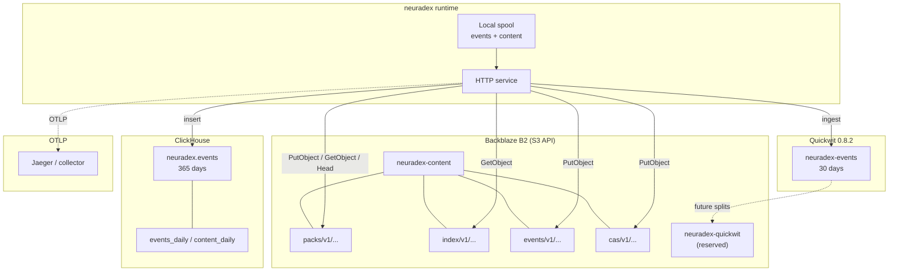

# Storage topology

**Status:** B2/Quickwit/ClickHouse design is specified; the local MinIO/Quickwit/ClickHouse
stack is implemented in `compose.yaml`.

## Topology



## Store responsibilities

| Store | Data | Retention | Source of truth? | Rebuild from |
| --- | --- | --- | --- | --- |
| B2 `neuradex-content/packs/` | Packfiles with content frames | 365 days | Yes for content | Original write only |
| B2 `neuradex-content/index/` | Hourly request index | 365 days | Yes for request→frame mapping | Event archive + pack footers |
| B2 `neuradex-content/events/` | Hourly event archive (NDJSON.zst) | 365 days | Yes for events | Original write only |
| B2 `neuradex-content/cas/` | Future standalone large bodies | 365 days | Yes | Original write only |
| B2 `neuradex-quickwit/` | Future Quickwit splits/metastore | 30 days | No | Reindex from event archive |
| Quickwit | Hot event documents | 30 days | No | Replay event archive |
| ClickHouse | Typed rows + daily aggregates | 365 days | No (derived) | Replay event archive |
| Jaeger | Local traces | Process lifetime | No | Re-run request |

## Bucket and prefix layout

```text
s3://neuradex-content/
  packs/v1/date=YYYY-MM-DD/hour=HH/pack-<pack_id>.nrp
  index/v1/date=YYYY-MM-DD/hour=HH/requests-<closed_at>-<writer>.ndjson.zst
  events/v1/date=YYYY-MM-DD/hour=HH/events-<closed_at>-<writer>.ndjson.zst
  cas/v1/blake3/<first2>/<blake3-hex>

s3://neuradex-quickwit/
  indexes/neuradex-events/...        # future
  metastore/...                      # future
```

- `date`/`hour` are close time for index/archive objects, and pack creation time for packs.
- Keys are immutable. A retry writes a new key with a new `closed_at`/`writer` or pack ID.
- Do not list a whole year's prefix in a request path. Use the index and pack ID.
- The local stack uses MinIO with the same bucket names; Quickwit uses a file index root instead
  of the `neuradex-quickwit` bucket.

## Consistency and durability

| Store | Write visibility | Durability | Notes |
| --- | --- | --- | --- |
| B2 | Read-after-write for new objects | 11 nines claimed by B2 | Immutable keys avoid overwrite races |
| Quickwit | After commit (10 s local) | Derived; splits on disk/S3 | Rebuildable |
| ClickHouse | After insert batch | Derived; MergeTree parts | Rebuildable |
| MinIO local | Immediate | Named volume; not durable | Dev only |

The write order is:

1. Pack PUT completes.
2. Request index PUT completes.
3. Event is emitted with refs (or pending refs resolved).
4. Event archive is written after the hour closes.
5. Quickwit/ClickHouse eventually catch up.

A reader must handle a request whose content ref is pending or whose pack is not yet indexed.
A reader must never see a request index entry whose pack PUT did not complete.

## Data classification

| Data | Classification | Access |
| --- | --- | --- |
| Page bodies | Restricted; may contain PII | `content.reader` via the future audited read API |
| Event metadata | Internal/restricted | `audit.reader` |
| Query text | Restricted | Policy-gated; `audit.reader` if enabled |
| Header HMACs | Restricted | `audit.reader` |
| Aggregates | Internal | `analyst` |
| Traces | Internal; may contain URLs | OTLP backend access |
| Credentials | Secret | Secret manager; never in events |

## Failure domains

| Domain | Failure | Impact | Mitigation |
| --- | --- | --- | --- |
| B2 region | API outage | Content/archive writes delayed; reads fail | Spool, retries, status page |
| B2 bucket | Lifecycle misconfig | Early data loss | Restrict lifecycle changes; audit |
| Quickwit node | Crash/corrupt index | Hot search down | Recreate/replay from archive |
| ClickHouse node | Crash/disk full | Analytics down | Replay from archive; restore DDL |
| Local spool disk | Full | Content/event shedding | Capacity alarm; dedicated volume |
| Network | B2/Quickwit/ClickHouse unreachable | Sink lag | Bounded spool; degradation |
| Clock | Skew | Pack age/hour key wrong | NTP; unique keys; do not rely on exact hour |

## Local vs production

| Aspect | Local | Production |
| --- | --- | --- |
| Object store | MinIO (`quay.io/minio/minio`) | B2 S3 API |
| Object credentials | `neuradex` / `neuradex-local-secret` | Scoped B2 application keys |
| Quickwit storage | File under named volume | S3-backed splits + metastore (TBD) |
| ClickHouse | Single node, no auth beyond local user | Cluster/managed (TBD), TLS |
| Traces | Jaeger in-memory | OTLP collector/backend (TBD) |
| TLS | none | required |
| Retention | same values, disposable volumes | lifecycle + TTL |

## S3 configuration

The service uses `aws-sdk-s3` with the standard AWS environment variables:

```sh
export AWS_ACCESS_KEY_ID=...
export AWS_SECRET_ACCESS_KEY=...
export AWS_REGION=us-west-004
export AWS_ENDPOINT_URL=https://s3.us-west-004.backblazeb2.com
export AWS_ALLOW_HTTP=false
```

For MinIO locally:

```sh
export AWS_ACCESS_KEY_ID=neuradex
export AWS_SECRET_ACCESS_KEY=neuradex-local-secret
export AWS_REGION=us-east-1
export AWS_ENDPOINT_URL=http://127.0.0.1:9000
export AWS_ALLOW_HTTP=true
```

`AWS_ALLOW_HTTP` is a neuradex/content setting, not an AWS SDK standard variable; it exists so
the local stack can use plain HTTP. Never enable it in production. The SDK needs path-style
addressing for MinIO; set the equivalent option in the content store constructor (planned).

## Object lifecycle

| Prefix | Rule | Grace |
| --- | --- | --- |
| `packs/v1/` | Delete after 365 days | Daily; may run hours late |
| `index/v1/` | Delete after 365 days | Daily |
| `events/v1/` | Delete after 365 days | Daily |
| `cas/v1/` | Delete after 365 days | Daily |

Lifecycle is a safety net, not a per-request deletion mechanism. A pack and its index should
expire together; if they do not, readers see a missing pack and return "expired". B2 lifecycle
rules operate on object age, not event timestamps.

## Security

- Buckets are private. No public access, no presigned URLs in logs.
- Writer credentials can put/get/head/list but not delete. Reader credentials can get/head only.
- Lifecycle/admin credentials are break-glass.
- TLS to B2; SSE at rest. Customer-managed keys are an open question.
- The local stack uses root credentials and no TLS; it is for synthetic data only.
- See [access-security.md](access-security.md) and [RFD 0009](../rfd/0009-access-and-read-audit.md).
