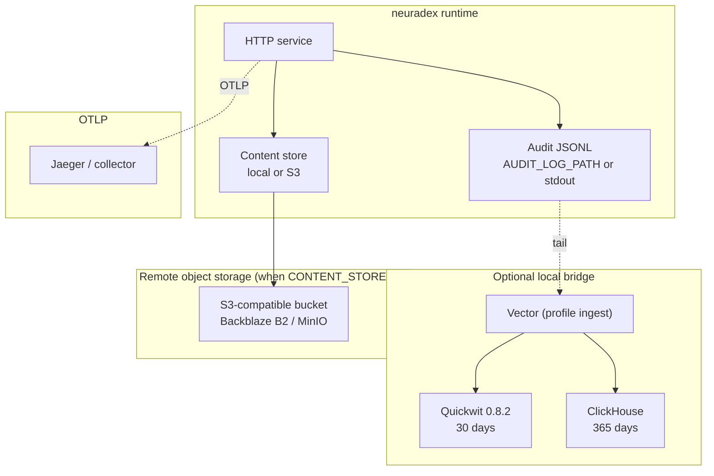

# Storage topology

**Status:** the service writes audit JSONL and, when enabled, local/S3 content packs. The
Quickwit/ClickHouse/MinIO compose stack is implemented; the B2 event archive and hourly request
index are target design, not service writes.

## Topology



## What the service writes

| Output | Location | Status |
| --- | --- | --- |
| Audit events | `AUDIT_LOG_PATH` file, or stdout when unset/`-` | implemented |
| Content packs | `packs/{operation}/{yyyy-mm-ddTHH}/{pid}-{sequence}.pack` in the local root or S3 bucket | implemented when `CONTENT_STORE` is `local`/`s3` |
| Large content objects | `objects/{blake3}` in the same store | implemented at the 30 MiB threshold |
| Hourly request index | Object store | future; not written by the service |
| Hourly event archive | Object store | future; not written by the service |

The service does not configure bucket lifecycle rules. `CONTENT_RETENTION_DAYS` is a policy
value that is logged at startup; retention enforcement is an external B2/S3 lifecycle concern.
[`hack/content-lifecycle.sh`](../../hack/content-lifecycle.sh) generates and applies the B2
policy outside the service.

## Store responsibilities

| Store | Data | Retention | Source of truth? | Rebuild from |
| --- | --- | --- | --- | --- |
| Local content root | Packs and objects | Operator-managed | Yes for content | Original write only |
| S3 bucket (`CONTENT_STORE=s3`) | Packs and objects | B2/S3 lifecycle | Yes for content | Original write only |
| Audit JSONL file / stdout | One event per request | Operator-managed | Yes for audit events | Original write only |
| Quickwit | Hot event documents (optional Vector) | 30 days | No | Replay the JSONL |
| ClickHouse | Typed rows + daily aggregates (optional Vector) | 365 days | No | Replay the JSONL |
| Jaeger | Local traces | Process lifetime | No | Re-run request |

## Bucket and prefix layout

The current service writes:

```text
<content root or s3://CONTENT_S3_BUCKET/CONTENT_S3_PREFIX>/
  packs/{operation}/{yyyy-mm-ddTHH}/{pid}-{sequence}.pack
  objects/{blake3}
```

Examples:

```text
packs/fetch-response/2026-11-10T12/4242-0.pack
packs/search-request/2026-11-10T12/4242-1.pack
packs/search-response/2026-11-10T12/4242-2.pack
objects/9f2c...
```

The target design additionally calls for an hourly request index and hourly event archive; those
prefixes are not written by the service yet. The local MinIO buckets are `neuradex-content` and
`neuradex-quickwit`; the latter is reserved for future Quickwit remote storage.

## Consistency and durability

| Store | Write visibility | Durability | Notes |
| --- | --- | --- | --- |
| Local content root | Immediate | Local disk; not replicated | Dev/single-host use |
| S3-compatible bucket | Read-after-write for new objects | Provider-dependent | Pack keys are unique; no overwrite of a sealed pack |
| Audit JSONL | Synchronous flush per event | Local file/stdout | No rotation; append on restart |
| Quickwit | After commit (10 s local) | Derived | Rebuildable from JSONL |
| ClickHouse | After insert batch | Derived | Rebuildable from JSONL |

Current write order:

1. The request handler appends a body to the content writer (hash/compress/pack).
2. The audit event is emitted with a content reference; the reference key is the pack key or
   `objects/{blake3}`.
3. Every 5 seconds (and once at shutdown) the content writer flushes, sealing open packs and
   uploading them. The reference is durable only after that upload.
4. Optional Vector tails the audit JSONL into Quickwit/ClickHouse.

There is no request index and no per-request manifest. A pack reference resolves by searching the
pack footer for the BLAKE3 hash; the event carries the pack key and hash.

## Data classification

| Data | Classification | Access |
| --- | --- | --- |
| Page bodies / search request-response JSON | Restricted; may contain PII | Future audited read API; local/S3 credentials otherwise |
| Event metadata | Internal/restricted | `audit.reader` (future read API) |
| Header HMACs | Restricted | `audit.reader` |
| Aggregates | Internal | `analyst` |
| Traces | Internal; may contain URLs | OTLP backend access |
| Credentials | Secret | Secret manager; never in events |

## Failure domains

| Domain | Failure | Impact | Mitigation |
| --- | --- | --- | --- |
| Local content root | Disk full/unwritable | Content writes fail; requests continue | Free space; monitor; content is best-effort |
| S3 endpoint | API outage | Uploads fail; sealed items stay queued | Retry on next flush; monitor |
| S3 bucket | Lifecycle misconfig | Early data loss | Restrict lifecycle changes; audit |
| Audit file path | Parent missing/unwritable | Startup fails | Create the parent; fix permissions |
| Quickwit node | Crash/corrupt index | Hot search down | Recreate/replay from JSONL |
| ClickHouse node | Crash/disk full | Analytics down | Replay from JSONL; restore DDL |
| Vector | Stopped/misconfigured | Local hot/analytics stops | Restart; JSONL remains |
| Clock | Skew | Pack hour key differs; still unique | NTP |

## Local vs production

| Aspect | Local | Production |
| --- | --- | --- |
| Content store | `CONTENT_STORE=local` (default off) or MinIO via `s3` | B2 S3 API or another S3-compatible store |
| Content credentials | `neuradex` / `neuradex-local-secret` for MinIO | Scoped application keys |
| Audit output | `AUDIT_LOG_PATH=.local/neuradex/events.jsonl` or stdout | Managed file/log collector |
| Quickwit storage | File under named volume | S3-backed splits + metastore (TBD) |
| ClickHouse | Single node, local user | Cluster/managed (TBD), TLS |
| Traces | Jaeger in-memory | OTLP collector/backend (TBD) |
| TLS | none | required |
| Retention | Operator-managed | Lifecycle + TTL |

## S3 configuration

The service uses explicit `CONTENT_S3_*` settings; it does **not** read the standard AWS
environment variables.

```sh
export CONTENT_STORE=s3
export CONTENT_S3_ENDPOINT=https://s3.us-west-004.backblazeb2.com
export CONTENT_S3_REGION=us-west-004
export CONTENT_S3_BUCKET=neuradex-content
export CONTENT_S3_ACCESS_KEY_ID=...
export CONTENT_S3_SECRET_ACCESS_KEY=...
export CONTENT_S3_PREFIX=neuradex
export CONTENT_S3_FORCE_PATH_STYLE=true
```

For MinIO locally:

```sh
export CONTENT_STORE=s3
export CONTENT_S3_ENDPOINT=http://127.0.0.1:9000
export CONTENT_S3_REGION=us-east-1
export CONTENT_S3_BUCKET=neuradex-content
export CONTENT_S3_ACCESS_KEY_ID=neuradex
export CONTENT_S3_SECRET_ACCESS_KEY=neuradex-local-secret
export CONTENT_S3_FORCE_PATH_STYLE=true
```

`CONTENT_S3_FORCE_PATH_STYLE` defaults to `true`; B2 and MinIO need path-style addressing.
`CONTENT_S3_PREFIX` is optional and has surrounding slashes stripped. Use HTTPS outside the
local MinIO stack.

## Object lifecycle

The service does not configure lifecycle rules. For production,
[`hack/content-lifecycle.sh`](../../hack/content-lifecycle.sh) generates the B2 policy for
`packs/`, `objects/`, `index/`, and `events/` from `CONTENT_RETENTION_DAYS`, including the
hide/delete pair B2 requires. This is external to the service and should be reviewed like any
retention change; see [deployment.md](../operations/deployment.md#retention). There is no
per-request deletion.

## Security

- Buckets/directories are private. No public access, no presigned URLs in logs.
- Content credentials can put/get/head/list; lifecycle/admin credentials are separate.
- TLS to remote object storage; SSE at rest for B2. Customer-managed keys are an open question.
- The local stack uses root MinIO credentials and plain HTTP; it is for synthetic data only.
- See [access-security.md](access-security.md) and [RFD 0009](../rfd/0009-access-and-read-audit.md).
