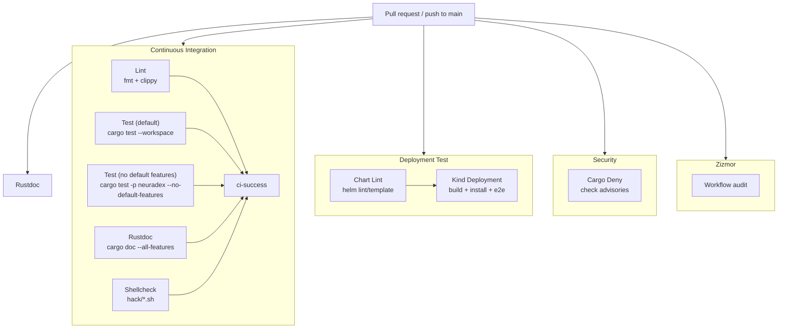

# CI

The CI is GitHub Actions. `ci-success` is the branch-protection check; it aggregates the
required jobs. This page explains what runs, what blocks, and what a docs/compose PR triggers.

## Pipeline

`ci-success` is the only required check for branch protection. It fails if any of lint, either
test matrix job, rustdoc, or shellcheck fails.

## Jobs

| Workflow | Job | Runs on | What it does | Blocks merge? |
| --- | --- | --- | --- | --- |
| `continuous-integration.yaml` | `Lint / Formatting` | PR + main | `cargo fmt --check` | via `ci-success` |
| `continuous-integration.yaml` | `Lint / Clippy` | PR + main | `cargo clippy --all-targets --workspace -- -D warnings` | via `ci-success` |
| `continuous-integration.yaml` | `Test (default)` | PR + main | `cargo test --workspace` | via `ci-success` |
| `continuous-integration.yaml` | `Test (no default features)` | PR + main | `cargo test -p neuradex --no-default-features` | via `ci-success` |
| `continuous-integration.yaml` | `Rustdoc` | PR + main | `RUSTDOCFLAGS=-D warnings cargo doc --workspace --no-deps --all-features` | via `ci-success` |
| `continuous-integration.yaml` | `Shellcheck` | PR + main | `shellcheck hack/*.sh` | via `ci-success` |
| `continuous-integration.yaml` | `CI Success` | PR + main | Aggregates the above | **yes** |
| `deployment-test.yaml` | `Chart Lint` | PR + main | `helm lint`/`helm template` variants | yes (own check) |
| `deployment-test.yaml` | `Kind Deployment` | PR + main | Build image, kind cluster, chart install, hermetic e2e suite | yes (own check) |
| `security.yaml` | `Cargo Deny` | PR + main + weekly | `cargo deny check advisories` | yes (own check) |
| `doc.yaml` | `Documentation` | reusable | Builds rustdoc; uploads only on main | via `ci-success` |
| `zizmor.yaml` | `Zizmor Audit` | PR + main | Workflow security audit (SARIF) | not blocking by default |
| `container-image.yaml` | `Publish Image` | push to main | GHCR image, SBOM, provenance | not a PR gate |

## What a docs/compose PR runs

The Kind job has a scope check:

- If every changed file is `*.md` or under `docs/`, it skips the image build and cluster, and
  still reports success.
- A PR that also changes `compose.yaml` or `hack/` is **not** docs-only. The Kind job builds the
  image, installs the chart, and runs the e2e suite, so expect the full runtime.
- The Rust jobs run regardless. A PR that does not touch `crates/` or `Cargo.toml` still runs
  the full test matrix and rustdoc.

## Local equivalents

Install mise first (see [local-development.md](local-development.md#prerequisites)), then run
`mise install --locked` once and use the tasks below. `mise run check` runs all seven gated
tasks. Each task wraps the raw command in [testing.md](testing.md#before-a-pr), which is still
available when debugging a failure.

| CI job | Local command |
| --- | --- |
| Formatting | `mise run fmt` |
| Clippy | `mise run clippy` |
| Test (default) | `mise run test` |
| Test (lean) | `mise run test-lean` |
| Rustdoc | `mise run doc` |
| Shellcheck | `mise run shellcheck` |
| Cargo Deny | `mise run deny` |
| Chart lint | `mise exec -- helm lint chart/neuradex --set kagiSessionToken=ci-dummy` |
| Kind e2e | `mise exec -- ./hack/e2e.sh` (see [testing.md](testing.md#kind-end-to-end-e2e)) |
| Compose config | `docker compose config --quiet` |
| Workflow audit | `zizmor .github/workflows` (if installed) |

Tool versions and mise backends live in `mise.toml`; per-platform URLs and checksums live in
`mise.lock`. Install them with `mise install --locked`. CI puts the pinned tools on `PATH` with
`jdx/mise-action`; each job's `install_args` names only the tools that job runs, and the steps
invoke those binaries directly. Docker build tools are the exception: they live in
`mise.docker.toml`/`mise.docker.lock`. The image copies the digest-pinned official mise binary
and runs `MISE_ENV=docker mise install --locked`, so the tools' checksums are verified before
they run. Renovate manages both mise config/lock pairs with a 7-day minimum release age.

`mise.toml` keeps the short names in `[tools]` and maps them to the GitHub backends in
`[tool_alias]`, so workflow `install_args` and local commands stay short (`shellcheck`,
`cargo-deny`, `kind`, `helm`). Renovate's mise manager resolves those short names through its
own registry data rather than reading `[tool_alias]`; `mise lock` applies the alias when it
refreshes the lockfile.

`mise.toml` sets `use_versions_host = false`, so a manual `mise lock` takes GitHub-backed
checksums from the GitHub release metadata or checksum assets instead of mise's metadata mirror;
every download is then verified against `mise.lock`. Helm is the one non-GitHub artifact: GitHub
is its version source, but the archive comes from the official `get.helm.sh` mirror, whose
published `.sha256sum` is recorded in `mise.lock`.

Renovate's safe-mode `mise lock` refresh can mark an updated entry with
`checksum_source = "mise-versions"`; the checksum value still matches GitHub and installs verify
it. Enforcing GitHub-only provenance requires allowing `MISE_USE_VERSIONS_HOST=false` in a
self-hosted Renovate deployment (`allowedEnv`), or allowing `mise` unsafe execution so the
project setting applies.

## Gates and policy

| Gate | Policy |
| --- | --- |
| Warnings | Clippy warnings are must-fix (`-D warnings`) |
| Rustdoc | Warnings are errors (`RUSTDOCFLAGS=-D warnings`) |
| Formatting | `cargo fmt --check` must pass |
| Tests | Both feature matrix jobs must pass |
| Shell scripts | `shellcheck hack/*.sh` must pass |
| Advisories | `cargo deny check advisories` must pass; licenses/bans/sources are not gating |
| Workflows | Third-party actions must be SHA-pinned; zizmor audits |
| Branch protection | `ci-success` is the required check |

## Code style

`cargo fmt --check` and Clippy enforce formatting and lints, not module layout or naming. Follow
[style.md](style.md):

- Use `foo.rs` + `foo/bar.rs`; do not add `foo/mod.rs`.
- Do not use `#[path]` to work around the layout.
- Modules are `snake_case`; types/traits are `UpperCamelCase`; functions/methods are
  `snake_case` (Rust API Guidelines naming).
- Use `crate::` / `super::` / `self::` paths; `extern crate` is not needed.

This follows the Rust 2018 Edition Guide's
[Path and module system changes](https://doc.rust-lang.org/edition-guide/rust-2018/path-changes.html)
and the Rust Style Guide's advice to avoid `#[path]`. Reviewers enforce it; there is no CI lint for
module layout.

## Docs and compose changes

- Markdown is not linted by CI. Keep links relative and test them with a local link checker if
  you have one.
- YAML/TOML/DDL/SQL are not linted by CI. Run `docker compose config --quiet` and the
  Quickwit/ClickHouse/Vector validations from [testing.md](../development/testing.md).
- `hack/*.sh` is shellchecked. If you add a shell script outside `hack/`, it is not checked;
  put it in `hack/` or extend the workflow.
- The `Dockerfile` copies `Cargo.toml`, `Cargo.lock`, `crates/`, `mise.docker.toml`, and
  `mise.docker.lock`; a new build-time file must be added there. Docs and compose do not affect
  the image.
- A change to `chart/` triggers Helm lint/template. A change to `hack/e2e.sh`, its fixtures, or
  an API contract should be reflected in the Kind e2e run.

## Cache and runtime

- Rust builds use `Swatinem/rust-cache` with separate keys for clippy, tests, and rustdoc.
- `wreq` compiles BoringSSL; `cmake`, `clang`, and `libclang-dev` are installed in the jobs
  that build it.
- The Kind job uses a registry build cache on main only; PRs read the cache but do not write it.
- Full builds are slow. Iterate locally with targeted tests (`cargo test -p <crate> <name>`)
  before pushing.

## Failure playbook

| Failure | Likely cause | Fix |
| --- | --- | --- |
| Clippy `-D warnings` | New lint in changed code | Fix or justify an allow at the workspace level (rare) |
| Rustdoc | Missing `# Errors`/docs on a public item | Add docs; `missing_docs` is warn workspace-wide |
| `cargo test --workspace` | Test failure in a crate | Run the crate test locally with `--nocapture` |
| Lean test | A `docs`-gated item used unconditionally | Gate the code or the test |
| Shellcheck | Quoting/portability | Fix the script; keep `hack/` scripts POSIX-ish |
| Kind Deployment | Image/chart/e2e failure | Run `mise exec -- ./hack/e2e.sh` against a local kind cluster; inspect the namespace it leaves behind |
| Chart Lint | Missing `kagiSessionToken` or `existingSecret` | Pass `--set kagiSessionToken=ci-dummy` |
| Cargo Deny | New advisory | Update the dependency or document an exception in `deny.toml` |
| Zizmor | Unpinned action or unsafe workflow | Pin to a SHA and fix the finding |
