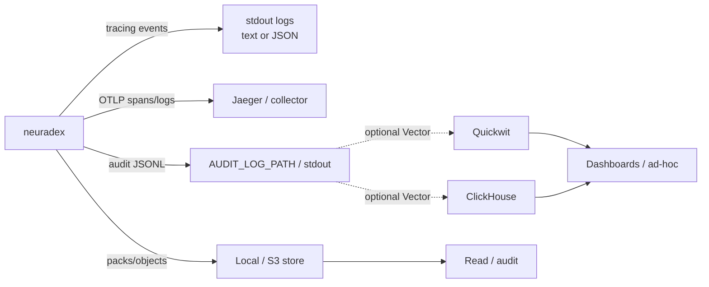

# Observability

**Status:** structured logs, OpenTelemetry spans, and JSONL audit events exist in the service.
Content references appear when `CONTENT_STORE` is enabled. The Quickwit/ClickHouse pipeline is
an optional local Vector bridge; metrics/alerts below are partly target design.

## Signal flow



There are three planes:

| Plane | Signal | Retention | Use |
| --- | --- | --- | --- |
| Logs | `RUST_LOG`, JSON fields | Log platform | Debugging one request |
| Traces | OTLP spans | Jaeger local / backend | Latency and call graph |
| Audit events | JSONL file/stdout; optional Vector to Quickwit/ClickHouse | Operator-managed; 30/365 in the local stack | Accountability, analytics, capacity |

Do not use logs as the audit record. A log line can be sampled or dropped; an audit event is the
record.

## What exists today

| Signal | Where | Notes |
| --- | --- | --- |
| `neuradex.http.request` tracing event | stdout / OTel logs | Route, path, status, duration, error type |
| HTTP server span | OTel traces | `http.route`, status, duration |
| Outbound HTTP client spans | OTel traces | Sanitized `url.full`, upstream host/port, status, protocol |
| Search span | OTel traces | Query length, timeout, queue ms, result count |
| Audit events | JSONL file/stdout, one per request except `/healthz` | Synchronous, flushed per event |
| Content packs/objects | `CONTENT_STORE` local/S3 | 5-second flush; off by default |
| `/healthz` | HTTP | 204; not audited |
| `/openapi.json` | HTTP | Always served |
| `/docs` | HTTP | Feature-gated |

The service does **not** expose a Prometheus `/metrics` endpoint. Metrics below are derived from
audit events/ClickHouse or must be added as OTel metrics later.

### Log fields

`LOG_FORMAT=json` emits flattened tracing fields. The request event includes:

| Field | Meaning |
| --- | --- |
| `http.request.method` | HTTP method |
| `http.route` | Matched route template (empty for 404) |
| `url.path` | Raw path (no query string) |
| `http.response.status_code` | Final status |
| `neuradex.http.request.duration_ms` | Duration |
| `error.type` | Status code string for 4xx/5xx; low-cardinality transport error otherwise |
| `trace_id` / `span_id` | Correlation (in the JSON formatter/OTel) |

Never log `Authorization`, cookies, query text, or bodies. Use the audit event for structured
request metadata.

## SLOs

| SLO | Target | Measurement |
| --- | --- | --- |
| API availability | 99.9% monthly | Non-5xx / total requests |
| Fetch latency p95 | < 2 s (excluding upstream) | `http_duration_ms` by route |
| Search queue wait p95 | < 1 s | `queue_ms` |
| Audit event completeness | ≥ 99.99% of requests | Events vs request count |
| Event searchability | < 30 s p95 (local Vector path) | Request timestamp vs Quickwit ingest lag |
| Content capture rate | ≥ 99.9% of successful fetches | fetch events with `content_reference_count > 0` / fetch events |
| Content read availability | 99.9% | Read API success |
| Read audit completeness | 100% of reads (future) | Read audit count vs read requests; not in schema 1.0.0 |

The content capture SLO excludes `client_disconnect`, `upstream_error`, and policy-shed cases;
report those separately. An SLO that hides shedding is not useful.

## Dashboards and queries

### Request health

```sql
SELECT
    toStartOfFiveMinute(timestamp) AS t,
    http_route,
    count() AS requests,
    countIf(http_status >= 500) AS errors,
    quantile(0.95)(http_duration_ms) AS p95_ms,
    quantile(0.99)(http_duration_ms) AS p99_ms
FROM neuradex.events
WHERE operation_type IN ('fetch', 'peek', 'search', 'openwebui_search')
  AND timestamp >= now() - INTERVAL 6 HOUR
GROUP BY t, http_route
ORDER BY t;
```

### Audit completeness

```sql
-- Compare event rows with an independent request counter if one exists.
-- Otherwise, watch for gaps in the event_id sequence and audit_sink warnings in logs.
SELECT
    toStartOfHour(timestamp) AS hour,
    count() AS events,
    uniqExact(event_id) AS unique_events,
    count() - uniqExact(event_id) AS duplicates
FROM neuradex.events
WHERE timestamp >= now() - INTERVAL 24 HOUR
GROUP BY hour
ORDER BY hour;
```

### Content

```sql
SELECT
    toStartOfHour(timestamp) AS hour,
    countIf(content_reference_count > 0) AS captured,
    countIf(content_reference_count = 0) AS missing,
    sum(content_bytes) AS bytes,
    countIf(truncated) AS truncated,
    quantile(0.95)(content_bytes) AS p95_bytes
FROM neuradex.events
WHERE operation_type = 'fetch' AND timestamp >= now() - INTERVAL 24 HOUR
GROUP BY hour
ORDER BY hour;
```

### Capture errors

```sql
-- Capture reasons are not in schema 1.0.0. Until a capture-status field exists, compare
-- fetch requests with and without a content reference, then inspect logs for the reason.
SELECT
    countIf(content_reference_count = 0) AS fetch_without_content,
    countIf(content_reference_count > 0) AS fetch_with_content
FROM neuradex.events
WHERE operation_type = 'fetch'
  AND timestamp >= now() - INTERVAL 24 HOUR;
```

### Read audit

```sql
-- Read audit is future work (RFD 0009). The current schema has no auth_subject/read_action
-- fields. When it lands, use a query like this:
--
-- SELECT hour, auth_subject, read_action, count() AS reads, sum(read_bytes) AS bytes
-- FROM neuradex.events
-- WHERE event IN ('audit.read', 'content.read')
-- GROUP BY hour, auth_subject, read_action
-- ORDER BY bytes DESC;
```

## Alerts

| Alert | Condition | Severity | First check |
| --- | --- | --- | --- |
| API 5xx rate | > 1% for 5 min | page | Service logs, upstreams |
| Upstream error spike | `outcome=upstream_error` > 5% for 10 min | page | Kagi/web status |
| Event lag | event `timestamp` to Quickwit visibility > 5 min p95 | page | Quickwit ingest/commit |
| Audit JSONL write failure | any | page | Disk/permissions |
| Event drop counter | any increase | page | Audit-loss incident |
| Content flush failure | > 1% for 15 min | ticket | Local/S3 store |
| Content capture rate | < 99% of successful fetches for 15 min | ticket | Capture errors (logs; no status field yet) |
| Pack upload failures | > 1% for 15 min | ticket | B2/credentials |
| Pack count anomaly | > 50% above model for 3 days | ticket | Body sizes/seal bug |
| Hash mismatch | any non-transient | page | Integrity incident |
| Archive missing | closed hour + 15 min | page | Archive writer |
| Request index missing | > 1 per hour | page | Index writer |
| ClickHouse insert failures | > 0 for 5 min | ticket | ClickHouse |
| Quickwit search errors | > 1% for 5 min | ticket | Quickwit |
| Read audit failure | any (future) | page | Access path |
| Break-glass issuance | any | notify security | Review within 1 day |
| Retention deletion spike | objects deleted > 10% above model | ticket | Lifecycle |

Alert thresholds are starting points. Tune them after two weeks of real traffic; do not remove
an alert without a replacement signal.

## Traces

The service uses stable HTTP semantic conventions:

| Span | Name | Key attributes |
| --- | --- | --- |
| Server | `<method> <route>` | `http.route`, `http.response.status_code`, `error.type`, duration |
| Client | `<method>` | `url.full` (sanitized), `server.address`, `server.port`, `http.response.status_code`, `network.protocol.version` |
| Search | `search` | `neuradex.search.query.length`, `timeout_s`, `queue_ms`, `result_count` (existing service span) |

`url.full` redacts userinfo, fragment, and query values; query keys remain. Do not add raw
headers or bodies to spans. A trace can be sampled; the audit event cannot.

Local:

```sh
export OTEL_EXPORTER_OTLP_ENDPOINT=http://127.0.0.1:4318
export OTEL_SERVICE_NAME=neuradex
cargo run
# Open http://127.0.0.1:16686, service "neuradex".
```

Disable export for quiet local runs:

```sh
export OTEL_SDK_DISABLED=true
```

## Log levels

| `RUST_LOG` | Use |
| --- | --- |
| `info` (default) | Normal operations |
| `neuradex=debug` | Request-level detail |
| `axum::rejection=trace` | Diagnose unexpected 400s |
| `quickwit=debug` | Local Quickwit client debugging (if instrumented) |

Do not run production at `debug` for long; it can leak more metadata and costs volume.

## Health checks

| Endpoint | Expect | Notes |
| --- | --- | --- |
| `GET /healthz` | 204 | Liveness; not audited; excluded from request events |
| `GET /openapi.json` | 200 JSON | Always served |
| `GET /docs` | 200 HTML | Only with the `docs` feature |

There is no readiness endpoint for the audit sinks. The service is designed to serve while the
sinks are down; readiness should reflect the HTTP path, not B2/Quickwit/ClickHouse.

## Dashboards to build

1. **Golden signals:** requests, errors, p95/p99 by route.
2. **Audit pipeline:** audit JSONL writes, Vector lag (optional), duplicates.
3. **Content pipeline:** capture rate, bytes/day, p50/p95/p99 body size, truncation, upload
   failures, pack count, compression ratio, dedupe rate.
4. **Access:** read audit by principal/action/bytes, denied requests, break-glass.
5. **Cost:** bytes/day vs model, pack count/day, B2 object count, retention countdown.
6. **Local:** compose health, Quickwit commit lag, ClickHouse insert errors, Vector errors.

## Open questions

| Question | Why it is open | Trigger |
| --- | --- | --- |
| Do we add OTel metrics or derive all metrics from ClickHouse? | OTel metrics are cheaper for live alerts; ClickHouse is already there | Decide with the first pipeline implementation |
| What is the production trace sampling rate? | Cost vs debuggability | Observability review |
| Where do production traces live? | Jaeger is local only | Deployment review |
| What is the on-call rotation? | Not defined in this repo | Operations review |
| How long do we retain application logs? | Different from audit retention | Security/ops review |
