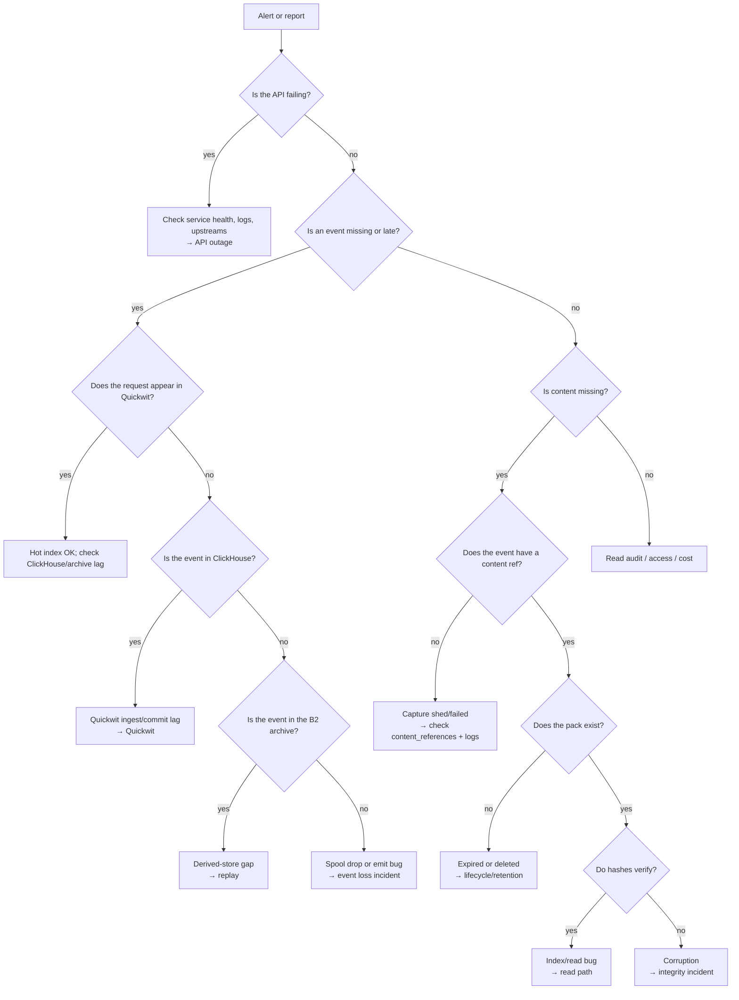

# Runbook

This runbook covers the target production stores (B2, Quickwit, ClickHouse) and the local
compose stack. The current service writes audit events as JSONL to `AUDIT_LOG_PATH` (or stdout)
and content to `CONTENT_STORE` local/S3; Quickwit/ClickHouse sections apply when the optional
Vector bridge is running. The service does not write an event spool, request index, or event
archive yet. Commands use `$B2_BUCKET`, `$B2_ENDPOINT`, `$QW`, `$CH`, and `$CH_AUTH` as
placeholders. Do not paste real credentials into a ticket.

## Triage decision tree



## First response

1. Identify the affected `request_id` (or the time window/route).
2. Check the API is healthy: `curl -sS -o /dev/null -w '%{http_code}' https://<host>/healthz`
   (expect 204).
3. Check the event in Quickwit, ClickHouse, and the archive (decision tree).
4. Check the content ref and pack (if content is involved).
5. Record the timeline and the data classification in the incident ticket.
6. Escalate per the table at the end.

Never delete a pack, index, or table to "fix" a lookup. Preserve evidence.

## Events are missing or late

### Quickwit (hot)

```sh
# Search by request_id. Quote values with punctuation.
curl -sS -XPOST "$QW/api/v1/neuradex-events/search" \
  -H 'content-type: application/json' \
  -d '{"query":"request_id:\"<request-id>\"","max_hits":5}' | jq '{num_hits, hits: [.hits[]._source]}'

# Recent errors by route.
curl -sS -XPOST "$QW/api/v1/neuradex-events/search" \
  -H 'content-type: application/json' \
  -d '{"query":"http.status:>=500","max_hits":10}' | jq '.hits[]._source | {timestamp, http, operation, error_type}'
```

If the event is absent, wait at least `commit_timeout_secs` (10 s locally) plus processing. If it
is still absent, check the Quickwit indexer log for `doc mapper parse error`. A field with the
wrong type (e.g. headers sent as a string instead of an object) is rejected and the document is
lost from the hot index.

### ClickHouse (analytics)

```sh
curl -sS "$CH/?$CH_AUTH" --data-binary \
  "SELECT event, request_id, operation_type, http_status, http_route, outcome,
          content_reference_count, content_bytes, content_references
   FROM neuradex.events WHERE request_id = '<request-id>' FORMAT Vertical"
```

If the row is missing but Quickwit has it, the insert failed or lagged. Check the Vector/service
logs and the ClickHouse error log. If the row exists but the daily view does not, check the
materialized view definition and the `events_daily` table.

### B2 archive (cold truth)

```sh
aws --endpoint-url "$B2_ENDPOINT" s3 ls "s3://$B2_BUCKET/events/v1/date=<YYYY-MM-DD>/hour=<HH>/"
aws --endpoint-url "$B2_ENDPOINT" s3 cp "s3://$B2_BUCKET/events/v1/date=<YYYY-MM-DD>/hour=<HH>/events-*.ndjson.zst" - \
  | zstd -d | jq -c 'select(.request_id == "<request-id>")'
```

- Archive objects are written after the hour closes plus a grace window. An empty hour is not
  automatically a bug.
- Late events keep their original `timestamp` but live in the next hour's object. Search the
  next hour too.
- If the event is in the archive but not in Quickwit/ClickHouse, replay (below).

### Event loss

If the event is in none of the three stores:

1. Check the service log for `audit_sink` errors and confirm `AUDIT_LOG_PATH` is writable. The
   service has no event spool; a failed JSONL write is logged and the event is not retried.
2. Check whether the request was `/healthz` (not audited) or a rejected request that failed
   before the event builder.
3. Treat it as an audit-loss incident. Preserve logs and the request ID; do not backfill an
   event you cannot reconstruct.

## Content is missing

1. Read the event's `content_references` array. Each entry has `storage`, `key`, `blake3`,
   `sha256`, `size`, and optional `content_type`. There is no `content_captured` boolean or
   `content_capture_error` field in schema 1.0.0.
2. If the array is absent/empty, the body was not stored. The reason is in the content-plane
   logs (body over limit, client disconnect, upstream error, store/upload failure), not in the
   event. A future capture-status field is an open question.
3. If a reference exists and the pack is missing:
   - Check lifecycle: has the object aged past 365 days?
   - Check B2 for the reference's `key`:
     `aws --endpoint-url "$B2_ENDPOINT" s3 ls "s3://$B2_BUCKET/<key>"`.
   - If it was deleted early, open a retention/lifecycle incident. Do not attempt to recreate
     the body from the event; it is not there.
4. If the pack exists but the read fails verification, see [Hash mismatch](#hash-mismatch).
5. The frame offset/length are in the hourly request index, not in the event.

## Pack upload failures

Symptoms: upload error rate, growing temporary content files, content-plane logs.

1. Check B2 status and credentials. A 403 usually means a scoped key was rotated or lacks
   `PutObject`; a 5xx is B2-side.
2. Check the object key and size:
   ```sh
   aws --endpoint-url "$B2_ENDPOINT" s3api head-object \
     --bucket "$B2_BUCKET" --key "packs/<operation>/<YYYY-MM-DDTHH>/<pid>-<sequence>.pack"
   ```
3. Check the local content root and system temporary directory. A full disk turns upload failures into lost content.
4. If uploads succeed but index writes fail, packs are orphans. Reconcile:
   - List packs under the hour.
   - List index objects under the hour.
   - For each pack with no index entry, check the archive for request IDs and rebuild the
     index entry. Do not delete the pack.
5. If the provider is down for an extended period, shed content (not events) and mark the
   degradation. Do not block requests.

## Hash mismatch

Symptoms: `content.read` failure, `XXH3 mismatch`, `BLAKE3 mismatch`, `SHA-256 mismatch`.

1. Capture the pack ID, frame offset, frame length, and expected hashes from the event.
2. Re-read the exact range. A transient network error can truncate a range GET; retry once.
3. Recompute XXH3 over the compressed payload and BLAKE3/SHA-256 over the decompressed bytes.
   A mismatch is corruption or a format bug, not a content change.
4. Do not return unverified bytes. Return a typed 502/410 and record the failure.
5. Check whether other frames in the same pack fail. One frame suggests a write/read bug; many
   frames suggest pack corruption or a bad upload.
6. Preserve the pack and the event. Open an integrity incident; do not overwrite the pack.

## Quickwit is down

Symptoms: search 5xx, ingest errors, `quickwit` unhealthy.

1. Check `docker compose ps quickwit` (local) or the Quickwit pod/service (prod).
2. Check the log for disk full, metastore errors, or a bad index config.
3. The API is unaffected; the service keeps writing JSONL locally. Do not stop the service.
4. If the index is corrupt or deleted, recreate it from `hack/quickwit/neuradex-events.yaml`
   and replay from the B2 archive. Quickwit mappings are not mutable in place; use a new index
   and swap the query target.
5. Replay must be idempotent. A duplicate document is acceptable; a missing hour is not.

## ClickHouse is down

Symptoms: insert errors, query 5xx, disk full.

1. Check the pod/container and the error log.
2. If the disk is full, drop expired partitions (TTL should do this) or expand the volume. Do
   not delete the `events` table.
3. The API is unaffected; the service keeps writing JSONL locally. Do not stop the service.
4. If the schema drifted, add the missing column and replay the affected window. Vector's
   `skip_unknown_fields` drops unknown keys silently; check the mapping before replaying.
5. If the table is lost, recreate it with `hack/clickhouse/init.sql` and replay from the archive.

## Archive gap

Symptoms: no object for a closed hour, or a completeness check fails.

1. Confirm the hour is closed and the grace window passed.
2. Check the archive writer's spool and object store credentials.
3. Check whether a late object exists with a different `closed_at`/`writer` suffix.
4. If the events are still in the spool, flush them. If they are only in Quickwit, export the
   hour from Quickwit before its 30-day retention expires. If they are only in ClickHouse, the
   archive is incomplete; reconstruct the event JSON from ClickHouse for the fields it stores
   and mark the archive as reconstructed.
5. Do not fabricate missing fields.

## Request index gap

Symptoms: a request event has content refs but the index object for its hour is missing.

1. List the hour's index prefix.
2. If a retry object exists, use it.
3. If not, rebuild from the event archive: group events by pack ID, read each pack footer, and
   emit index records. Frame headers are self-describing; the footer/index can be rebuilt if they disagree.
4. If the archive is also missing, content lookup for that hour is unrecoverable; record the
   gap.

## Audit log or content disk is full

1. Identify the disk: the `AUDIT_LOG_PATH` filesystem, the local content root, or the system temp
   directory used by the content writer.
2. Free space or expand the volume.
3. If content writes fail, the API is still correct; requests continue without new content refs.
4. If the audit JSONL cannot be written, page immediately: this is an audit-loss incident.
5. Restarting may be required if a file handle is stuck; confirm appends resume afterward.

## Retention and lifecycle

1. Confirm the intended policy: 365 days for content/events/index/archive, 30 days for Quickwit.
2. Check B2 lifecycle rules by prefix. A rule that applies to the whole bucket can delete
   objects earlier than intended.
3. Check ClickHouse TTL: `SHOW CREATE TABLE neuradex.events` and the partition list.
4. Check Quickwit retention: the index config and the janitor log.
5. A retention change is a reviewed change. Record the ticket and the expected deletion window.
   There is no per-request deletion.

## Access and read audit

1. A 403 is a policy decision, not a bug. Check the principal's roles. Read audit is future
   work; schema 1.0.0 has no read fields.
2. A content read requires a reason; an empty reason is rejected.
3. Once read audit exists, a read that is not in it is a page: the read path may have bypassed
   the audit.
4. Break-glass: ticket + second approver + time-bound credential + security notification +
   review within one business day.
5. Do not grant direct B2 access to an analyst to work around a missing read API; fix the API.

## Local stack

| Symptom | Check | Fix |
| --- | --- | --- |
| `quickwit-init` exits 1 | `docker compose logs quickwit-init` | Fix the index YAML; delete/recreate if the mapping changed |
| Quickwit 0 hits after ingest | Wait 10 s; check `quickwit` log | Fix a parse error, usually a header type |
| ClickHouse init SQL skipped | `docker compose logs clickhouse` | `docker compose down -v` or apply DDL |
| MinIO port bind fails | `ss -ltnp \| grep 9000` | Use a port override; do not kill another user's service |
| Vector no output | `docker compose --profile ingest ps vector` | Enable the profile; check `AUDIT_LOG_PATH` and the Vector mount |
| Jaeger no traces | `OTEL_EXPORTER_OTLP_ENDPOINT` unset | Export it and restart the service |

Reset the local stack only when you accept losing its data:

```sh
docker compose down -v
rm -rf .local/neuradex
```

## Credential rotation

1. Create the new key/secret with the same least-privilege scope.
2. Deploy it to the service/ingester; keep the old one active for overlap.
3. Verify writes/reads with the new key.
4. Revoke the old key after the overlap window.
5. For the header HMAC key, keep the old version for the retention window and record a key ID.
   Do not re-HMAC old events.

## Replay

Replay reads the B2 event archive, not a derived store:

1. Select the hour(s) and verify the archive objects exist.
2. Emit NDJSON to Quickwit's ingest API and JSONEachRow to ClickHouse.
3. Deduplicate by `event_id` at query time or use a staging table.
4. Verify counts and spot-check a request.
5. Record the replay window and the source objects in the incident ticket.

## Escalation

| Severity | Examples | Notify | Response |
| --- | --- | --- | --- |
| SEV1 | Event loss, content corruption, data breach, retention misdelete | Service owner + security + on-call | Immediate |
| SEV2 | Quickwit/ClickHouse down, pack upload failing > 15 min, spool > 90% | Service owner + on-call | 30 min |
| SEV3 | Single pack read failure, one-hour archive gap, dashboard stale | Service owner | Next business day |
| SEV4 | Cosmetic docs/compose issue | Team channel | Backlog |

## Do not

- Do not delete a pack, index, table, or archive object to resolve a lookup.
- Do not return bytes that fail verification.
- Do not disable audit to improve latency.
- Do not grant direct B2 access to bypass the read API.
- Do not change lifecycle or retention without a ticket and a second reviewer.
- Do not paste bodies, cookies, tokens, or query text into a ticket or chat.
- Do not trust a client-supplied identity header.
