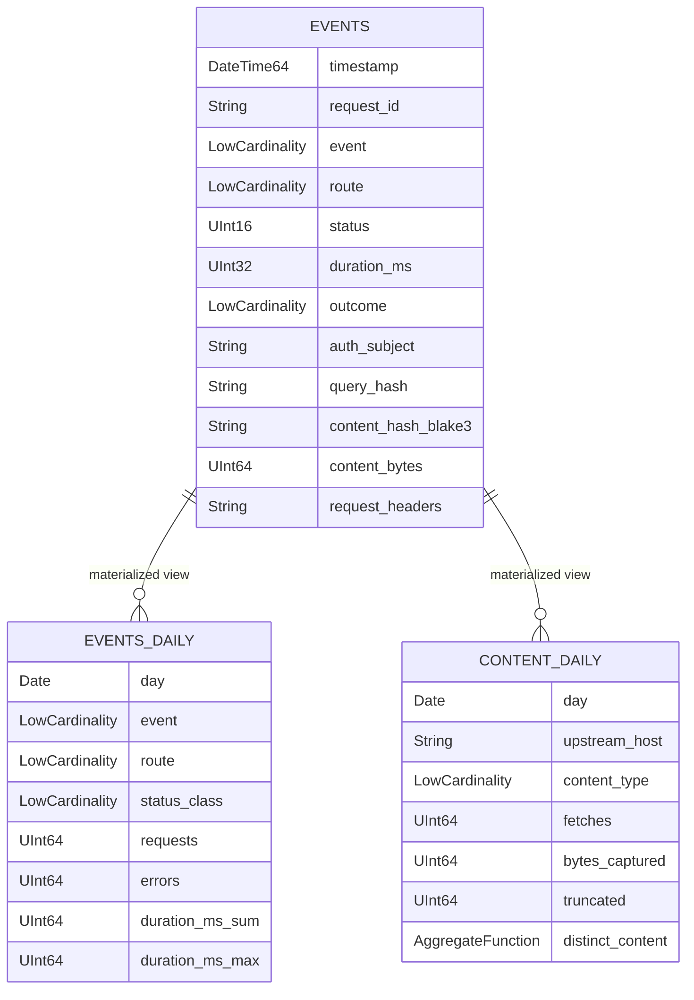

# ClickHouse schema

**Status:** implemented for the local stack in `hack/clickhouse/init.sql`; production topology is
not specified. ClickHouse is a derived analytics store, not the source of truth.

## Database and table

- Database: `neuradex`
- Table: `neuradex.events`
- Engine: `MergeTree`
- Partition: `toDate(timestamp)`
- Order: `(timestamp, request_id)`
- TTL: `timestamp + INTERVAL 365 DAY`, `ttl_only_drop_parts = 1`
- Index granularity: `8192`
- No bodies, no result snippets. `query_text` is optional and restricted.

## ER diagram



The materialized views aggregate on insert; they are not computed at query time. A row inserted
before a view existed is not backfilled automatically.

## `events` columns

### Envelope and correlation

| Column | Type | Notes |
| --- | --- | --- |
| `schema_version` | `UInt16` | `1` |
| `event` | `LowCardinality(String)` | `fetch`, `peek`, `search`, `openwebui_search`, `audit.read`, `content.*` |
| `event_id` | `String` | Unique event ID |
| `timestamp` | `DateTime64(3, 'UTC')` | Completion time |
| `request_id` | `String` | Primary correlation key |
| `trace_id` | `String` | 32 hex chars or empty |
| `span_id` | `String` | 16 hex chars or empty |

### Request

| Column | Type | Notes |
| --- | --- | --- |
| `route` | `LowCardinality(String)` | Route template; empty for 404/405 |
| `method` | `LowCardinality(String)` | HTTP method or empty |
| `status` | `UInt16` | `0` for non-HTTP events |
| `duration_ms` | `UInt32` | Milliseconds |
| `outcome` | `LowCardinality(String)` | `success`, `client_error`, … |
| `error_type` | `LowCardinality(String)` | Low-cardinality class; empty on success |
| `service_version` | `String` | Package version |

### Principal

| Column | Type | Notes |
| --- | --- | --- |
| `auth_subject` | `String` | Verified principal |
| `auth_method` | `LowCardinality(String)` | `mtls`, `oidc`, `none`, `local` |
| `user_id` | `String` | Stable user ID |

### Search

| Column | Type | Notes |
| --- | --- | --- |
| `query_text` | `String` | Restricted; empty by default |
| `query_hash` | `String` | SHA-256 hex; use for aggregates |
| `result_count` | `UInt32` | Returned results |

### Target

| Column | Type | Notes |
| --- | --- | --- |
| `target_url` | `String` | Sanitized URL |
| `upstream_host` | `String` | Final upstream host |
| `redirects_followed` | `UInt16` | Hop count |

### Content

| Column | Type | Notes |
| --- | --- | --- |
| `content_captured` | `Bool` | False is valid |
| `content_kind` | `LowCardinality(String)` | `fetch_body`, `peek_head`, empty |
| `content_hash_blake3` | `String` | 64 hex chars when captured |
| `content_hash_sha256` | `String` | 64 hex chars when captured |
| `content_bytes` | `UInt64` | Canonical bytes |
| `content_type` | `LowCardinality(String)` | Media type |
| `content_truncated` | `Bool` | Prefix hit the cap |
| `content_pack_id` | `String` | Pack ID |
| `content_frame_offset` | `UInt64` | Absolute frame offset |
| `content_frame_length` | `UInt32` | Header + payload |
| `content_capture_error` | `LowCardinality(String)` | Why content is absent |

### Headers

| Column | Type | Notes |
| --- | --- | --- |
| `request_headers` | `String` | Compact JSON text |
| `response_headers` | `String` | Compact JSON text |
| `request_headers_truncated` | `Bool` | Limit hit |
| `response_headers_truncated` | `Bool` | Limit hit |

The event carries header objects; Vector's `encode_clickhouse` transform converts them to JSON
text for these columns. Query with `JSONExtractString`/`JSONExtractArrayRaw` if needed.

### Read audit

| Column | Type | Notes |
| --- | --- | --- |
| `read_action` | `LowCardinality(String)` | `list_events`, `get_event`, `get_content`, `export_events`, `verify_pack` |
| `read_target` | `String` | Request/pack/query target |
| `read_reason` | `String` | Ticket/incident ID |
| `read_bytes` | `UInt64` | Bytes returned |

## Materialized views

### `events_daily`

Target table: `AggregatingMergeTree`, partition by month, order by
`(day, event, route, method, status_class, outcome)`, TTL 365 days.

| Column | Type |
| --- | --- |
| `day` | `Date` |
| `event` | `LowCardinality(String)` |
| `route` | `LowCardinality(String)` |
| `method` | `LowCardinality(String)` |
| `status_class` | `LowCardinality(String)` (`2xx`, `4xx`, `5xx`, `0xx`) |
| `outcome` | `LowCardinality(String)` |
| `requests` | `SimpleAggregateFunction(sum, UInt64)` |
| `errors` | `SimpleAggregateFunction(sum, UInt64)` |
| `duration_ms_sum` | `SimpleAggregateFunction(sum, UInt64)` |
| `duration_ms_max` | `SimpleAggregateFunction(max, UInt64)` |

View: `events_daily_mv` groups `events` by day/event/route/method/status_class/outcome and
writes `count()`, `countIf(status >= 500)`, `sum(duration_ms)`, `max(duration_ms)`.

Read it directly; the `SimpleAggregateFunction` values are already merged by the engine. Do not
wrap them in `sumMerge` (that is for `AggregateFunction`, not `SimpleAggregateFunction`).

### `content_daily`

Target table: `AggregatingMergeTree`, partition by month, order by
`(day, upstream_host, content_type)`, TTL 365 days.

| Column | Type |
| --- | --- |
| `day` | `Date` |
| `upstream_host` | `String` |
| `content_type` | `LowCardinality(String)` |
| `fetches` | `SimpleAggregateFunction(sum, UInt64)` |
| `bytes_captured` | `SimpleAggregateFunction(sum, UInt64)` |
| `truncated` | `SimpleAggregateFunction(sum, UInt64)` |
| `distinct_content` | `AggregateFunction(uniq, String)` |

View: `content_daily_mv` filters `event='fetch' AND content_captured AND content_hash_blake3 != ''`
and writes counts/bytes plus `uniqState(content_hash_blake3)`.

Read `distinct_content` with `uniqMerge(distinct_content)`.

## Example queries

### Error rate by route (24h)

```sql
SELECT
    route,
    count() AS requests,
    countIf(status >= 500) AS errors,
    round(errors / requests * 100, 2) AS error_pct
FROM neuradex.events
WHERE timestamp >= now() - INTERVAL 24 HOUR
  AND event IN ('fetch', 'peek', 'search', 'openwebui_search')
GROUP BY route
ORDER BY error_pct DESC;
```

### p95/p99 latency by upstream

```sql
SELECT
    upstream_host,
    count() AS requests,
    quantile(0.95)(duration_ms) AS p95_ms,
    quantile(0.99)(duration_ms) AS p99_ms
FROM neuradex.events
WHERE event = 'fetch'
  AND timestamp >= now() - INTERVAL 6 HOUR
GROUP BY upstream_host
ORDER BY requests DESC
LIMIT 20;
```

### Content bytes and sizes per day

```sql
SELECT
    toDate(timestamp) AS day,
    count() AS fetches,
    sum(content_bytes) AS bytes,
    quantile(0.5)(content_bytes) AS p50,
    quantile(0.9)(content_bytes) AS p90,
    quantile(0.99)(content_bytes) AS p99,
    countIf(content_truncated) AS truncated
FROM neuradex.events
WHERE event = 'fetch' AND content_captured
GROUP BY day
ORDER BY day;
```

### Daily rollup

```sql
SELECT
    day,
    event,
    route,
    status_class,
    sum(requests) AS requests,
    sum(errors) AS errors,
    sum(duration_ms_sum) / sum(requests) AS avg_ms,
    max(duration_ms_max) AS max_ms
FROM neuradex.events_daily
WHERE day >= today() - 30
GROUP BY day, event, route, status_class
ORDER BY day DESC, requests DESC;
```

### Distinct content per day

```sql
SELECT
    day,
    upstream_host,
    sum(fetches) AS fetches,
    sum(bytes_captured) AS bytes,
    uniqMerge(distinct_content) AS distinct_hashes
FROM neuradex.content_daily
WHERE day >= today() - 30
GROUP BY day, upstream_host
ORDER BY bytes DESC;
```

### Read audit

```sql
SELECT
    toStartOfDay(timestamp) AS day,
    auth_subject,
    read_action,
    count() AS reads,
    sum(read_bytes) AS bytes
FROM neuradex.events
WHERE event IN ('audit.read', 'content.read')
GROUP BY day, auth_subject, read_action
ORDER BY bytes DESC;
```

## Ingestion

### Vector

`hack/vector/neuradex-events.toml` uses the `clickhouse` sink with:

- `endpoint = http://clickhouse:8123`
- `database = neuradex`
- `table = events`
- `format = json_each_row`
- `skip_unknown_fields = true`
- `date_time_best_effort = true`
- basic auth `neuradex` / local secret

Vector sends header objects through the `encode_clickhouse` transform, so the columns receive
JSON strings. If you add a field, add the column before enabling it; otherwise
`skip_unknown_fields` drops it silently.

### Direct insert

```sh
curl -sS 'http://127.0.0.1:8123/?user=neuradex&password=neuradex-local-secret&query=INSERT%20INTO%20neuradex.events%20FORMAT%20JSONEachRow' \
  --data-binary @event.ndjson
```

For `DateTime64`, either send `2026-11-10 12:34:56.789` or enable
`date_time_best_effort` in the ingester. RFC 3339 with `T`/`Z` is parsed by Vector, not always by
a raw ClickHouse insert.

## Retention and operations

- TTL is 365 days on `events`, `events_daily`, and `content_daily`.
- `ttl_only_drop_parts=1` drops whole expired parts; expect deletions at part granularity, not
  exactly at 365 days per row.
- Partition by date keeps drops cheap. Do not use a high-cardinality partition key.
- `ORDER BY (timestamp, request_id)` optimizes time-range scans and request lookup. A lookup by
  `request_id` alone still scans the time range; add a projection/index only if measurements
  justify it.
- Local ClickHouse is a single node; production replication/sharding is an open question. The
  DDL uses `MergeTree`; a production cluster may use `ReplicatedMergeTree` or a managed service.
- Init SQL runs only on an empty data directory. After a DDL change, reset the volume or apply an
  `ALTER` manually. `CREATE ... IF NOT EXISTS` does not update an existing table's schema.
- Do not store bodies, result snippets, tokens, or cookies. `query_text` is the only free-text
  field and is restricted.

## Access

- Local user `neuradex` has full access to the `neuradex` database.
- Production: a read-only `analyst` user, a write-only ingester, and an admin. The analyst must
  not be able to read `query_text` if policy forbids it; use a view or column grant.
- ClickHouse is not exposed publicly. Bind to the internal network and require TLS.

## Open questions

| Question | Why it is open | Trigger |
| --- | --- | --- |
| Replicated vs managed ClickHouse? | Local is single-node; production topology is undecided | Deployment review |
| Do we need a `request_id` projection? | Point lookups may scan a day; measure | After 30 days of data |
| Is `query_text` column-level restricted? | Depends on role implementation | Security review |
| Do we need a separate read-audit table? | Same table is simpler but mixes TTLs | Read API review |
