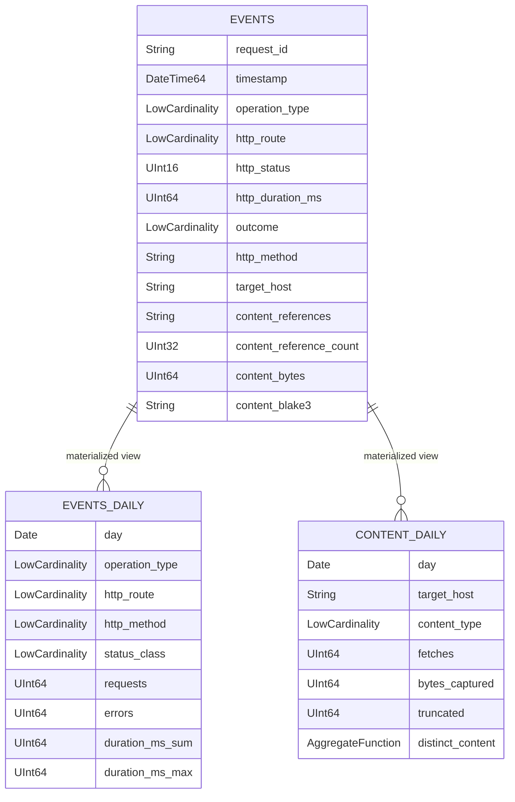

# ClickHouse schema

**Status:** the local DDL in `hack/clickhouse/init.sql` mirrors the serialized `AuditEvent`
(`schema_version 1.0.0`) after Vector flattens its nested objects. Production topology is not
specified. ClickHouse is a derived analytics store, not the source of truth.

## Database and table

- Database: `neuradex`
- Table: `neuradex.events`
- Engine: `MergeTree`
- Partition: `toDate(timestamp)`
- Order: `(timestamp, request_id)`
- TTL: `timestamp + INTERVAL 365 DAY`, `ttl_only_drop_parts = 1`
- Index granularity: `8192`
- No bodies, query text, auth subject, or read-audit fields (the audit crate does not emit them).

## ER diagram



## Envelope and correlation

| Column | Type | Source |
| --- | --- | --- |
| `event` | `LowCardinality(String)` | `event` (always `neuradex.request`) |
| `schema_version` | `LowCardinality(String)` | `schema_version` (`1.0.0`) |
| `event_id` | `String` | `event_id` |
| `timestamp` | `DateTime64(3,'UTC')` | `timestamp` |
| `observed_at` | `Nullable(DateTime64(3,'UTC'))` | `observed_at` |
| `trace_id` | `String` | `trace_id` (empty if absent) |
| `span_id` | `String` | `span_id` |
| `request_id` | `String` | `request_id` |

## Service and HTTP

| Column | Type | Source |
| --- | --- | --- |
| `service_name` | `LowCardinality(String)` | `service.name` |
| `service_version` | `String` | `service.version` |
| `service_environment` | `LowCardinality(String)` | `service.environment` (empty if absent) |
| `http_method` | `LowCardinality(String)` | `http.method` |
| `http_route` | `LowCardinality(String)` | `http.route` (empty if absent) |
| `http_path` | `String` | `http.path` |
| `http_status` | `UInt16` | `http.status` (0 if absent) |
| `http_request_body_bytes` | `UInt64` | `http.request_body_bytes` (0 if absent) |
| `http_response_body_bytes` | `UInt64` | `http.response_body_bytes` (0 if absent) |
| `http_duration_ms` | `UInt64` | `http.duration_ms` |
| `outcome` | `LowCardinality(String)` | `outcome` |
| `error_type` | `LowCardinality(String)` | `error_type` (empty if absent) |

`http_status = 0` means no response was produced. A real status is never 0.

## Operation union

| Column | Type | Source |
| --- | --- | --- |
| `operation_type` | `LowCardinality(String)` | `operation.type` (empty if absent) |
| `query_length` | `UInt64` | `operation.query_length` |
| `query_terms` | `UInt64` | `operation.query_terms` |
| `query_sha256` | `String` | `operation.query_sha256` |
| `query_limit` | `UInt64` | `operation.limit` (renamed to avoid the SQL keyword) |
| `query_count` | `UInt64` | `operation.count` (Open WebUI) |
| `auth_mode` | `LowCardinality(String)` | `operation.auth_mode` |
| `queue_ms` | `UInt64` | `operation.queue_ms` |
| `upstream_ms` | `UInt64` | `operation.upstream_ms` |
| `upstream_result_count` | `UInt64` | `operation.upstream_result_count` |
| `returned_result_count` | `UInt64` | `operation.returned_result_count` |
| `zero_results` | `Bool` | `operation.zero_results` |
| `result_digest` | `String` | `operation.result_digest` |
| `top_hosts` | `String` (JSON array) | `operation.top_hosts` |
| `target_scheme` | `LowCardinality(String)` | `operation.target_scheme` |
| `target_host` | `String` | `operation.target_host` |
| `target_port` | `UInt16` | `operation.target_port` (0 if absent) |
| `target_path` | `String` | `operation.target_path` |
| `target_url_sha256` | `String` | `operation.target_url_sha256` |
| `redirects` | `UInt32` | `operation.redirects` |
| `final_host` | `String` | `operation.final_host` |
| `upstream_status` | `UInt16` | `operation.upstream_status` (0 if absent) |
| `content_type` | `LowCardinality(String)` | `operation.content_type` |
| `content_length` | `UInt64` | `operation.content_length` |
| `bytes_read` | `UInt64` | `operation.bytes_read` |
| `ttfb_ms` | `UInt64` | `operation.ttfb_ms` |
| `total_ms` | `UInt64` | `operation.total_ms` |
| `truncated` | `Bool` | `operation.truncated` |
| `stopped_at_head` | `Bool` | `operation.stopped_at_head` |
| `infrastructure_kind` | `LowCardinality(String)` | `operation.kind` |

Fields not applicable to the event's operation are 0/false/empty in the flat projection. Use
`operation_type` to select the right subset.

## Content and headers

| Column | Type | Source |
| --- | --- | --- |
| `content_references` | `String` (JSON array) | `content_references` |
| `content_reference_count` | `UInt32` | **derived** from the array length |
| `content_bytes` | `UInt64` | **derived** sum of `content_references[].size` |
| `content_storage` | `LowCardinality(String)` | **derived** first reference's `storage` |
| `content_key` | `String` | **derived** first reference's `key` |
| `content_blake3` | `String` | **derived** first reference's `blake3` |
| `content_sha256` | `String` | **derived** first reference's `sha256` |
| `request_headers` | `String` (JSON object) | `request_headers` HeaderCapture |
| `response_headers` | `String` (JSON object) | `response_headers` HeaderCapture |

The `content_*` scalar columns are **not** fields of `AuditEvent`; Vector computes them so
capacity queries do not parse JSON on every scan. If an event has multiple references, only the
first is summarized; the full array is in `content_references`.

There is no `content_captured`, `content_capture_error`, `content_kind`, `content_pack_id`,
`content_frame_offset`, or `content_frame_length` column. Absence of references means no
content; the request index holds the frame location.

## Materialized views

### `events_daily`

Target: `AggregatingMergeTree`, monthly partitions, ordered by
`(day, operation_type, http_route, http_method, status_class, outcome)`, TTL 365 days.

| Column | Type |
| --- | --- |
| `day` | `Date` |
| `operation_type` | `LowCardinality(String)` |
| `http_route` | `LowCardinality(String)` |
| `http_method` | `LowCardinality(String)` |
| `status_class` | `LowCardinality(String)` (`2xx`, `4xx`, `5xx`, `0xx`) |
| `outcome` | `LowCardinality(String)` |
| `requests` | `SimpleAggregateFunction(sum, UInt64)` |
| `errors` | `SimpleAggregateFunction(sum, UInt64)` |
| `duration_ms_sum` | `SimpleAggregateFunction(sum, UInt64)` |
| `duration_ms_max` | `SimpleAggregateFunction(max, UInt64)` |

View `events_daily_mv` groups `events` and writes `count()`, `countIf(http_status >= 500)`,
`sum(http_duration_ms)`, `max(http_duration_ms)`. Read the target table directly; the
`SimpleAggregateFunction` values are already merged by the engine.

### `content_daily`

Target: `AggregatingMergeTree`, monthly partitions, ordered by
`(day, target_host, content_type)`, TTL 365 days.

| Column | Type |
| --- | --- |
| `day` | `Date` |
| `target_host` | `String` |
| `content_type` | `LowCardinality(String)` |
| `fetches` | `SimpleAggregateFunction(sum, UInt64)` |
| `bytes_captured` | `SimpleAggregateFunction(sum, UInt64)` |
| `truncated` | `SimpleAggregateFunction(sum, UInt64)` |
| `distinct_content` | `AggregateFunction(uniq, String)` |

View `content_daily_mv` filters `operation_type = 'fetch' AND content_reference_count > 0 AND
content_blake3 != ''` and writes counts/bytes plus `uniqState(content_blake3)`. Read
`distinct_content` with `uniqMerge(distinct_content)`.

## Example queries

### Error rate by route (24h)

```sql
SELECT
    http_route,
    count() AS requests,
    countIf(http_status >= 500) AS errors,
    round(errors / requests * 100, 2) AS error_pct
FROM neuradex.events
WHERE timestamp >= now() - INTERVAL 24 HOUR
  AND operation_type IN ('fetch', 'peek', 'search', 'openwebui_search')
GROUP BY http_route
ORDER BY error_pct DESC;
```

### p95/p99 latency by upstream host

```sql
SELECT
    target_host,
    count() AS requests,
    quantile(0.95)(http_duration_ms) AS p95_ms,
    quantile(0.99)(http_duration_ms) AS p99_ms
FROM neuradex.events
WHERE operation_type = 'fetch'
  AND timestamp >= now() - INTERVAL 6 HOUR
GROUP BY target_host
ORDER BY requests DESC
LIMIT 20;
```

### Content bytes and sizes per day

```sql
SELECT
    toDate(timestamp) AS day,
    count() AS fetches,
    sum(content_bytes) AS bytes,
    quantile(0.5)(content_bytes) AS p50,
    quantile(0.9)(content_bytes) AS p90,
    quantile(0.99)(content_bytes) AS p99,
    countIf(truncated) AS truncated
FROM neuradex.events
WHERE operation_type = 'fetch' AND content_reference_count > 0
GROUP BY day
ORDER BY day;
```

### Daily rollup

```sql
SELECT
    day,
    operation_type,
    http_route,
    status_class,
    sum(requests) AS requests,
    sum(errors) AS errors,
    sum(duration_ms_sum) / sum(requests) AS avg_ms,
    max(duration_ms_max) AS max_ms
FROM neuradex.events_daily
WHERE day >= today() - 30
GROUP BY day, operation_type, http_route, status_class
ORDER BY day DESC, requests DESC;
```

### Distinct content per day

```sql
SELECT
    day,
    target_host,
    sum(fetches) AS fetches,
    sum(bytes_captured) AS bytes,
    uniqMerge(distinct_content) AS distinct_hashes
FROM neuradex.content_daily
WHERE day >= today() - 30
GROUP BY day, target_host
ORDER BY bytes DESC;
```

### Search volume without query text

```sql
SELECT
    toDate(timestamp) AS day,
    operation_type,
    count() AS searches,
    countIf(zero_results) AS zero_result_searches,
    quantile(0.95)(queue_ms) AS p95_queue_ms
FROM neuradex.events
WHERE operation_type IN ('search', 'openwebui_search')
GROUP BY day, operation_type
ORDER BY day DESC;
```

There is no `query_text` column. Use `query_sha256` to group identical queries without storing
the text.

## Ingestion

Vector's `flatten` transform produces the flat columns; `date_time_best_effort = true` parses
the RFC 3339 timestamps. `skip_unknown_fields = true` drops keys that are not columns; add a
column before enabling a new field.

```sh
curl -sS 'http://127.0.0.1:8123/?user=neuradex&password=neuradex-local-secret&query=INSERT%20INTO%20neuradex.events%20FORMAT%20JSONEachRow' \
  --data-binary @event.ndjson
```

A raw JSONEachRow insert of the nested event will not work directly: flatten it first, and use
`YYYY-MM-DD HH:MM:SS.sss` timestamps if `date_time_best_effort` is not available.

## Retention and operations

- TTL is 365 days on `events`, `events_daily`, and `content_daily`.
- `ttl_only_drop_parts=1` drops whole expired parts; deletions are part-granular, not exactly
  365 days per row.
- Partition by date keeps drops cheap. Do not partition by request ID or content hash.
- `ORDER BY (timestamp, request_id)` optimizes time-range scans and request lookup. A pure
  `request_id` lookup still scans a time range; add a projection only if measurements justify it.
- Local ClickHouse is a single node; production replication/sharding is an open question.
- Init SQL runs only on an empty data directory. After a DDL change, reset the volume or apply an
  `ALTER` manually. `CREATE ... IF NOT EXISTS` does not update an existing table.
- No bodies, query text, auth subject, or read-audit fields. Read audit is future work (RFD 0009).

## Access

- Local user `neuradex` has full access to the `neuradex` database.
- Production: a read-only `analyst` user, a write-only ingester, and an admin. ClickHouse is not
  exposed publicly; require TLS.
- There is no query text to restrict today. If a future schema adds it, use a restricted view or
  column grant.

## Open questions

| Question | Why it is open | Trigger |
| --- | --- | --- |
| Replicated vs managed ClickHouse? | Local is single-node; production topology is undecided | Deployment review |
| Do we need a `request_id` projection? | Point lookups may scan a day; measure | After 30 days of data |
| Do we add auth/read-audit columns? | They are not in schema 1.0.0 | RFD 0009 implementation |
| Do we need a separate read-audit table? | Same table is simpler but mixes TTLs | Read API review |
