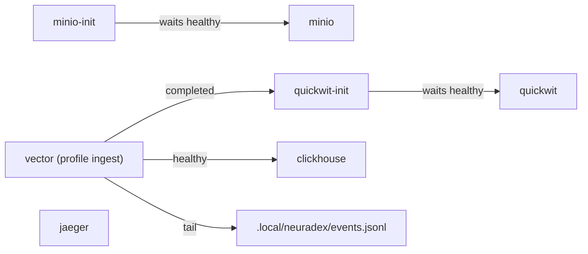

# Compose services

`compose.yaml` runs the local audit/analytics/content stack. The neuradex service itself runs on
the host with `cargo run`; it is not a compose service yet. Every published port binds to
`127.0.0.1`.

## Services

| Service | Image | Host ports | Profile | Depends on | Healthcheck |
| --- | --- | --- | --- | --- | --- |
| `quickwit` | `quickwit/quickwit:0.9.3` | 7280, 7281 | default | — | `quickwit index list` |
| `quickwit-init` | `quickwit/quickwit:0.9.3` | none | default | `quickwit` healthy | none (one-shot) |
| `minio` | `cgr.dev/chainguard/minio:latest` | 9000, 9001 | default | — | `mc ready local` |
| `minio-init` | `cgr.dev/chainguard/minio-client:latest` | none | default | `minio` healthy | none (one-shot) |
| `clickhouse` | `clickhouse/clickhouse-server:26.10` | 8123, 19000→9000 | default | — | `clickhouse-client SELECT 1` |
| `jaeger` | `jaegertracing/jaeger:2.23.0` | 4317, 4318, 16686 | default | — | none |
| `vector` | `timberio/vector:0.61.0-debian` | none | `ingest` | `quickwit-init` completed, `clickhouse` healthy | none |

### Dependency graph



## URLs and credentials

| Service | URL | Credentials |
| --- | --- | --- |
| Quickwit UI/REST | <http://127.0.0.1:7280> | none (localhost) |
| Quickwit gRPC | `127.0.0.1:7281` | none |
| MinIO S3 | <http://127.0.0.1:9000> | `neuradex` / `neuradex-local-secret` |
| MinIO console | <http://127.0.0.1:9001> | same |
| ClickHouse HTTP | <http://127.0.0.1:8123> | `neuradex` / `neuradex-local-secret`, DB `neuradex` |
| ClickHouse native | `127.0.0.1:19000` | same |
| Jaeger UI | <http://127.0.0.1:16686> | none |
| OTLP/HTTP | <http://127.0.0.1:4318> | none |
| OTLP/gRPC | `127.0.0.1:4317` | none |

The credentials are public by design and local-only. Do not reuse them in staging or production.

## Volumes

| Volume | Mount | Contents | Reset |
| --- | --- | --- | --- |
| `quickwit_data` | `/quickwit/qwdata` | Quickwit indexes/splits/metastore | `docker compose down -v` |
| `minio_data` | `/data` | Buckets `neuradex-content`, `neuradex-quickwit` | `docker compose down -v` |
| `clickhouse_data` | `/var/lib/clickhouse` | `neuradex.events`, daily views | `docker compose down -v` |

Jaeger has no volume; its storage is in-memory. Vector has no volume; it reads the host spool
read-only and buffers in its own container filesystem.

## What each service does

### Quickwit

- Node config: `hack/quickwit/quickwit.yaml` (version 0.7, `0.0.0.0:7280/7281`, file metastore
  and index root under `/quickwit/qwdata`).
- Starts with `quickwit run --config /quickwit/config/quickwit.yaml`.
- `QW_DISABLE_TELEMETRY=true` avoids outbound telemetry.
- The image has no `curl`, so the healthcheck runs `quickwit index list` with
  `QW_CLUSTER_ENDPOINT=http://127.0.0.1:7280`.
- `quickwit-init` waits for that healthcheck, lists indexes, and creates `neuradex-events` only
  if missing. It uses `QW_CLUSTER_ENDPOINT=http://quickwit:7280`.
- The index config is `hack/quickwit/neuradex-events.yaml` (version 0.8, 30-day retention,
  10-second commit). See [quickwit-index.md](quickwit-index.md).

### MinIO

- S3-compatible store for the content plane and Quickwit archive. Point the service at it with
  `CONTENT_STORE=s3` and the `CONTENT_S3_*` settings (not the standard AWS variables).
- The images are the public Chainguard MinIO images (`cgr.dev/chainguard/minio` and
  `minio-client`); they avoid the anonymous `quay.io` pull failures. The server image includes
  `mc`, so its healthcheck is `mc ready local`.
- `minio-init` uses the distroless client image with `MC_HOST_local` and creates
  `neuradex-content` and `neuradex-quickwit` with `mc mb --ignore-existing`.
- The server runs as root (`user: "0"`) because Docker creates named volumes root-owned while the
  Chainguard image defaults to nonroot. This is a local-only stack with public credentials.
- The console is on 9001; the API is on 9000. ClickHouse native uses host 19000 to avoid a
  conflict with 9000.

### ClickHouse

- Database `neuradex`, table `events`, daily `events_daily` and `content_daily` views.
- Init SQL: `hack/clickhouse/init.sql`, mounted at
  `/docker-entrypoint-initdb.d/init.sql`. It runs only when the data directory is empty.
- HTTP on 8123, native on 19000 (container 9000).
- `CLICKHOUSE_DEFAULT_ACCESS_MANAGEMENT=1` allows the `neuradex` user to be created.
- See [clickhouse-schema.md](clickhouse-schema.md).

### Jaeger

- All-in-one Jaeger 2.23.0.
- OTLP HTTP on 4318, gRPC on 4317, UI on 16686.
- In-memory storage; restart drops traces.
- The service exports traces when `OTEL_EXPORTER_OTLP_ENDPOINT=http://127.0.0.1:4318`.

### Vector (optional)

- Profile `ingest`; not started by `docker compose up -d`.
- Tails `.local/neuradex/events.jsonl` read-only, parses each line, sends NDJSON to Quickwit's
  ingest API and JSONEachRow to ClickHouse.
- The `flatten` remap maps nested `service`/`http`/`operation` fields to ClickHouse columns and
  encodes the content array/header captures as JSON strings. `shape_quickwit` wraps the two
  array values as `{"items":[…]}` because Quickwit's `json` field requires an object.
- Config: `hack/vector/neuradex-events.toml`.
- Start: `docker compose --profile ingest up -d vector`.

## Commands

```sh
# Start the default stack.
docker compose up -d

# Status (one-shot init containers may show Exited (0)).
docker compose ps -a

# Logs.
docker compose logs --no-color quickwit quickwit-init
docker compose logs --no-color minio minio-init
docker compose logs --no-color clickhouse
docker compose logs --no-color jaeger

# Recreate one service after a config change.
docker compose up -d --force-recreate quickwit
docker compose up -d --force-recreate quickwit-init

# Optional ingester.
docker compose --profile ingest up -d vector

# Stop, keep data.
docker compose down

# Stop, delete volumes (all local data).
docker compose down -v
```

## Validation

```sh
docker compose config --quiet
python3 - <<'PY'
import yaml, tomllib
for p in ["compose.yaml", "hack/quickwit/quickwit.yaml", "hack/quickwit/neuradex-events.yaml"]:
    with open(p) as f:
        yaml.safe_load(f)
with open("hack/vector/neuradex-events.toml", "rb") as f:
    tomllib.load(f)
print("ok")
PY
```

Tested with Docker Compose v2.40+ / Docker 29 on Linux: `docker compose config`, `up -d`, the
Quickwit CLI healthcheck, index creation, ClickHouse init SQL/materialized views, MinIO bucket
creation, and Jaeger UI/OTLP were exercised. On a clean host, `docker compose up -d`
pulls the images and starts the default services. The first start can take a minute.

## Port conflicts

| Port | Conflict | Fix |
| --- | --- | --- |
| 9000/9001 | Another MinIO (e.g. zeta) | Use an override file with `!override` ports |
| 8123 | Another ClickHouse | Change the host port or stop the other instance |
| 7280/7281 | Another Quickwit | Change the host port and `QW_CLUSTER_ENDPOINT` |
| 4317/4318 | Another OTLP collector | Change the host port and the service endpoint |
| 16686 | Another Jaeger | Change the host port |

Example override:

```yaml
# /tmp/neuradex-ports.yaml
services:
  minio:
    ports: !override
      - "127.0.0.1:19001:9000"
      - "127.0.0.1:19002:9001"
```

```sh
docker compose -f compose.yaml -f /tmp/neuradex-ports.yaml up -d
```

Use `!override` rather than a plain list: Compose merges port lists by default, so a plain list
would keep the original 9000 binding and still fail.

## Init and idempotency

| Service | Idempotent? | What happens on re-run |
| --- | --- | --- |
| `quickwit-init` | yes | `index list` sees `neuradex-events` and exits 0 |
| `minio-init` | yes | `mc mb --ignore-existing` leaves existing buckets |
| `clickhouse` | only on empty data dir | Init SQL is skipped if `/var/lib/clickhouse` is populated |
| `vector` | yes | File source checkpoints its position |

To apply a changed ClickHouse DDL, reset the volume (destroys data) or run the `ALTER` manually.
To apply a changed Quickwit mapping, delete/recreate the index and replay; mappings are not
mutable in place.

## Image notes

| Image | Pin | Notes |
| --- | --- | --- |
| `quickwit/quickwit:0.9.3` | tag | Index config version 0.8, node config 0.7 |
| `clickhouse/clickhouse-server:26.10` | tag | LTS line; supports the DDL |
| `jaegertracing/jaeger:2.23.0` | tag | All-in-one; in-memory local storage |
| `cgr.dev/chainguard/minio:latest` | tag | Public Chainguard build of upstream MinIO; local only |
| `cgr.dev/chainguard/minio-client:latest` | tag | Distroless `mc` for bucket init |
| `timberio/vector:0.61.0-debian` | tag | `http` + `clickhouse` sinks; `shape_quickwit`/`flatten` remaps |

Renovate may bump tags. If MinIO `latest` drifts, pin a release or digest; the local stack is not
a production artifact.

## Troubleshooting

| Symptom | Cause | Fix |
| --- | --- | --- |
| `quickwit-init` exits 1 | Bad index YAML or mapping | Check logs; fix `fast_precision`, header type, etc. |
| `quickwit-init` says index exists but mapping is old | Init does not update | Delete index, recreate, replay |
| MinIO bind fails | Port 9000/9001 in use | Override ports |
| ClickHouse init skipped | Non-empty data dir | Reset volume or apply DDL |
| Vector no data | Profile off, spool missing, or transform error | Check `docker compose --profile ingest ps vector` and logs |
| Jaeger no traces | OTLP endpoint unset | Export `OTEL_EXPORTER_OTLP_ENDPOINT` and restart the service |
| `docker compose config` warns about `$` | A single `$` in a command | Escape as `$$` for Compose interpolation |
| MinIO images cannot be pulled | Registry or network policy blocks `cgr.dev` | Mirror the Chainguard images by digest, or allow egress to `cgr.dev` |
