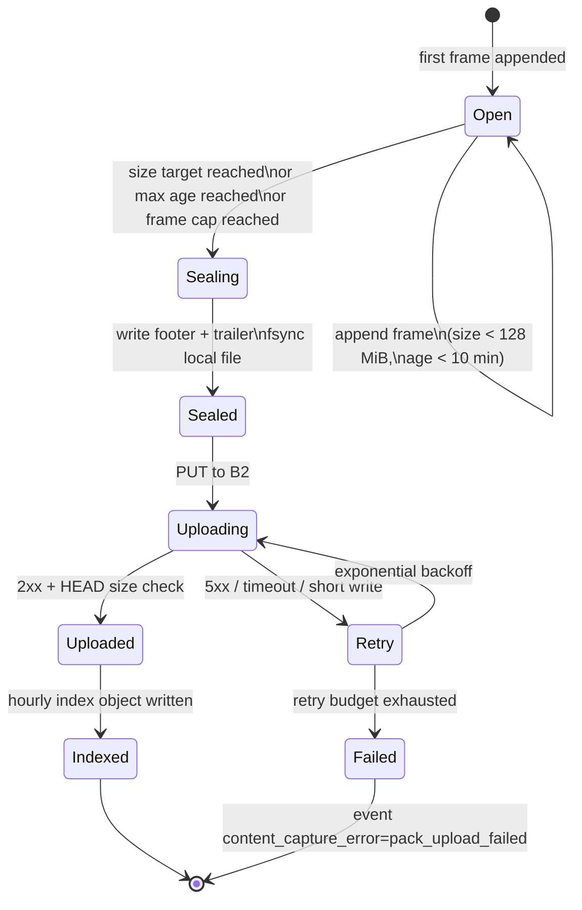
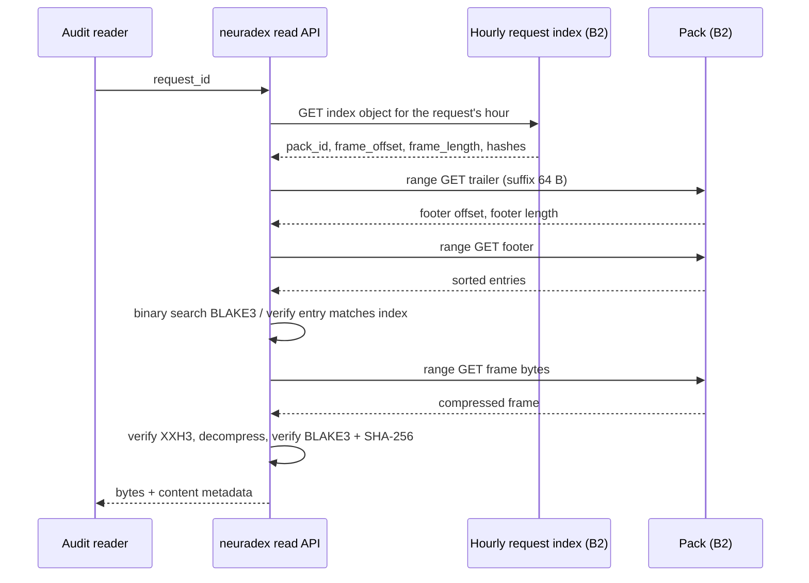

# RFD 2: Content-addressed storage

## Summary

Store captured response bodies in immutable **packfiles** in Backblaze B2. A pack targets
128 MiB of encoded bytes and is sealed at 10 minutes from its first frame, whichever comes
first. Each pack ends with a sorted footer index and a trailer. An **hourly request index**
object maps `request_id` to the pack, frame offset, frame length, and hashes. There are no
per-request S3 manifests and no per-request objects.

Content identity is the BLAKE3-256 digest of the captured bytes. SHA-256 is stored for audit.
XXH3-64 checksums the compressed frame only.

## Context and scope

At 100,000 fetches/hour with an assumed 4 MiB average body, the service would produce about
9.15 TiB/day. A per-request object design would create 2.4 million objects/day and at least as
many PUTs, plus a manifest object per request if we wanted to find content later. That is
expensive in requests, metadata, and operational complexity, and it makes listing/backfill
pathological.

The content plane must:

- keep the request path non-blocking, even when B2 is slow or unavailable;
- make a request's content findable from its audit event alone (plus one hourly index lookup);
- avoid per-request S3 operations;
- detect corruption on read;
- support 365-day retention without immediate per-request deletion;
- leave room for a future large-body path.

Out of scope: content search, OCR, HTML re-parsing, and serving content back through the API
(the read path is an internal tool/API in RFD 0009, not a public endpoint).

## Goals and non-goals

| Goal | How we know it is met |
| --- | --- |
| No per-request object or manifest | A request produces zero S3 PUTs; a pack produces one |
| Bounded pack size and age | Every sealed pack is ≤ target + one frame and ≤ 10 minutes old at seal |
| Find content from `request_id` | Hourly index lookup returns pack ID and frame range |
| Verify integrity on read | XXH3, BLAKE3, and SHA-256 checks pass before bytes are returned |
| Survive B2 outages | Local spool absorbs; events mark content as missing, not silently lost |
| Cost-predictable | Pack count and bytes/day are modelled and measurable |
| Future large bodies | A body ≥ 30 MiB can be stored standalone without changing the event schema |

Non-goals:

- Global deduplication across all packs. Dedupe is within one open pack only.
- Per-request deletion or in-place mutation. Packs are immutable.
- A content catalog database. The hourly index and footer are the catalog.
- Storing search result snippets as content.

## Options

### Storage layout

| Option | Benefits | Drawbacks | Verdict |
| --- | --- | --- | --- |
| A. One object per request + per-request manifest | Simple mental model; independent retention; easy delete | 2.4M+ objects/day; PUT cost and rate limits; listing and lifecycle pain; manifest is another object to lose; no dedupe | Rejected |
| B. One object per request, metadata in the event only | No manifest; event is enough | Still 2.4M objects/day; no packing/dedupe; large object count; multipart overhead for small bodies | Rejected |
| C. Packfiles with footer index + hourly request index | One PUT per 128 MiB; content-addressable frames; footer is self-contained; range GETs; dedupe within pack | More complex format; pack loss loses many requests; index must be written after upload; pack rewrite needed for deletion | **Chosen** |
| D. Database BLOB (Postgres/ClickHouse) | Transactional; easy query | Wrong tool for 9 TiB/day; expensive; bloats the analytics store; backup/restore pain | Rejected |
| E. Object store + external catalog DB | Flexible queries | Catalog becomes a second source of truth; consistency and failure handling; still needs objects | Rejected |

### Pack index location

| Option | Benefits | Drawbacks | Verdict |
| --- | --- | --- | --- |
| Footer index in the pack | One object; index and data cannot diverge; range-readable | Footer must be written last; a corrupt tail loses the index | **Chosen** |
| Sidecar index object | Easy to read without touching the pack | Two objects to keep consistent; another failure point; per-pack metadata cost | Rejected |
| Index only in the hourly request index | No footer duplication | Cannot recover without the hourly index; no content-hash lookup within a pack | Rejected |

### Large bodies

| Option | Benefits | Drawbacks | Verdict |
| --- | --- | --- | --- |
| Always pack | One code path | A 25 MiB frame is fine; a future >128 MiB body would violate the pack target | Chosen for now, with a guard |
| Standalone CAS object at ≥ 30 MiB | Keeps packs small; simple range reads | A second read path and object layout | **Specified**, effectively disabled because capture caps at 25 MiB |
| Reject large bodies | Simple | Loses content | Rejected |

## Determination

Adopt **Option C** for layout, **footer index** for pack indexing, and **standalone CAS** for a
body at or above the 30 MiB threshold.

Specifics:

- Pack target: **128 MiB** of encoded bytes (compressed frames + footer + trailer).
- Pack max age: **10 minutes** from the first frame.
- Hard pack cap: **160 MiB** (target + one maximum 25 MiB frame + footer slack). The builder
  seals before appending a frame that would cross the target; a single frame may take the pack
  over the target but never over the hard cap.
- Maximum captured body: **25 MiB** (the existing fetch cap). Peek head capture is capped at
  **2 MiB**.
- Large-body threshold: **30 MiB**. Because 30 MiB > 25 MiB, no body can reach it today. The
  code path and event fields exist so a future cap increase does not require a schema change.
- A pack is uploaded only after its footer and trailer are complete and locally fsynced.
- The request index is written **after** the pack upload completes. An orphan pack is safe;
  an index pointing at a missing pack is not.
- Objects are immutable and keyed by date/hour and a unique pack ID. A retry uses a new key, so
  it never overwrites a previous object.

Reversibility: the event schema is independent of the pack format, so the pack format can be
versioned (`pack format v1`) and new packs can use v2 while old packs remain readable. Changing
the *identity* hash is much harder and needs RFD 0003.

## Design

### Object layout

```text
s3://neuradex-content/
  packs/v1/date=2026-11-10/hour=01/pack-<pack_id>.nrp
  index/v1/date=2026-11-10/hour=01/requests-<closed_at>-<writer>.ndjson.zst
  events/v1/date=2026-11-10/hour=01/events-<closed_at>-<writer>.ndjson.zst
  cas/v1/blake3/<first2>/<blake3-hex>          # future large-body path
```

- `pack_id` is a 128-bit opaque identifier (UUIDv7 is the provisional encoding).
- `closed_at` is the UTC close time, `writer` is a short instance identifier. Together they make
  the key unique across retries and multiple writers.
- `date`/`hour` are derived from the **close** time, not from each event's timestamp. A late
  event keeps its original timestamp inside the next hour's object.
- `neuradex-quickwit` is reserved for future Quickwit remote storage; the local stack uses a
  file-backed index root.

### Pack lifecycle



Notes:

- A pack is **open** only in the builder process. It is not visible to readers until the index
  is written.
- The builder keeps a local temp file (spool). It does not hold the whole 128 MiB in memory.
- On upload failure, the local file is retained for the retry budget; after that, the pack is
  failed and every event referencing it is marked with `content_capture_error`.
- An upload that succeeds but whose index write fails leaves an orphan pack. It is harmless and
  can be discovered by a reconciliation job; it must not be deleted blindly because a later
  index might reference it.

### Frame and footer

The byte-level format is in [reference/packfile-format.md](../reference/packfile-format.md).
The parts that matter here:

- Each frame has a header with the BLAKE3 hash, SHA-256, XXH3-64 of the compressed payload,
  uncompressed and compressed lengths, content type, and flags.
- The footer contains one entry per distinct content hash, sorted by BLAKE3, with the absolute
  frame offset and lengths.
- The trailer points at the footer and has a SHA-256 of the footer bytes.
- The footer is authoritative for lookup within a pack. The request index is authoritative for
  mapping a request to a pack.

### Request index

The request index is an hourly, zstd-compressed NDJSON object. One line per request event with
captured content:

```json
{"request_id":"019a7f3c-...","event_id":"019a7f3c-...","pack_id":"019a7f3c-...","frame_offset":4096,"frame_length":1234,"hash_blake3":"...","hash_sha256":"...","content_bytes":5123,"content_type":"text/html","truncated":false}
```

Properties:

- Immutable. A retry writes a new object with a new `closed_at`/`writer` suffix.
- Sorted by `request_id` for predictable compression and optional binary search.
- Contains a header record with `schema_version`, `hour`, `count`, and `created_at`.
- Does not contain bodies or header values.
- Can be rebuilt from the event archive + pack footers if lost. The footer alone cannot tell you
  which request produced a frame; the event archive can.

`request_id → frame` is a one-to-many relationship in principle (a future retry could capture
the same request twice). The index stores one record per captured request; a duplicate is a
replay anomaly and is resolved by `event_id` at read time.

### Dedupe

- Within an open pack, the builder keeps a `BLAKE3 → frame` map. If the same content arrives
  again before seal, the second request points at the existing frame.
- Across packs, there is no global content index. The same page fetched tomorrow is written
  again. This is deliberate: a global index is another consistency problem, and the pack
  footer already gives local dedupe.
- A future content index could map BLAKE3 → (pack, frame) and skip duplicate frames across
  packs. It would be an optimization, not a correctness requirement.

### Read path



- Range GETs mean a read costs the footer plus one frame, not the whole pack.
- The footer may be cached in memory by pack ID; it is immutable.
- If the footer entry and the request index disagree, **the footer wins**; the reader records a
  `content.read` event with `read_action=verify_mismatch` and returns an integrity error.
- If the pack is missing (lifecycle expiry, B2 loss), the reader returns a typed "content
  expired or unavailable" result; the audit event still exists.

### Failure and backpressure

| Failure | Behaviour | What the event records |
| --- | --- | --- |
| Capture channel full | Drop content for this request; never block the response | `content_captured=false`, `content_capture_error=spool_full` |
| Local spool disk full | Same as above, plus a high-severity log | `spool_full` |
| Client disconnects mid-body | Do not store a partial frame as canonical content | `content_captured=false`, `content_capture_error=client_disconnect` |
| Upstream error before body | No content | `content_captured=false`, `content_capture_error=upstream_error` |
| Pack upload fails after retries | Sealed pack retained locally for inspection; events marked | `content_capture_error=pack_upload_failed` |
| Index write fails after upload | Orphan pack; readers cannot find it; reconciliation can rebuild | `content_capture_error=index_write_failed` |
| Hash mismatch on read | Do not return bytes; record verification failure | `content.read` with `failed` |
| Clock skew across builders | Pack age may seal early/late; object key still unique | No event; metric |

The content path has lower priority than the event path. If both are under pressure, shed
content first.

## Economic, capacity, and performance considerations

At the assumed 4 MiB average body and 100,000 fetches/hour:

| Quantity | Value |
| --- | --- |
| Captured bytes/day | 9.15 TiB |
| Pack count/day at 128 MiB | ~75,000 |
| Pack count/hour | ~3,125 (one every ~1.2 s) |
| PUTs/day | ~75,000 (one per pack) |
| 365-day steady-state bytes | ~3.34 PiB |
| B2 storage at $6/TiB-month | ~$20k/month (see RFD 0008) |

The pack target is much smaller than the 10-minute age bound in this regime: at 4 MiB average,
32 fetches fill a pack in about 1.2 seconds. Max age matters at low traffic or when the capture
path is stalled; it prevents a pack from staying open indefinitely.

Network is the bottleneck: 9.15 TiB/day is about 111 MiB/s average, or ~0.93 Gbit/s, before
peak. At a 2× peak it is ~1.9 Gbit/s. Hashing and zstd are a small fraction of one core at this
rate on modern hardware, but the pack builder must be measured, not assumed.

If the average body is 512 KiB instead, the 365-day steady state is ~418 TiB and ~$2.5k/month.
The cost is linear in average body size; see RFD 0008 for the sensitivity table and the
measurement gate.

## Security considerations

- Packfiles contain real page bodies, which may include personal data, tokens in URLs, or
  third-party content. Treat `neuradex-content` as restricted data.
- B2 credentials are scoped to the bucket and prefix. The service needs `PutObject`,
  `GetObject`, `HeadObject`, and `ListBucket` for reconciliation; it does not need
  `DeleteObject` in normal operation. Lifecycle deletion is a bucket policy.
- Encryption: TLS to B2; B2 server-side encryption at rest. If a customer-managed key is
  required, use SSE-C with a key stored outside the service image.
- Pack IDs and hashes are not secrets, but the request index maps a known request ID to a frame.
  Access to the index must be as restricted as access to events.
- No per-request deletion: deleting one request means rewriting a pack, which changes its
  identity and every referencing event. Retention is the primary control. A legal deletion
  process is an open question, not a supported operation.
- Read access is audited. Do not expose B2 directly to analysts when an audited read API can
  mediate it.

## Operational considerations

- One pack builder per process is enough initially. Multiple builders are safe because pack IDs
  and index keys are unique, but each writes its own packs; dedupe does not cross builders.
- The builder must be crash-safe: a partial local pack is discarded on startup, never uploaded.
- Reconciliation: list packs under a day prefix, compare against the index objects, and mark
  orphan packs. Do not delete orphans automatically until the index retention window has
  passed.
- Lifecycle: expire `packs/`, `index/`, `events/`, and `cas/` prefixes at 365 days. Lifecycle
  is a safety net; it can run hours late. Do not rely on it for a precise deletion SLA.
- Metrics: open pack bytes/age, seal reason (size/age/frame cap), upload latency, upload
  failures, index write failures, frames per pack, compression ratio, dedupe ratio, read
  verification failures, range GET bytes.
- Runbook: [operations/runbook.md](../operations/runbook.md#content-is-missing).

## Open questions

| Question | Why it is open | Trigger / owner |
| --- | --- | --- |
| Should peek head bytes be captured? | Adds ≤2 MiB per peek; improves completeness; not modelled in capacity | Measure peek volume; default here is yes |
| Is a single PUT enough for 128–160 MiB, or should we use multipart? | B2/S3 single PUT supports it, but retry and timeouts differ | Load-test in staging; if p99 PUT > 60 s, switch to multipart |
| Do we need a global content index for dedupe? | Could cut storage if pages repeat; adds a consistency problem | Measure duplicate BLAKE3 rate over 30 days |
| What is the pack loss blast radius we accept? | A lost pack loses up to 128 MiB of bodies; events remain | Decide with B2 durability/versioning review |
| How do we perform a legal per-request deletion? | Packs are immutable; rewrite is expensive | Legal/security review; document as unsupported until then |
| Should the request index be sorted binary rather than NDJSON? | Faster lookup, less compression-friendly | Measure index GET/parse time at 2.4M requests/day |

## References

- [RFD 0003: Hashing](0003-hashing.md)
- [RFD 0004: Storage and analytics](0004-storage-and-analytics.md)
- [RFD 0008: Capacity, cost, and retention](0008-capacity-cost-and-retention.md)
- [Packfile format](../reference/packfile-format.md)
- [Content plane](../architecture/content-plane.md)
- Code: `crates/neuradex-content`, `crates/neuradex-packfile`
