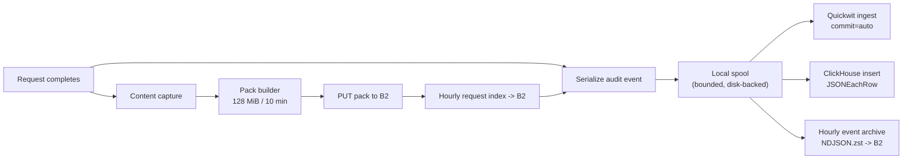

# RFD 4: Storage and analytics

## Summary

Use **Backblaze B2** through its S3-compatible API for durable content and event archives,
**Quickwit 0.8.2** for 30-day full-text search, **ClickHouse** for 365-day typed analytics, and
**Jaeger** for local OTLP traces. The service uses the official **`aws-sdk-s3`** crate, not
`object_store`. B2 is the source of truth; Quickwit and ClickHouse are derived, rebuildable
views. There are no per-request S3 manifests: content is packed, and request/event indexes are
hourly objects.

## Context and scope

The audit/analytics work needs three different access patterns:

1. **Find one request** by ID and inspect its metadata and content reference. This is a
   point lookup with a known key.
2. **Search recent events** by text, route, status, user, or URL. This needs an inverted index
   and low latency over the last weeks.
3. **Aggregate over a year** by day, route, upstream, status, and bytes. This needs columnar
   scans, SQL, and TTL.

No single store does all three well at this scale. The design separates them by access pattern
and keeps B2 as the only store whose loss is irrecoverable.

Out of scope: a production ClickHouse cluster topology, a production Quickwit cluster,
cross-region replication, and a customer-facing analytics API. Those are deployment decisions
that follow this RFD.

## Goals and non-goals

| Goal | How we know it is met |
| --- | --- |
| Point lookup without scanning | `request_id` resolves to a frame via one hourly index object + range GETs |
| Recent search | Quickwit returns a filtered result in < 2 s p95 for the last 30 days |
| Yearly aggregates | ClickHouse answers daily rollups over 365 days without touching B2 |
| Rebuildable views | Quickwit/ClickHouse can be rebuilt from the B2 event archive |
| Low object count | No per-request objects; pack + hourly index/archive key design |
| Least-privilege access | Separate credentials for write, hot read, analytics read, and admin |
| Cost visibility | Bytes/day, pack count/day, and retention cost are measurable from ClickHouse and B2 |

Non-goals:

- Using Quickwit as the long-term archive. Its retention is 30 days.
- Using ClickHouse as a blob store. Bodies and result text are excluded.
- Cross-store transactions. The pipeline is eventually consistent and idempotent.
- Querying B2 directly for dashboards. B2 is for point reads and replay.

## Options

### Object storage

| Option | Benefits | Drawbacks | Verdict |
| --- | --- | --- | --- |
| A. Backblaze B2 via S3 API | Cheap at rest; S3-compatible; range GET; lifecycle rules; no egress fee up to 3× stored/month | Not the lowest-latency; S3 API quirks; separate provider | **Chosen** |
| B. AWS S3 | Mature; strong consistency; tiering | Significantly more expensive at 3+ PiB; egress pricing | Rejected on cost |
| C. Local MinIO only | Free; simple | Not durable; not a production store; capacity-bound | Local dev only |
| D. Database blobs | Transactional | Wrong scale; expensive; backup pain | Rejected |
| E. Filesystem/NFS | Simple | No durability or lifecycle; operational burden | Rejected |

### Hot index

| Option | Benefits | Drawbacks | Verdict |
| --- | --- | --- | --- |
| A. Quickwit 0.8.2 | Purpose-built log search; cheap; S3-backed splits; simple single-node local mode; JSON fields | Smaller ecosystem; schema changes require reindex; 0.8.x is older | **Chosen** |
| B. Elasticsearch / OpenSearch | Mature; rich query DSL; familiar | Expensive RAM/disk; operational weight; licensing | Rejected |
| C. Loki | Good for logs; label-based | Weak full-text/structured queries; not a document store | Rejected |
| D. ClickHouse only | One store; SQL | Full-text search is weaker; expensive for raw text queries; no inverted index for arbitrary terms | Rejected for hot search |
| E. No hot index (B2 only) | Simplest | Point lookups only; no recent search; poor incident response | Rejected |

### Analytics

| Option | Benefits | Drawbacks | Verdict |
| --- | --- | --- | --- |
| A. ClickHouse | Columnar; SQL; TTL; materialized views; cheap at this volume; already being deployed | Another service to operate; schema/migration discipline | **Chosen** |
| B. DuckDB/Parquet on B2 | Serverless; cheap; good for batch | No concurrent ingest/query service; no TTL; query latency | Rejected for now; good for offline analysis |
| C. Postgres | Familiar; transactional | Row-store scans at 1B+ rows; index bloat; cost | Rejected |
| D. Quickwit aggregations only | One store | Limited SQL/aggregation; 30-day retention | Rejected |

### Local traces

| Option | Benefits | Drawbacks | Verdict |
| --- | --- | --- | --- |
| A. Jaeger all-in-one 2.22.0 | Standard OTLP; UI; zero config; matches zeta | In-memory by default; not a production store | **Chosen for local** |
| B. Grafana Tempo | Scales; object storage | More moving parts locally; no need yet | Rejected for local |
| C. No trace backend | Less to run | Cannot inspect spans locally | Rejected |

## Determination

Adopt A/A/A/A:

- **B2** for content packs, request indexes, event archives, and future large-body CAS objects.
  Access through `aws-sdk-s3` with `behavior-version-latest`, `rt-tokio`, `rustls`, and the
  default HTTPS client. Endpoint and region come from the standard AWS environment variables
  (`AWS_ENDPOINT_URL`, `AWS_REGION`, `AWS_ACCESS_KEY_ID`, `AWS_SECRET_ACCESS_KEY`).
- **Quickwit 0.8.2** for the `neuradex-events` index, 30-day retention, local file storage in
  the compose stack; S3-backed index storage when deployed.
- **ClickHouse** database `neuradex`, table `events`, daily materialized views, 365-day TTL.
- **Jaeger 2.22.0** for local OTLP only; production trace storage is an open question.

The `neuradex-content` crate keeps object storage behind a feature: `local` is the default for
tests/dev, `s3` enables `aws-sdk-s3`. The service enables `s3` in production builds. This keeps
the packfile logic testable without a network.

### Store responsibilities

| Store | Holds | Retention | Consistency | Rebuild source |
| --- | --- | --- | --- | --- |
| B2 `neuradex-content` | Packs, hourly request index, hourly event archive, future CAS | 365 days | Strong read-after-write for new objects; immutable keys | Original write |
| Quickwit `neuradex-events` | Hot event documents | 30 days | Eventually consistent after commit (10 s) | B2 event archive |
| ClickHouse `neuradex.events` | Typed event rows + daily aggregates | 365 days | Eventually consistent via Vector/batch insert | B2 event archive |
| Jaeger | Local traces | Process lifetime (in-memory) | n/a | Re-run the request |
| B2 `neuradex-quickwit` | Reserved for Quickwit splits/metastore | 30 days | n/a | Reindex from archive |

### Write path

- Event fan-out is asynchronous. The response does not wait for Quickwit, ClickHouse, or B2.
- Quickwit and ClickHouse are best-effort derived stores; B2 archive is the durable event record.
- The pack upload happens before the request index write. The event's content refs are filled
  when the index is committed; until then the event says `content_pending` (or the event is
  buffered until the pack is indexed). See the open question below.
- A retry is safe: event IDs and object keys are unique; ClickHouse/Quickwit duplicates are
  deduplicated at query time by `event_id` if needed.

### Consistency model

| Operation | Guarantee |
| --- | --- |
| Pack upload | Read-after-write within B2; the reader uses the exact key from the index |
| Request index | Written after the pack; a reader never sees an index for an incomplete pack |
| Event archive | Written after the hour closes + grace; late events go in the next object with original timestamps |
| Quickwit | Visible after the indexer commits (≤ `commit_timeout_secs` + processing) |
| ClickHouse | Visible after the insert batch commits |
| Cross-store | No transaction; a request can be in B2 but not yet in Quickwit/ClickHouse |

### Why no per-request manifests

A per-request manifest is an object whose only job is to list that request's content. It doubles
the object count, adds a second write that can fail independently, and provides no information
the event + hourly index cannot provide. The pack footer already lists every frame; the hourly
request index maps the request to the frame. This is the smallest number of durable writes that
still supports point lookup.

If a future feature needs a per-request inventory (e.g. multiple content parts), extend the
event fields and the hourly index; do not add a manifest.

### Retention

| Store | Mechanism | Enforcement |
| --- | --- | --- |
| B2 content | Bucket lifecycle rule on `packs/`, `index/`, `events/`, `cas/` | Daily; may run hours late |
| Quickwit | `retention.period: 30 days`, `schedule: daily` | Quickwit retention task |
| ClickHouse | `TTL timestamp + INTERVAL 365 DAY`, `ttl_only_drop_parts=1` | Merge/part drop |
| Jaeger | In-memory | Process restart |

Retention is not per-request deletion. A request's content expires when its pack expires; the
event expires on its own schedule. This is documented as a limitation in RFD 0009.

## Economic, capacity, and performance considerations

At 100,000 fetches/hour × 4 MiB average:

| Store | Annual steady state | Monthly cost estimate |
| --- | --- | --- |
| B2 content (365 days) | ~3.34 PiB | ~$20k at $6/TiB-month |
| Quickwit hot (30 days) | ~40–80 GB compressed + index | negligible vs B2 |
| ClickHouse (365 days) | ~60–120 GB compressed | negligible vs B2 |
| Event archive (365 days) | ~470 GB compressed | included in B2 |
| Request index (365 days) | ~60 GB compressed | included in B2 |

The exact B2 bill depends on the average body size, which is an assumption (see RFD 0008).
Quickwit and ClickHouse are cheap at this event volume; B2 dominates. Network egress for reads is
small because the read path uses range GETs.

Performance targets:

| Operation | Target | Measurement |
| --- | --- | --- |
| Event ingest lag (request → Quickwit searchable) | < 30 s p95 | Quickwit commit time + queue |
| Event ingest lag (request → ClickHouse queryable) | < 60 s p95 | Insert batch + queue |
| Event archive availability | < 15 min after hour close | Object listing/HEAD |
| Content point read | < 2 s p95 | Index GET + footer + frame |
| Content upload | < 60 s p99 per 128 MiB pack | Uploader metric |

## Security considerations

- B2 buckets are private. No public bucket policy, no presigned URLs in logs, no long-lived
  presigned URLs for analysts.
- Credentials are separated by role:
  - **writer**: put/get/head/list on `neuradex-content`; no delete.
  - **reader**: get/head on packs and indexes; no list, no put.
  - **analyst**: ClickHouse read-only; no B2.
  - **admin**: lifecycle and bucket configuration; break-glass only.
- Quickwit and ClickHouse remember query text. The event table's `query_text` column is
  restricted; dashboards must use `query_hash` and aggregates, not raw text.
- ClickHouse and Quickwit must not be exposed publicly. Bind to localhost in compose; put them
  behind the internal network and auth in production.
- TLS is required for B2 and for any cross-host Quickwit/ClickHouse traffic.
- Backups: B2 is the backup for content and events; Quickwit/ClickHouse are rebuildable. Do not
  back up derived stores as if they were sources of truth.
- Lifecycle rules are powerful. Restrict who can change them; an incorrect rule can delete a
  year of content.

## Operational considerations

- Start order in production: B2 credentials → event spool → ClickHouse/Quickwit → content
  builder → service. The service must start and serve even if all sinks are down.
- A missing Quickwit index is a hot-search incident, not a data-loss incident. Recreate the
  index and replay from the archive.
- A missing ClickHouse table is an analytics incident. Recreate the DDL and replay.
- A missing B2 pack is data loss. Check lifecycle, credentials, and the request index; do not
  silently return empty content.
- Reindex procedure: create a new index with the current mapping (Quickwit mappings are not
  mutable in place), replay archive hours, then swap the alias/query target. Keep the old index
  until the new one is verified.
- ClickHouse schema changes: `ALTER TABLE ... ADD COLUMN` is cheap; changing a type or ORDER BY
  requires a new table and a backfill. Use `IF NOT EXISTS` in the local init SQL.
- Monitor B2 object count and lifecycle deletions; a sudden drop is a retention/lifecycle bug.
- Runbook: [operations/runbook.md](../operations/runbook.md).

## Open questions

| Question | Why it is open | Trigger / owner |
| --- | --- | --- |
| Does the event carry a content ref before the pack is indexed, or is it buffered? | Buffering preserves a complete event but delays the event; writing early requires a `content_pending` state | Decide with the content builder; current design allows a pending state |
| What is the production ClickHouse topology? | Single node is enough for local; production needs replicas/shards or a managed service | Deployment review; this RFD only fixes the schema |
| What is the production Quickwit topology and object storage? | Single node is enough for 30 days of this volume, but HA is not addressed | Deployment review |
| Where do production traces go? | Jaeger is local only; sampling and retention are undefined | Observability review |
| Do we need B2 object versioning? | Protects against accidental overwrite/delete; costs storage | Security/cost review |
| Is B2's 3× free egress enough for investigations? | Range GETs keep reads small, but bulk replay is different | Measure first month |

## References

- [RFD 0002: Content-addressed storage](0002-content-addressed-storage.md)
- [RFD 0008: Capacity, cost, and retention](0008-capacity-cost-and-retention.md)
- [RFD 0009: Access and read audit](0009-access-and-read-audit.md)
- [Storage topology](../architecture/storage-topology.md)
- [ClickHouse schema](../reference/clickhouse-schema.md)
- [Quickwit index](../reference/quickwit-index.md)
- B2 S3 API: <https://www.backblaze.com/docs/cloud-storage-s3-compatible-api>
- Quickwit docs: <https://quickwit.io/docs>
- Code: `crates/neuradex-content/Cargo.toml` (`s3` feature)
