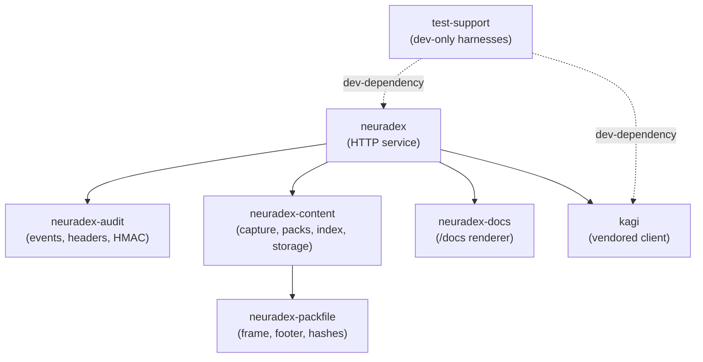

# RFD 6: Crate boundaries

## Summary

Keep the audit schema, the packfile format, and the content orchestration in three separate
crates (`neuradex-audit`, `neuradex-packfile`, `neuradex-content`) and compose them in the
`neuradex` service. The dependency direction is one-way: service → content/audit, content →
packfile. The packfile crate is synchronous and free of async runtimes and object storage; the
content crate owns async orchestration and the `local`/`s3` object-store features; the audit
crate owns what is recorded.

## Context and scope

The audit/analytics/content work adds three kinds of complexity:

1. **A wire schema and privacy policy** (what to record, what to redact).
2. **A byte-level immutable format** (frames, footer, trailer, hashes).
3. **Async orchestration** (spool, pack builder, uploader, hourly index).

Putting all three in the service makes the format hard to test without HTTP and couples the
schema to axum. Putting them in one library makes the sync format depend on tokio and object
storage, which makes corruption tests slow and brittle. The split follows the natural failure
boundaries.

Out of scope: a separate CLI for content inspection (a future `neuradex-content` binary or a
`hack/` tool), a plugin system, and moving the existing Kagi client.

## Goals and non-goals

| Goal | How we know it is met |
| --- | --- |
| The packfile format is testable without a runtime | `neuradex-packfile` has no tokio, no reqwest, no AWS SDK |
| The audit schema is testable without the service | `neuradex-audit` has no axum, no Kagi, no content dependency |
| Object storage is optional in tests | `neuradex-content` defaults to `local`; `s3` enables `aws-sdk-s3` |
| No dependency cycles | `cargo metadata` graph is a DAG; `cargo test --workspace` passes |
| The service is the only composition root | Only `neuradex` wires HTTP, Kagi, audit, and content together |
| Each crate has a clear owner and test command | README/AGENTS and `cargo test -p <crate>` |

Non-goals:

- One crate per module.
- A stable public API for external consumers. These crates are `publish = false`.
- Hiding all implementation details behind traits. Use concrete types until a second
  implementation exists.
- Moving the vendored Kagi client or the docs renderer.

## Options

| Option | Benefits | Drawbacks | Verdict |
| --- | --- | --- | --- |
| A. One `neuradex-audit` crate for everything | Fewer crates; simple | Format tests pull in async/network; schema and storage evolve together; no clean dependency direction | Rejected |
| B. Three crates: audit, packfile, content | Clear failure boundaries; fast unit tests; optional S3; service composes | More manifests; a little more wiring | **Chosen** |
| C. Four crates, splitting content store from orchestration | Even cleaner storage abstraction | Premature; only one object store implementation is real today | Rejected |
| D. Put audit in the service and content in a crate | Fewer crates | Audit schema becomes hard to test without HTTP; service still couples to packfile | Rejected |
| E. Put packfile in `neuradex-content` | Fewer crates | Pack tests need tokio; object-store feature leaks into format tests | Rejected |

## Determination

Adopt **Option B**.

| Crate | Owns | Must not depend on | Key test command |
| --- | --- | --- | --- |
| `neuradex-audit` | Event structs, enums, header policy, redaction/HMAC, event serialization, sink traits | axum, Kagi, `neuradex-content`, object storage | `cargo test -p neuradex-audit` |
| `neuradex-packfile` | Frame/footer/trailer format, compression, BLAKE3/SHA-256/XXH3, reader/writer | tokio, reqwest, AWS SDK, the service | `cargo test -p neuradex-packfile` |
| `neuradex-content` | Capture spool, pack builder, uploader, request index, event archive writer, object-store abstraction | axum, Kagi, the service | `cargo test -p neuradex-content` |
| `neuradex` | HTTP routes, config, state, composition of audit/content, telemetry | nothing above it | `cargo test -p neuradex` |
| `neuradex-docs` | `/docs` rendering from OpenAPI | audit/content | `cargo test -p neuradex-docs` |
| `test-support` | HTTP harnesses and fixtures | production crates (except as dev-dependency) | `cargo test -p test-support` |
| `kagi` | Vendored Kagi client | audit/content | `cargo test -p kagi` |

### Dependency graph



Rules:

- Arrows point in the allowed dependency direction. `audit` and `pack` are leaves; they never
  depend on each other. The service composes them: `AuditEvent.content_references` is an
  audit-side `ContentReference`, and the service maps it from the content crate's frame metadata.
- `neuradex-content` is allowed to depend on `neuradex-packfile`, never the reverse.
- `neuradex-audit` does not depend on `neuradex-content`; if a shared type is needed, define it
  in `neuradex-audit` as `ContentReference` (storage, key, hashes, size, optional content type)
  and have the service map it. Do not create a bidirectional dependency.
- `test-support` may depend on the crates under test only under `[dev-dependencies]`. Never use
  it from `src/#[cfg(test)]` of a crate it depends on; the dev-dependency cycle can otherwise
  link two copies of that crate.
- `neuradex-docs` stays independent of audit/content; it renders OpenAPI JSON.

### Feature policy

`neuradex-content`:

| Feature | Default | Behaviour |
| --- | --- | --- |
| `local` | yes | Filesystem object store for tests and local development; no network |
| `s3` | no | Enables `aws-sdk-s3` and the B2/S3 object store |

The service enables `s3` in production builds. Tests use `local`; a small integration test may
enable `s3` against `httpmock`/MinIO later. Do not make `s3` default: it would force the AWS SDK
into every packfile/content unit test and slow the feedback loop.

Compression features for Kagi are unrelated and must stay enabled in `neuradex` and
`test-support`; do not trim them when changing TLS features.

### Where code goes

| Concern | Crate | Why |
| --- | --- | --- |
| `Event` struct and enums | `neuradex-audit` | Single source of truth for the schema |
| Header allow-list, redaction, HMAC | `neuradex-audit` | Security-sensitive, testable without network |
| Event JSON serialization | `neuradex-audit` | Sinks consume the same bytes |
| Frame header/footer/trailer | `neuradex-packfile` | Byte-level, sync, no I/O |
| Hash and compress a frame | `neuradex-packfile` | Deterministic, unit-testable |
| Pack builder state machine | `neuradex-content` | Async, needs spool and upload |
| Object store trait and `local`/`s3` impls | `neuradex-content` | Feature-gated |
| Hourly request index writer | `neuradex-content` | Depends on pack layout and event refs |
| Hourly event archive writer | `neuradex-content` | Depends on audit events and object store |
| HTTP middleware and handlers | `neuradex` | Composition root |
| OTLP/logging setup | `neuradex` | Runtime concern |

### Interface sketch

Names are indicative; the implementation may adjust them, but the direction and ownership are
fixed.

```rust
// neuradex-audit
pub struct Event { /* flat fields, serde */ }
pub struct HeaderPolicy { /* allow-list, hmac key */ }
impl HeaderPolicy {
    pub fn capture_request(&self, headers: &HeaderMap) -> CapturedHeaders;
    pub fn capture_response(&self, headers: &HeaderMap) -> CapturedHeaders;
}

// neuradex-packfile
pub struct PackWriter<W: Write + Seek> { /* ... */ }
pub struct PackReader<R: Read + Seek> { /* ... */ }
pub struct FrameMeta { /* hashes, lengths, flags */ }

// neuradex-content
pub trait ObjectStore { /* put, get_range, head, list */ }
pub struct PackBuilder<S> { /* open, append, seal, upload */ }
pub struct RequestIndexWriter<S> { /* append, close */ }
```

Do not put async traits in `neuradex-packfile`. Do not make `neuradex-audit` depend on
`http::HeaderMap` if a smaller iterator type is enough; the current scaffold already depends on
`http`, which is acceptable for header capture but not for axum.

## Economic, capacity, and performance considerations

The split has no runtime cost: monomorphization and inlining erase most crate boundaries. It
does add compile time (more crates) and a little boilerplate. The benefit is that packfile tests
run in milliseconds instead of building tokio/AWS, and audit redaction tests cannot accidentally
perform network I/O.

At the modelled rate, the content crate is the only one with significant CPU (zstd/hashing) and
I/O (spool/B2). The audit crate is CPU-light (JSON + HMAC). Keeping them separate lets us
profile and scale them independently.

## Security considerations

- The header policy and HMAC live in `neuradex-audit`, which has no network dependency. This
  reduces the chance that a logging or HTTP change bypasses redaction.
- The packfile crate never sees secrets other than content bytes; it does not log payloads. It
  must not add debug logging of frame contents.
- `neuradex-content` owns B2 credentials. Keep them out of `neuradex-audit` and
  `neuradex-packfile`; do not pass them through event structs.
- `unsafe_code` is forbidden workspace-wide. The packfile parser must be safe Rust and validate
  every length/offset before slicing.
- `missing_docs` is warn workspace-wide; public items in these crates need docs, including
  `# Errors` sections for fallible functions.

## Operational considerations

- A build failure in one crate blocks the service; keep `cargo test -p <crate>` fast.
- `cargo clippy --all-targets --workspace -- -D warnings` is the gate; warnings are must-fix.
- `cargo doc --workspace --no-deps --all-features` must pass; all-features pulls in the AWS SDK
  and Kagi's native TLS, so it is slower but still required.
- When adding a dependency, justify it in the PR and update the workspace `Cargo.toml`. Do not
  add a dependency to `neuradex-packfile` that pulls in async or HTTP.
- A re-vendor of `kagi` must not touch these crates; the dependency direction is unchanged.

## Open questions

| Question | Why it is open | Trigger / owner |
| --- | --- | --- |
| Should the content crate reuse `ContentReference` directly? | The current audit type is a plain shape; a direct dependency would point content → audit, against the direction | Keep the small mapping in the service |
| Should the pack builder be a task in the service or a separate process? | A separate process isolates CPU/disk and survives restarts; a task is simpler | Load-test both; start in-process |
| Does the event archive writer belong in `content` or `audit`? | It writes events but uses object storage | Current: `content`, because it owns object-store writes; revisit if audit grows an archive sink |
| Do we need a CLI crate for inspection? | Useful for runbooks; not needed for the service | Add after the read path exists |

## References

- [RFD 0001: Audit event model](0001-audit-event-model.md)
- [RFD 0002: Content-addressed storage](0002-content-addressed-storage.md)
- [RFD 0003: Hashing](0003-hashing.md)
- [AGENTS.md](../../AGENTS.md) — workspace rules
- Code: `crates/neuradex-audit`, `crates/neuradex-packfile`, `crates/neuradex-content`
