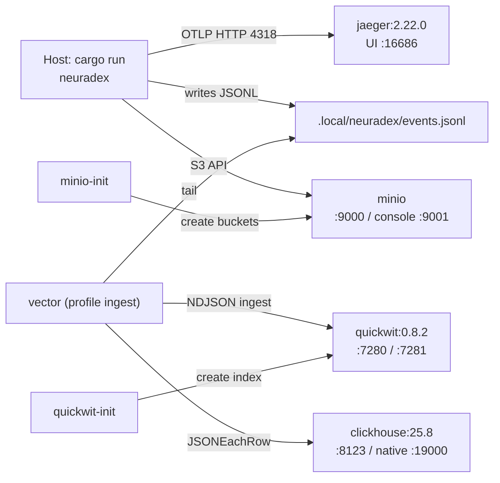

# RFD 7: Local testing stack

## Summary

Run the audit/analytics stack with a root `compose.yaml`: Quickwit 0.8.2 for hot search, MinIO
for S3-compatible object storage, ClickHouse for analytics, and Jaeger 2.22.0 for OTLP traces.
An optional `ingest` profile runs Vector, which tails `.local/neuradex/events.jsonl` and writes
to Quickwit and ClickHouse. All host ports bind to `127.0.0.1`; credentials are local-only.

## Context and scope

An engineer implementing the audit/content pipeline needs to see an event in Quickwit, a row in
ClickHouse, an object in a bucket, and a trace in Jaeger without provisioning cloud resources or
learning four different installers. The stack must be reproducible, disposable, and close enough
to production to catch mapping/schema mistakes.

The service itself runs on the host with `cargo run`. The compose stack is infrastructure; it
does not build or run the neuradex image. This keeps the edit/run loop fast and avoids baking a
Kagi token into an image.

Out of scope: a production deployment (Helm chart), CI integration with service containers, TLS
between local services, and multi-node Quickwit/ClickHouse. Those are separate concerns.

## Goals and non-goals

| Goal | How we know it is met |
| --- | --- |
| One command starts the stack | `docker compose up -d` brings up healthy services |
| Idempotent initialization | Re-running `up` does not fail on existing buckets or indexes |
| The Quickwit index matches the event schema | An event with headers is searchable and the headers are returned |
| The ClickHouse table matches the event schema | A `JSONEachRow` insert with the documented fields succeeds |
| Local ports do not collide with common defaults | ClickHouse native is 19000, not 9000; MinIO keeps 9000 |
| No public exposure | Every published port is `127.0.0.1:<port>` |
| Data is disposable | `docker compose down -v` removes named volumes |
| The ingest path is optional | Core services start without Vector; `--profile ingest` adds it |

Non-goals:

- Production parity for HA, backups, or auth.
- Running the Rust service in compose.
- A permanent local data store. Volumes are for the session, not for years.
- Replacing the offline test suite. Compose tests are manual/integration, not `cargo test`.

## Options

| Option | Benefits | Drawbacks | Verdict |
| --- | --- | --- | --- |
| A. Root `compose.yaml` | One command; shared across the team; matches ops tools; easy reset | Docker required; image pulls; port management | **Chosen** |
| B. Testcontainers in Rust tests | Great CI integration; per-test isolation | Requires Docker in CI; slower; not a human dev stack | Future, for integration tests |
| C. Native binaries via `hack/install-tools.sh` | No Docker; fast | Four installers/versions; OS-specific; hard to reset; not reproducible | Rejected |
| D. Kubernetes/kind locally | Production-like | Heavy; slow; overkill for a laptop | Rejected |
| E. Mock sinks in tests only | Fast; offline | Cannot catch real mapping/DDL/config errors | Rejected for the dev stack; keep mocks for unit tests |

## Determination

Adopt **Option A**.

| Service | Image | Host ports (localhost) | Purpose | Profile |
| --- | --- | --- | --- | --- |
| `quickwit` | `quickwit/quickwit:0.8.2` | 7280 REST/UI, 7281 gRPC | Hot index and search | default |
| `quickwit-init` | `quickwit/quickwit:0.8.2` | none | Create `neuradex-events` idempotently | default |
| `minio` | `quay.io/minio/minio:latest` | 9000 API, 9001 console | S3-compatible object store | default |
| `minio-init` | `quay.io/minio/mc:latest` | none | Create buckets | default |
| `clickhouse` | `clickhouse/clickhouse-server:25.8` | 8123 HTTP, 19000 native | Analytics | default |
| `jaeger` | `jaegertracing/jaeger:2.22.0@sha256:836b…` | 4317 gRPC, 4318 HTTP, 16686 UI | OTLP traces | default |
| `vector` | `timberio/vector:0.49.0-debian` | none | Spool → Quickwit/ClickHouse | `ingest` |

Details:

- Quickwit uses a local file metastore and index root under `/quickwit/qwdata`, mounted on a
  named volume. The node config is `hack/quickwit/quickwit.yaml`; the index config is
  `hack/quickwit/neuradex-events.yaml`.
- `quickwit-init` waits for Quickwit, checks whether the index exists, and creates it only if it
  does not. It is safe to run repeatedly.
- MinIO uses `quay.io` images (Docker Hub is unreachable from some environments) and creates
  `neuradex-content` and `neuradex-quickwit` with `mc mb --ignore-existing`. The bucket init
  uses the dedicated `quay.io/minio/mc:latest` image, as in the zeta compose stack.
- ClickHouse uses `hack/clickhouse/init.sql`, creates database `neuradex` and table `events`
  plus daily materialized views. The native port is published as **19000** to avoid MinIO's
  9000.
- Jaeger uses the same 2.22.0 image and digest as the zeta compose stack. It is all-in-one and
  in-memory; traces disappear on restart.
- Vector is optional. It tails `.local/neuradex/events.jsonl`, parses each line as JSON, and
  writes NDJSON to Quickwit's ingest API and JSONEachRow to ClickHouse.
- Named volumes: `quickwit_data`, `minio_data`, `clickhouse_data`. Jaeger has no volume because
  its local storage is intentionally ephemeral.
- Every host port is bound to `127.0.0.1`, not `0.0.0.0`.

### Why these versions

| Component | Version | Reason |
| --- | --- | --- |
| Quickwit | 0.8.2 | Fixed by the storage decision; index config `version: 0.8` is supported by 0.8.2 |
| ClickHouse | 25.8 | Current LTS line; supports `JSONEachRow`, `SimpleAggregateFunction`, and `ttl_only_drop_parts` |
| Jaeger | 2.22.0 | Matches the zeta local stack and its tested digest |
| MinIO / mc | `latest` from quay.io | Matches zeta's local approach; local only, not a production pin. `mc` runs bucket init. |
| Vector | 0.49.0-debian | Current stable line with the `clickhouse` and `http` sinks used here |

## Design

### Service graph

### Startup order

1. `minio` starts and becomes healthy.
2. `minio-init` waits for MinIO, creates buckets, exits 0.
3. `quickwit` starts and becomes healthy.
4. `quickwit-init` waits for Quickwit, creates the index if missing, exits 0.
5. `clickhouse` starts, runs `init.sql` on an empty data directory, becomes healthy.
6. `jaeger` starts independently.
7. `vector` (optional) waits for `quickwit-init` to complete successfully and ClickHouse to be
   healthy, then tails the audit JSONL file.

The service can start before the stack; it writes JSONL locally and Vector catches up when it starts.
For a clean demo, start the stack first.

### Ports and URLs

| URL | What |
| --- | --- |
| <http://127.0.0.1:7280> | Quickwit UI and REST API |
| <http://127.0.0.1:7280/api/v1/neuradex-events/search> | Quickwit search |
| <http://127.0.0.1:9000> | MinIO S3 endpoint |
| <http://127.0.0.1:9001> | MinIO console (`neuradex` / `neuradex-local-secret`) |
| <http://127.0.0.1:8123> | ClickHouse HTTP |
| `127.0.0.1:19000` | ClickHouse native protocol |
| <http://127.0.0.1:16686> | Jaeger UI |
| <http://127.0.0.1:4318> | OTLP/HTTP receiver |
| `127.0.0.1:4317` | OTLP/gRPC receiver |

### Data layout

| Location | Contents | Reset |
| --- | --- | --- |
| `quickwit_data:/quickwit/qwdata` | Indexes, splits, metastore | `docker compose down -v` |
| `minio_data:/data` | `neuradex-content`, `neuradex-quickwit` | `docker compose down -v` |
| `clickhouse_data:/var/lib/clickhouse` | `neuradex.events` and views | `docker compose down -v` |
| `.local/neuradex/events.jsonl` (host) | Audit JSONL for Vector | `rm -rf .local/neuradex` |
| Jaeger memory | Traces | Restart `jaeger` |

`.local/` is gitignored. Never commit the audit log; it contains real request metadata.

### Credentials

| Service | User | Password / key | Notes |
| --- | --- | --- | --- |
| MinIO | `neuradex` | `neuradex-local-secret` | Root user for local only |
| ClickHouse | `neuradex` | `neuradex-local-secret` | Database `neuradex` |
| Quickwit | none | none | No auth locally; localhost only |
| Jaeger | none | none | No auth locally |

These are deliberately obvious local credentials. Do not reuse them in staging or production.
The compose file does not read production secrets from the environment; it is a dev stack.

## Economic, capacity, and performance considerations

The stack is sized for a laptop:

| Service | Approx. memory | Disk |
| --- | --- | --- |
| Quickwit | 512 MiB–1 GiB | Index size for the events you ingest |
| MinIO | 256 MiB | Bucket contents |
| ClickHouse | 1–2 GiB | Table + views |
| Jaeger | 128–256 MiB | In-memory |
| Vector | 64–128 MiB | Small buffer |

This is not a load-test environment. For load tests, run the service and sinks on separate
hosts or increase the container limits and measure. Do not extrapolate local latency to
production.

## Security considerations

- Localhost-only bindings are the primary control. Do not change them to `0.0.0.0` on a shared
  host.
- The local credentials are public in this repository. They grant access to local data only.
- MinIO root credentials are used by `minio-init`; a production deployment should use scoped
  application keys, not root.
- Quickwit and ClickHouse have no auth locally. Do not put real user data in the local stack;
  use synthetic events and pages.
- Jaeger receives traces that may contain URLs and service metadata. Treat the local UI as
  sensitive if you are debugging real traffic.
- The Vector source reads a host path. Mount it read-only; do not give Vector write access to
  the audit log.
- `.local/` must stay gitignored. The audit log can contain URLs and header HMACs.

## Operational considerations

- Validate the file without starting anything: `docker compose config --quiet`.
- Check health: `docker compose ps` and `docker compose logs <service>`.
- Recreate one service: `docker compose up -d --force-recreate quickwit`.
- Reset everything: `docker compose down -v` (destroys volumes) and
  `rm -rf .local/neuradex`.
- Quickwit index already exists: `quickwit-init` should skip it. If the mapping changed, delete
  the index and recreate it; Quickwit mappings are not mutable in place.
- ClickHouse init SQL only runs on an empty data directory. After changing DDL, reset the volume
  or apply the `ALTER` manually.
- MinIO init is idempotent via `--ignore-existing`. If a bucket exists with different settings,
  it is left alone.
- Port 9000 conflict: ClickHouse native is 19000 for this reason. If another service owns 9000,
  change the MinIO host port, not the container port.
- Vector not shipping: check the profile is enabled, `AUDIT_LOG_PATH` points at the file, and
  `docker compose logs vector`.
- CI does not start this stack. The offline test suite must not depend on it. A future
  integration job can use `docker compose` or testcontainers.

## Open questions

| Question | Why it is open | Trigger / owner |
| --- | --- | --- |
| Should the service itself run in compose under an `app` profile? | Convenient for demos; needs a Kagi token and a built image | Add when the audit pipeline is wired |
| Should CI run a compose smoke test? | Catches mapping/DDL drift; adds Docker and image pulls to CI | Evaluate after the first schema change |
| Do we need a persistent Jaeger backend? | In-memory is fine for a session; traces vanish on restart | Add Badger/Elasticsearch if local trace history matters |
| Should MinIO be pinned by digest? | Reproducibility; `latest` can drift | Renovate or a manual pin after the stack stabilizes |
| Do we need a local B2 emulator instead of MinIO? | MinIO is close enough for S3 API; B2-specific quirks remain | Keep MinIO; test B2 in staging |

## References

- [RFD 0004: Storage and analytics](0004-storage-and-analytics.md)
- [RFD 0008: Capacity, cost, and retention](0008-capacity-cost-and-retention.md)
- [Local development](../development/local-development.md)
- [Compose services](../reference/compose-services.md)
- `compose.yaml`, `hack/quickwit/`, `hack/clickhouse/`, `hack/vector/`
- Quickwit docs: <https://quickwit.io/docs>
- ClickHouse docs: <https://clickhouse.com/docs>
- Jaeger v2 docs: <https://www.jaegertracing.io/docs/2.0/>
