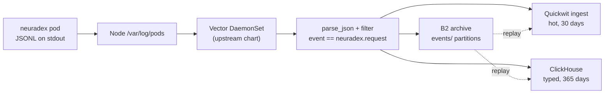

# RFD 10: Production event pipeline

> **Status:** the reference deployment is checked in under `deploy/event-pipeline`; it uses the
> upstream Vector Helm chart. The local compose bridge remains the development path.

## Summary

Ship audit events to Quickwit, ClickHouse, and an S3-compatible archive with a **Vector
DaemonSet**. The service keeps writing one JSON object per line to stdout. Vector reads only the
neuradex pods on each node, parses the JSON, keeps events where `event == "neuradex.request"`,
and fans them out. The service never waits for a sink. B2 holds the durable archive under
`events/`; Quickwit and ClickHouse are derived, rebuildable views.

The deployment does **not** add a DaemonSet, RBAC, or ConfigMap to the service chart. It uses the
upstream Vector Helm chart and a checked-in `vector.yaml`; the service chart stays focused on the
service.

## Context and scope

The service has one audit sink: JSONL to a file or stdout (`neuradex-audit::JsonlSink`). The
local compose stack adds an optional Vector container that tails that file and writes to
Quickwit and ClickHouse, but it is a development bridge: it reads a host path, assumes local
credentials, and does not cover a multi-node cluster or the B2 archive.

Production needs:

- one collector per node, because pod stdout is local to the node;
- durable-enough delivery that survives collector restarts and sink outages;
- the three RFD 0004 sinks: Quickwit for hot search, ClickHouse for analytics, B2 for archive;
- the 365-day `events/` lifecycle from the retention policy;
- credentials and RBAC that do not give the service access to the analytics stores.

Out of scope: a managed collector service, cross-region replication, Quickwit/ClickHouse HA, and
trace storage. Those remain deployment decisions.

## Goals and non-goals

| Goal | How we know it is met |
| --- | --- |
| The request path is unaffected | A sink outage does not change HTTP latency or status |
| Audit events reach all three stores | Quickwit hit, ClickHouse row, and B2 object for the same event |
| Collector restarts do not replay everything | Vector checkpoints under `/var/lib/vector` |
| Only audit events leave the node | The parsed stream is filtered before any sink |
| Archive is lifecycle-managed | `events/` is in the retention policy |
| Least privilege | Collector RBAC is pods/namespaces read-only; sink credentials are separate |

Non-goals:

- Reading content packs. The collector ships event metadata, not bodies.
- Exactly-once delivery. Vector is at-least-once; duplicates are handled at query time.
- Replacing the local compose stack.
- Shipping arbitrary application logs.

## Options

| Option | Benefits | Drawbacks | Verdict |
| --- | --- | --- | --- |
| A. Upstream Vector Helm chart | Maintained DaemonSet/RBAC/ConfigMap; one config file; native Kubernetes log source; disk buffers | An external chart to pin; another workload | **Chosen** |
| B. Custom Vector DaemonSet in the service chart | One chart to install | Duplicates Vector's RBAC, host mounts, and update behavior; the chart grows unrelated templates | Rejected |
| C. Vector sidecar per pod | Isolation per pod; simple file handoff | One agent per replica; no collection when the pod is down; duplicate config | Rejected |
| D. Service-native sinks | No extra workload; direct writes | Couples the request path to Quickwit/ClickHouse/B2; needs async buffering and retry in the service; service credentials reach the stores | Rejected |
| E. OpenTelemetry Collector | Standard protocol; vendor-neutral | Audit events are JSONL, not OTLP today; more configuration for the same fan-out | Rejected for v1 |

## Determination

Adopt **Option A**. The service stays a JSONL producer. The upstream Vector chart owns the
DaemonSet and Kubernetes plumbing; this repository owns only the data-plane configuration
(`deploy/event-pipeline/vector.yaml`) and the chart values that inject credentials. This keeps
the moving parts versioned and avoids a second implementation of Vector's Kubernetes
integration.

The pipeline is a separate install and is not part of `chart/neuradex`.

## Design

### Flow

### Service side

The chart defaults `LOG_FORMAT=json` and leaves `AUDIT_LOG_PATH` unset, so audit events go to
stdout. Production must keep that mode: a file path is local to the pod and invisible to a
DaemonSet. The service does not detect or configure the collector.

`/healthz` is not audited. Other requests, including 404/405 fallbacks, produce one event.

### Collection

`vector.yaml` uses Vector's `kubernetes_logs` source with:

- `extra_label_selector` restricted to the neuradex service pods;
- `read_from = "beginning"` and the chart's hostPath-backed `/var/lib/vector` data directory;
- a `remap` transform that parses the log line as JSON and drops non-JSON lines;
- a filter that keeps only `event == "neuradex.request"`.

The collector does not read other pods' logs. If the label selector is broadened, review the
privacy impact: the source can see every selected pod's stdout.

### Fan-out

- **Quickwit**: the `shape_quickwit` transform wraps the array fields that Quickwit's JSON field
  cannot represent, then posts NDJSON to the ingest API with `commit=auto`.
- **ClickHouse**: the `flatten` transform maps the nested event to the `neuradex.events` columns;
  the sink uses `JSONEachRow`, `skip_unknown_fields`, and the collector's password.
- **Archive**: `aws_s3` writes NDJSON compressed with zstd under `events/`. The filename time
  format is `%Y-%m-%dT%H`, so objects are partitioned by hour; a large hour can produce more than
  one object. The bucket lifecycle expires `events/` at 365 days.

All sinks use a disk buffer (`type = "disk"`, `when_full = "block"`) under the chart's data
directory. A sink outage backpressures the pipeline instead of dropping audit events.

### Delivery semantics

- At-least-once. A restart can resend a batch; queries must deduplicate by `event_id`.
- Quickwit and ClickHouse are eventually consistent; the archive is the durable copy.
- Consumers use `timestamp` / `event_id`, not arrival order.
- The archive write is independent of the derived stores; a Quickwit outage does not stop the
  archive.

### Deployment

`deploy/event-pipeline` contains:

- `vector.yaml` — the Vector configuration, validated in CI;
- `values.yaml` — upstream Vector chart values (`role: Agent`, `existingConfigMaps`, secret-backed
  environment variables, tolerations, resources);
- `README.md` — the install sequence and verification.

The ConfigMap is created with `kubectl create configmap --from-file`; the chart mounts it with
`existingConfigMaps`. The chart's Agent role supplies the host log mounts, hostPath data
directory, ServiceAccount, ClusterRole, and ClusterRoleBinding. The collector runs as root
because node log files are root-owned; the chart's pod security settings can be tightened only if
the cluster's log layout allows it.

### Configuration

| Input | Purpose |
| --- | --- |
| `vector.yaml` `extra_label_selector` | Which pods to read; default release `neuradex` |
| `vector.yaml` Quickwit `uri` | Quickwit endpoint and index |
| `vector.yaml` ClickHouse `endpoint`, database, table, user | ClickHouse connection |
| `values.yaml` `env` | `CLICKHOUSE_PASSWORD`, `AWS_ACCESS_KEY_ID`, `AWS_SECRET_ACCESS_KEY` |
| `vector.yaml` archive endpoint, region, bucket, prefix | S3-compatible archive |
| `values.yaml` `tolerations`, `resources` | Placement and limits |

Endpoints and the bucket are static in `vector.yaml`; operators review and edit them with the
deployment. Credentials are never inlined. This is intentionally a configuration file, not a
template language.

### Retention

`events/` is covered by the same retention policy as content (`packs/`, `objects/`, `index/`).
Quickwit keeps 30 days; ClickHouse keeps 365 days. The collector deletes nothing. A retention
change updates all three stores together.

## Economic, capacity, and performance considerations

At the RFD 0008 volume, the archive is roughly 470 GB/year compressed and Quickwit/ClickHouse are
small compared with B2 content. Vector adds one small pod per node and three bounded disk buffers
(256 MiB each in the reference config); the buffers are bounded so an outage cannot fill the node
disk.

Targets:

| Operation | Target | Measurement |
| --- | --- | --- |
| Request → Quickwit searchable | < 30 s p95 | commit time + batch |
| Request → ClickHouse queryable | < 60 s p95 | insert batch |
| Request → archive object | < 15 min after hour close | object listing/HEAD |
| Collector overhead per node | < 100 mCPU / 128 MiB steady | container metrics |

These are measurement gates, not guarantees.

## Security considerations

- Audit events already exclude query text, full URLs, and redacted header values. The collector
  must not add body capture.
- The collector reads node log files for the selected pods. Restrict node access and the
  collector's ServiceAccount; do not broaden the label selector without review.
- ClickHouse and archive credentials are separate from the service's Kagi and content keys. The
  archive key needs `PutObject` on the event prefix only; it does not need content access.
- TLS for Quickwit, ClickHouse, and B2 on any cross-host path. The reference config uses plain
  HTTP for in-cluster service names; production must use TLS where required.
- The collector has no listener; do not enable the Vector API or a Service.

## Operational considerations

- Deploy order: bucket and lifecycle → sink credentials → sinks → collector → service. The
  service can start before the collector, but events are only in pod stdout until collection is
  running.
- A collector outage loses nothing already checkpointed; events written while it is down remain
  in node log files until rotation.
- A Quickwit outage is a hot-search incident, not data loss. Recreate the index and replay from
  the archive.
- A ClickHouse outage is an analytics incident; replay archive hours after the table is back.
- An archive outage is the serious one: the disk buffer is bounded and node log rotation
  eventually removes uncopied events. Alert on buffer usage and archive errors.
- Verify with one request: a Quickwit hit, a ClickHouse row, and an `events/` object with the same
  `request_id`.
- Runbook: [operations/runbook.md](../operations/runbook.md). Observability:
  [operations/observability.md](../operations/observability.md).

## Open questions

| Question | Why it is open | Trigger / owner |
| --- | --- | --- |
| Should the Quickwit/ClickHouse endpoints be templated per environment? | A static config file is simpler; a wrapper chart would add templating back | Decide if more than one production cluster appears |
| Is one hourly archive object per node required, or are multiple objects per hour acceptable? | The sink batches hourly but can flush early on size | Measure object count and replay cost |
| How large should the disk buffers be? | 256 MiB per sink is a starting point; node disk and outage duration vary | Load test and node disk budget |
| Does Quickwit need authentication in production? | The local stack has none; the ingest API may be private | Deployment/security review |
| How are duplicates removed from ClickHouse? | The current table is `MergeTree`; at-least-once can duplicate rows | Add a dedupe view or `ReplacingMergeTree` in a follow-up |
| Is a node log agent allowed by the cluster's pod security policy? | hostPath + root are common for log agents but not universal | Cluster review |

## References

- [RFD 0001: Audit event model](0001-audit-event-model.md)
- [RFD 0004: Storage and analytics](0004-storage-and-analytics.md)
- [RFD 0008: Capacity, cost, and retention](0008-capacity-cost-and-retention.md)
- [RFD 0009: Access and read audit](0009-access-and-read-audit.md)
- [Storage topology](../architecture/storage-topology.md)
- [Deployment](../operations/deployment.md)
- [Quickwit index](../reference/quickwit-index.md)
- [ClickHouse schema](../reference/clickhouse-schema.md)
- Vector Helm chart: <https://vector.dev/docs/setup/installation/package-managers/helm/>
- Vector `kubernetes_logs`: <https://vector.dev/docs/reference/configuration/sources/kubernetes_logs/>
- Vector `aws_s3` sink: <https://vector.dev/docs/reference/configuration/sinks/aws_s3/>
